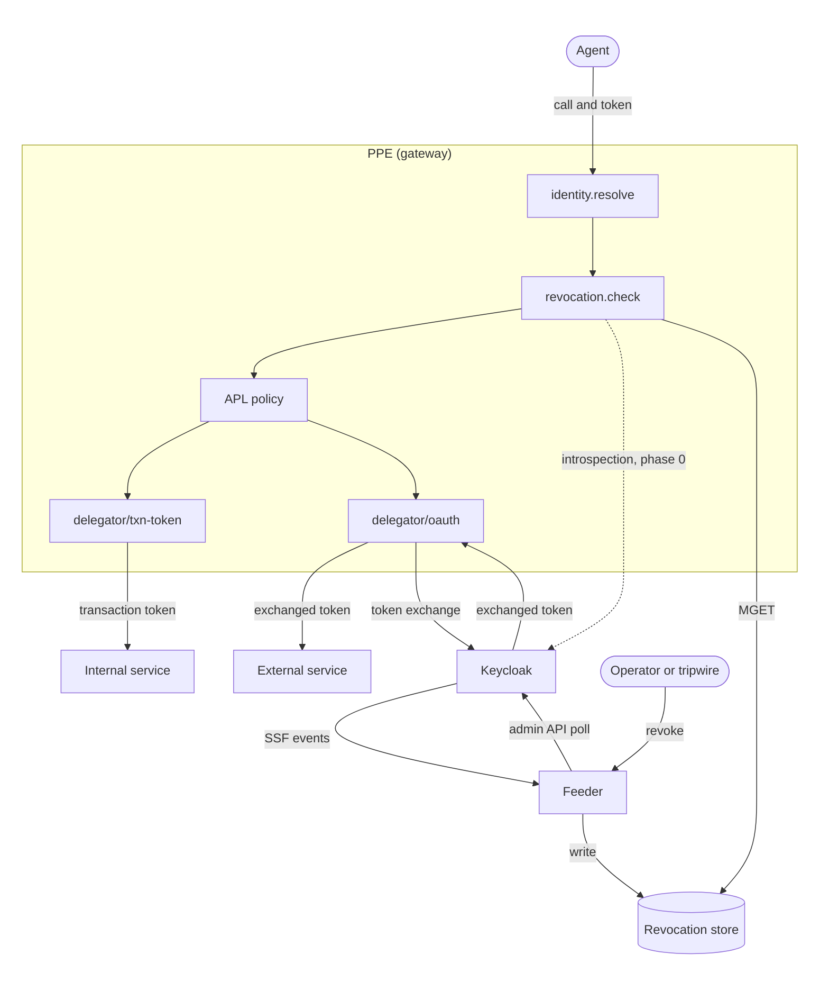
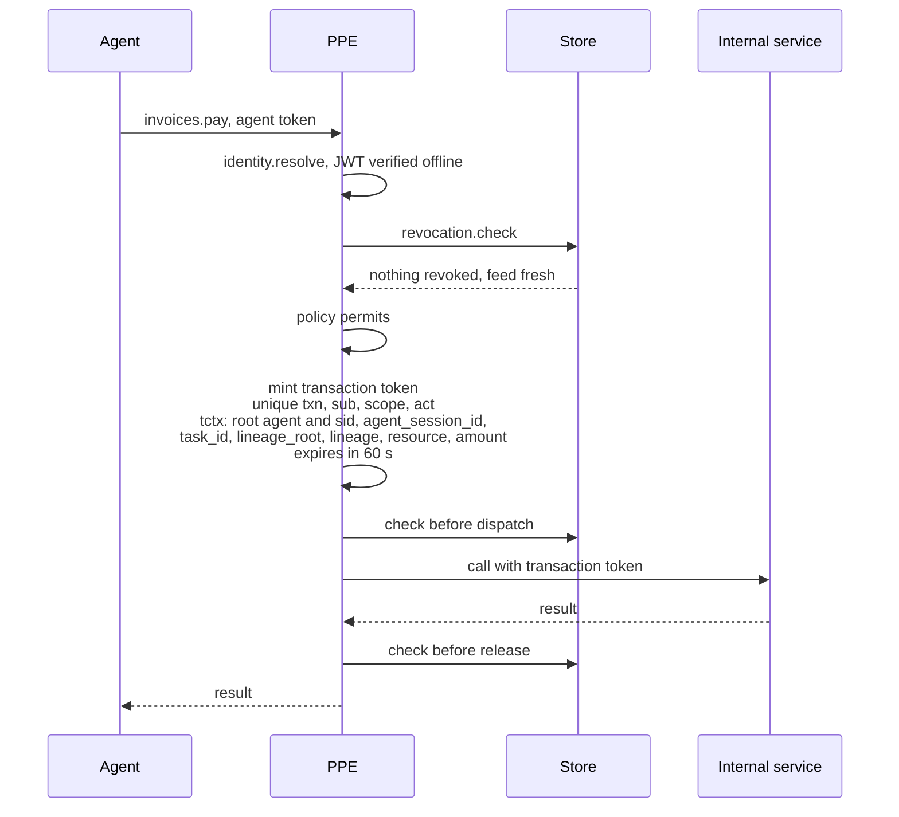
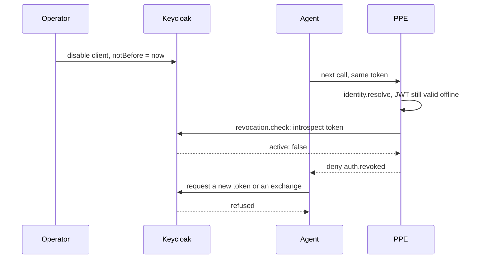
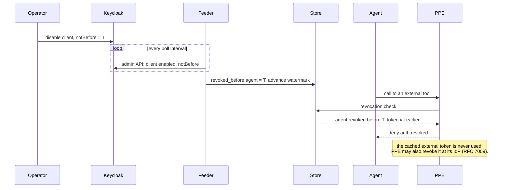
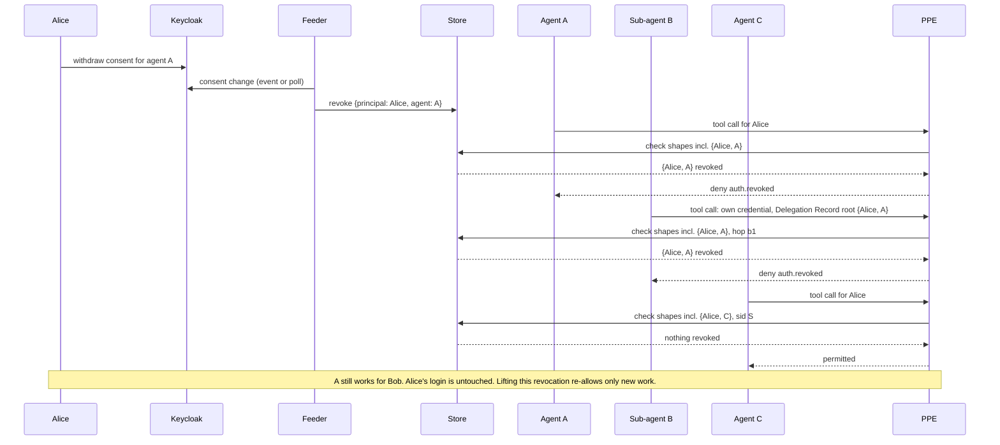
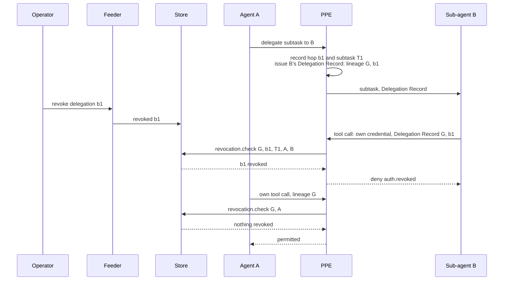
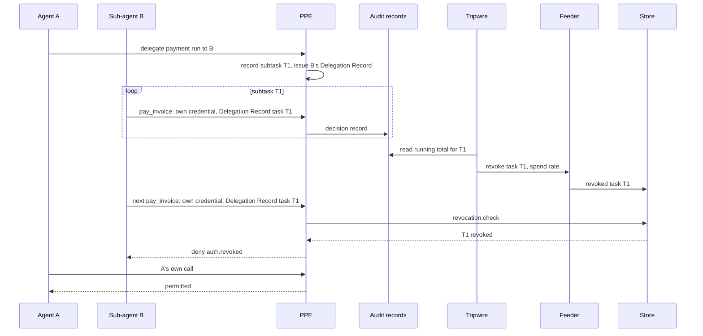
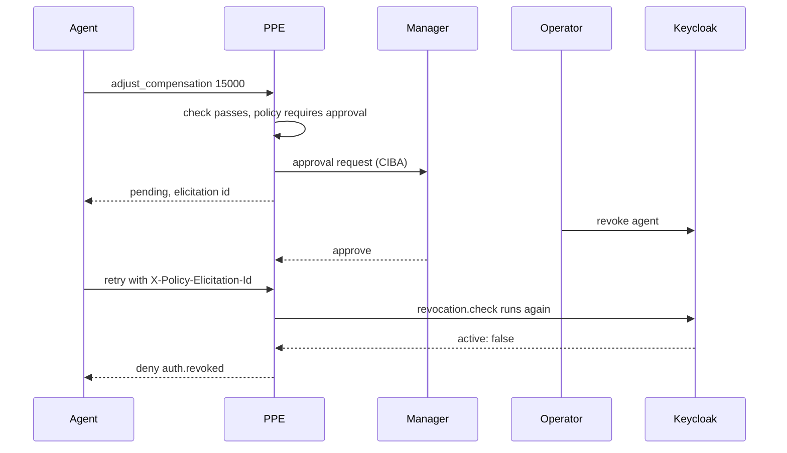
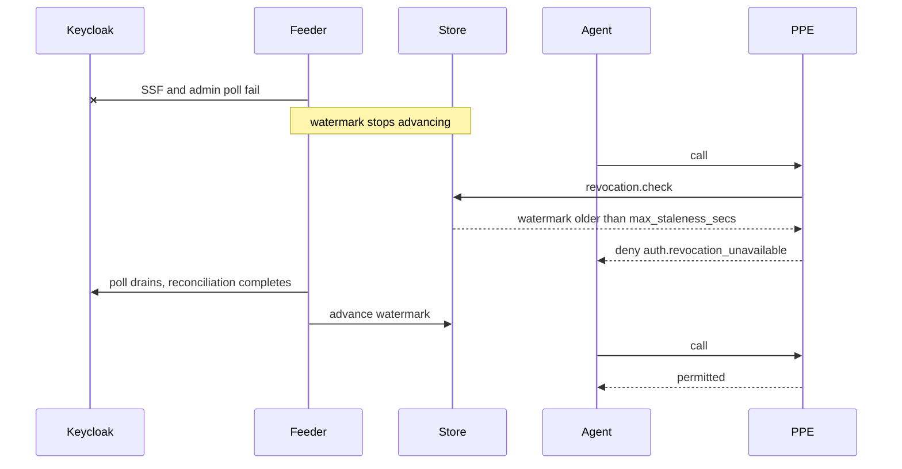

# Revocation and transaction tokens in PPE

## Summary

Offline JWT verification cannot detect changes after issuance: a disabled account, ended
session, or compromised agent may keep using a valid token. Short lifetimes bound that exposure
but can still leave minutes or hours. Introspection (RFC 7662) checks issuer state for tokens
it minted; shared signals (SSF, CAEP, RISC) notify relying parties of changes to users,
sessions, devices, and applications.

An agent's authorization can also produce delegations, tasks, tool calls, and exchanged tokens.
Stopping one task or delegation is narrower than revoking a user; stopping every token derived
from a grant is wider than revoking one token. Standardized signal subjects do not identify
these agent-specific scopes, token revocation does not cascade through exchange, and the IdP
cannot see gateway-created tasks. PPE therefore needs checks at agent calls using both IdP
signals and its own state.

This proposal adds three things:

1. **Engine-owned checks:** A `revocation.check` hook runs at fixed points on every governed
   call. Phase 0 uses introspection; later phases use a shared store.
2. **Signals and shared state:** A feeder ingests IdP signals (SSF events, and admin API
   polling where events are missing), plus operator and PPE signals, into a store all PPE
   instances share.
3. **Transaction tokens, Delegation Records and lineage:** PPE mints a short-lived token per
   call for internal services, issues a Delegation Record to each sub-agent it hands work to,
   and tracks `lineage_root` and `lineage` across derived credentials, so revoking a
   relationship or a delegation hop stops further use through PPE.

These checks can stop an agent across governed calls, stop one delegation, task, tool, or call
waiting for approval while other work continues, or stop a declared combination, such as one
agent's use of one tool for one principal. Lineage lets a root or delegation revocation deny
descendants. Checks can withhold a result or prevent new credentials. PPE may also originate
scoped revocations within its authority, such as a tripwire quarantine of an agent, task, or
mandate.

### Transaction tokens in the revocation design

A transaction token is short-lived context for one call inside a trust domain
([draft-ietf-oauth-transaction-tokens-11](https://datatracker.ietf.org/doc/draft-ietf-oauth-transaction-tokens/)).
PPE would mint it after revocation and policy checks. It names the principal, agent chain,
approved operation and parameters, task, and delegation. It accompanies the caller's own
authentication and any access token; it does not authenticate the caller or grant access by
itself.

Forwarding an agent's token is unsuitable, especially when bound to the agent's key. An
IdP-exchanged token may outlive the call and generally lacks the gateway's delegation and task
identifiers. The transaction token carries root `sid` and agent, `lineage_root`, `lineage`, and
`task_id` so a downstream PPE can check them. A sub-agent never forwards one: it receives a
Delegation Record when work is handed to it, and PPE mints a fresh transaction token for each
of its calls. It also links records across services by `txn`, task, and lineage. PPE issues no
new token after revocation; an issued token remains usable until expiry unless the receiver
checks revocation. Its short lifetime and single approved operation limit that exposure. WIMSE
proof tokens can bind it by hash.

Nothing proposed here is built yet. The goals below describe the complete design; phase 0
covers only the subjects and checks listed in section 3.6.

### Goals

- Stop covered PPE calls for an agent, principal, delegation, task, tool, or pending approval
  within a declared delay of at most 300 seconds (ODIS L3-04). For downstream receivers, the
  bound comes from their revocation check or the transaction token's expiry (TXN-12).
- Deny an indeterminate state with a distinct reason; a lost signal must not fail open.
- Enforce revocation in the framework on every covered route.
- Work with any credential type and any standards-based IdP as it is today, with Keycloak as
  the reference (section 3.7).

### Non-goals

- Replacing the IdP as the authority for the users, sessions, clients and tokens it issues.
- Revoking tokens already held by services outside PPE, beyond what RFC 7009 offers at their
  issuer.
- Using audit records as inputs to a permit. Audit may feed a tripwire that removes authority,
  never one that grants it (section 3.5).
- Defining revocation subjects for other standards. Section 3.8 sketches the SSF profile this
  design would use; the proposals themselves go separately to SSF and ODIS.

## 1. Terms

- **Revocation:** withdrawing trust before credentials expire. A recorded revocation is not
  undone; a later authorization may issue new credentials.
- **Suspension:** a reversible pause. The newest event wins.
- **Enforcement point:** the component that checks revocation on a call. Here, PPE.
- **Signal source:** a party that reports revocations: an IdP, a credential issuer, an
  operator, or the enforcement point itself.
- **Revocation entry and shape:** a revocation entry names one or more attributes of a call,
  such as `{principal: Alice, agent: A}`, and denies every call that matches all of them. The
  set of attributes an entry names is its shape. A deployment declares which shapes are
  revocable; one shape is one store key per call, so the check stays a single read.
  Single-attribute shapes (a principal, an agent, a session) behave like entities; adding
  attributes narrows the entry.
- **Block and revoke modes:** an entry is written in one of two modes. A block is a suspension:
  lifting it restores everything, including work derived before it. A revocation is permanent
  for what already exists: lifting it re-allows new work only, and everything PPE derived
  before the lift stays revoked (REV-09).
- **Relationship:** the shape `{principal, agent}`: an agent acting for a principal. Revoking
  it stops that agent acting for that principal while the agent still works for others and the
  principal's other agents continue. It is what is usually meant by revoking a grant. Lifting a
  block restores the relationship; lifting a revocation re-allows only new work (REV-09).
- **Source grant ID:** an identifier an IdP or Bridge issues for one act of authorization, such
  as one consent (compare OAuth Grant Management's `grant_id` and ODIS
  `originating_authorization_ref`). Optional. Where present, it is an instance attribute like a
  delegation hop, and lets a new consent pass while the revoked one stays revoked (REV-07).
- **Lineage:** the delegation identifiers from the root to a credential. The first entry is the
  root: a source grant ID where the IdP issues one, otherwise the relationship key
  `hash(issuer, principal, agent)`. Each later entry is one delegation hop (ODIS
  `delegation_id`), recorded as `{hop_id, created_seq, created_at}`: when PPE creates the hop
  it stamps the newest value of the store's shared sequence counter it can confirm and the
  time, and neither ever changes. The sequence orders hops against lifts; the time is for audit. In tokens and
  records the root travels as a typed `lineage_root`, `{type: source_grant | relationship,
  issuer, value}`, so a relationship key is never mistaken for a grant ID.
- **Watermark:** the last completeness checkpoint for a signal source: a poll drained to empty
  (`moreAvailable: false`) with every received event durably stored and acknowledged, or a
  full-state reconciliation that completed. A watermark older than `max_staleness_secs` makes
  the source indeterminate; checks deny as unavailable. SSF verification events confirm only
  that the source is reachable and never advance the watermark, because SSF allows them to
  arrive ahead of events still queued at the transmitter (SSF §8.1.4.2).
- **Principal session (`sid`):** the user's login session at the IdP, shared by every client
  and agent that signs in through it. Revoking it logs the user out everywhere.
- **Agent session:** one continuous run of an agent under a grant, identified and bound by PPE
  to the agent and runtime instance. It starts on the first call or an explicit new session; it
  ends on close, idle timeout, maximum lifetime, or revocation. It survives token refresh,
  records parent and principal sessions where applicable, and can contain several tasks. It
  differs from the MCP transport session: one login can contain several runs, and a run can
  span or outlive logins. This PPE definition is offered to ODIS #25.
- **Task:** the purpose a delegation was made for (ODIS `task_id`). It begins and ends with
  that delegation, not with a session. Tasks nest: a sub-agent's job is a subtask of its
  parent's. PPE assigns `task_id` for the sub-agent delegations it mediates; a root task's
  `task_id` comes from the IdP or a Bridge, and with Keycloak today the root task is the user's
  grant itself.
- **Delegation Record:** what a delegate receives when work is handed to it: the lineage, task,
  agent session, root context, actor chain and granted authorizations, signed by its issuer and
  lasting as long as the delegation (ODIS §6.3, L2-05). PPE issues it in the Bridge's
  Delegation Service role for handoffs through it, or an IdP may issue it. It carries authority
  for the principal, not identity: the delegate still authenticates as itself.
- **Transaction token:** a short-lived signed JWT minted per transaction inside one trust
  domain, carrying the principal and the transaction's authorization context
  ([draft-ietf-oauth-transaction-tokens-11](https://datatracker.ietf.org/doc/draft-ietf-oauth-transaction-tokens/)).
  It is context for authorization decisions, not a credential that authenticates a workload,
  and not an access token. PPE mints one per call after its checks; an agent never forwards one
  as its authority.

## 2. Requirements

### 2.1 Subjects and authority

| ID | Requirement | Refs |
|---|---|---|
| REV-01 | Revocation MUST be expressible over these call attributes: principal, principal session, agent, agent session, runtime instance, credential, delegation hop, task, tool, resource, and pending approval (keyed by the elicitation ID PPE issues), and over declared conjunctions of them (REV-08). There is no per-call level: an ordinary call is too short to revoke individually, and a call already dispatched cannot be recalled. The closest equivalent is a narrow shape such as `{principal, agent session, tool}`, which blocks that tool for that run until the entry is lifted or expires. | Router Table 2 |
| REV-02 | Each attribute MUST have a stable identifier derivable from the call: `iss`+`sub`, `sid` (principal sessions only), `agent_session_id` (agent sessions, section 1), agent ID, `runtime_instance_id` (possibly the holder-key thumbprint), `jti` or `credential_id`, the lineage root (`lineage_root`) and hops, the elicitation ID for a pending approval, and `task_id` for tasks, taken from the delegation and never from the agent or the session (carried in a transaction token's `tctx`). | BRG-13, PSP-22 |
| REV-03 | Every derived credential (exchanged token, transaction token, child delegation) MUST carry its lineage: the typed root (`lineage_root`: a source grant ID or the relationship key) unchanged, and the hop IDs. Each derivation copies its parent's lineage and appends its own hop, as `{hop_id, created_seq, created_at}` stamped by PPE; copied entries keep their original values. A check MUST deny if the root or any hop is revoked, stopping descendants without revoking each token separately. A check MUST evaluate the call's own identifiers together with every ancestor's: from the caller's token, from PPE's record for a token it holds, or from a transaction token's `tctx`, counting every agent in the actor chain as an agent key (section 3.4). | BRG-13, L2-05 |
| REV-04 | A revocation MUST be accepted only from a party authorized to revoke that subject: the IdP for principals and credentials, the credential issuer for agents and instances, the Bridge for delegations, the enforcement point or an operator for tool access, tasks and pending approvals. | RTR-41, L3-04 |
| REV-05 | Revocation MUST work regardless of credential technology: JWT, opaque token, API key, payment mandate. Each credential MUST have an issue time or generation the check can compare against. | |
| REV-06 | Agent sessions MUST be issued by the enforcement point, never named by the agent, and bound to the agent, its runtime instance and the grant; a session handle presented by any other caller MUST be rejected. A session MUST survive token refresh, MUST record its parent session and principal session, and a check MUST include parent session identifiers. Revoking a session stops that run and its sub-agents, not the agent. Limits and taint MUST also be keyed by agent and grant, so opening a new session does not reset them. | policy#217 |
| REV-07 | Where an IdP or Bridge issues source grant IDs, the lineage root MUST use them, and a revoked source grant ID MUST NOT be revived by a new token issue time; a new authorization arrives with a new ID. Without source grant IDs, the relationship shape is the finest root-level revocation, and the deployment MUST NOT claim per-consent revocation. | Grant Management, ODIS §6.3 |
| REV-08 | A revocation entry MUST be a conjunction of call attributes whose shape the deployment has declared; a call matching every attribute of any entry MUST be denied. Writes with an undeclared shape MUST be rejected, and write authority MUST be declared per shape (REV-04). Entries MUST record source, reason and expiry; lifting an entry MUST be recorded like writing one (REV-26). Each key MUST be the hash of a canonical, typed tuple: shape identifier and version, then each attribute's name, issuer namespace, type and value, in shape order, so different tuples cannot collide. A check MUST generate keys for every applicable value of each attribute, including every agent in the actor chain and every resource the call affects, within a declared bound on keys per check. The bound MUST be computed from declared maxima for actor-chain depth and resources per call, and the defaults MUST admit the default shapes at the default maxima. A call exceeding the bound MUST be denied, and a shape whose worst case exceeds it MUST be rejected at load. | SSF `complex` subjects, RFC 8785 |
| REV-09 | Every entry MUST declare its mode. Lifting a block MUST restore everything it covered. Lifting a revocation MUST leave revoked every delegation hop, held-token record and transaction token PPE created before the lift, by turning the entry into a cutoff. The lift MUST atomically increment a monotonic sequence on the shared store's primary and record both its value (`lift_seq`) and the primary's time (`lifted_at`). Each PPE-created hop, held-token record and transaction token carries the newest sequence value PPE can confirm: read from the primary, or else the highest value it has read from the primary or a replica. Because the sequence only increases, a stale value makes the derivation look older, so a lift can deny it but never admit it. PPE MUST NOT derive the value from a local clock or advance the sequence itself. A call matching the entry MUST be denied if any hop in its lineage under the matched root has `created_seq < lift_seq`, whether the call presents an old token, a newly minted or replacement token, or a delegation made after the lift from an old ancestor. Where a matching root IdP credential has no source grant ID or generation, the check MUST also deny it if its issue time is at or before `lifted_at` plus the declared clock-skew bound, which MUST cover the IdP's clock relative to the store primary as well as PPE and feeder clocks. A lifted cutoff MUST be retained through the declared skew window plus the longest declared lifetime of any credential or derivation it covers (root IdP credentials, delegation hops, held credentials, transaction tokens, agent sessions); without a declared maximum root credential or hop lifetime it MUST be retained indefinitely. A deployment that cannot share a sequence MAY order hops by time instead, but MUST declare a skew bound, keep PPE and feeder clocks within it, and treat any hop created within that bound after `lifted_at` as old. Without a source grant ID or generation (REV-07), the new-work-only guarantee covers PPE-created derivations only: a root credential refreshed from the old authorization after the skew window cannot be told apart from a new authorization and passes. The deployment MUST NOT claim that re-authorization is separate from the revoked authorization without a source grant ID or generation. | REV-07 |

For a revoke-mode relationship entry with source grant IDs, the ID alone does not show whether
a grant predates the lift. Before publishing the lift, the feeder MUST either persist PPE-side
exact-ID denials for every earlier grant that could still authorize a call, using an
issuer-complete inventory fenced through the lift, or record an issuer-authenticated
grant-generation cutoff established at the lift boundary that the check can compare with every
root credential. If neither is available, the relationship MUST remain revoked. An old grant ID
remains denied even when the IdP issues a fresh token under it; a new authorization with a new
ID or later generation may pass. An exact-ID denial MUST remain until the issuer confirms that
the grant can issue no more credentials and PPE can establish that every credential derived
from it has expired; otherwise it MUST remain indefinitely. PPE-side denial does not revoke a
grant at its issuer (REV-24).

### 2.2 Signals

| ID | Requirement | Refs |
|---|---|---|
| REV-10 | Signals MUST be authenticated, integrity-protected and replay-resistant. Duplicates MUST be harmless. | L3-04, RFC 8417 |
| REV-11 | The system MUST accept pushed and pulled signals. Where a source exposes full state, such as client or user status, it MUST reconcile periodically to recover lost events. | RFC 8935, 8936 |
| REV-12 | Lost, duplicated or reordered signals MUST converge: cutoff-based revocation keeps the latest cutoff, exact-ID revocation remains applied for its declared lifetime, and suspension keeps the newest event's state. | |
| REV-13 | A signal MUST be acknowledged only after it is durably stored. Durable MUST be declared as either replicated to a declared number of replicas before acknowledgement, or written to an append-only log fsynced on every write; a write the primary accepted but could lose on failover does not count. Durably stored means in the store that enforcement points read, not a queue, log or buffer local to the ingester. | RFC 8936 |
| REV-14 | Each source MUST declare a maximum staleness, measured from its last completeness checkpoint: a poll drained to empty with everything received durably stored, or a completed full-state reconciliation. Liveness signals such as verification events MUST NOT count as a checkpoint. A source without a checkpoint inside its bound is indeterminate. | BRG-11, RTR-43, SSF §8.1.4.2 |
| REV-15 | Each source stream MUST have exactly one active ingester, and every enforcement instance MUST read the same store. The ingester holds a lease whose epoch increases with each new holder; every write MUST carry that epoch, and the store MUST reject a write whose epoch is older than the newest it has seen, so an ingester that lost its lease cannot overwrite newer state. The store MAY be eventually consistent, provided that the maximum staleness of any read a check performs is bounded, measured while running and counted within the declared revocation delay (REV-19), with checks denying as unavailable when the bound cannot be confirmed; and that a write acknowledged as durable (REV-13) survives failover. Where a failover may have lost acknowledged writes, checks MUST deny as unavailable for the affected sources until each completes a full-state reconciliation. A source that cannot be reconciled, such as push-only SSF, MUST be stored where acknowledged writes survive failover. | REV-13, REV-19 |

### 2.3 Enforcement

| ID | Requirement | Refs |
|---|---|---|
| REV-16 | The enforcement point MUST check revocation (1) after caller authentication, (2) before obtaining, minting, or reusing a derived credential, (3) immediately before dispatch, including after approval waits, and (4) before result release. No route or policy can omit these checks. Check (4) runs in PPE's post phase, which the host calls. On a covered route the host MUST call it before releasing any part of a result, and result paths that do not call it MUST be denied or explicitly excluded under REV-22. | RTR-42 |
| REV-17 | Revoking a subject MUST stop further PPE-mediated use of its derived authority: delegations, child-agent calls, cached downstream credentials, and new transaction tokens. Receivers that check revocation MUST deny an existing transaction token once the revocation reaches them. An expiry-only receiver may continue accepting one until expiry, bounded by TXN-12. Other tokens held outside PPE depend on their issuer's revocation support. | BRG-13, PSP-29 |
| REV-18 | A revoked subject MUST be denied as revoked. An indeterminate source MUST deny with a distinct reason. Neither may fail open. Every check against a source MUST have a declared timeout; a check that does not complete within it is indeterminate. | RTR-03, RTR-43 |
| REV-19 | Propagation from receipt to enforcement MUST stay within the declared delay, at most 300 seconds within a trust domain. | L3-04 |
| REV-20 | A cached derived credential MUST NOT be reused beyond the shortest of its remaining lifetime, the declared revocation delay, and the time until the next mandatory check. | L2-11, RTR-31 |
| REV-21 | Policy MAY tighten the check for a route (a live check, a shorter delay) but MUST NOT weaken it. | |
| REV-22 | The deployment MUST declare which calls are covered. Calls outside coverage MUST be denied or explicitly excluded. | RTR-46 |

### 2.4 Local revocation and reporting

| ID | Requirement | Refs |
|---|---|---|
| REV-23 | The enforcement point MAY revoke within its own authority (tool access, task, pending approval, a mandate it governs, a quarantine of the current agent or delegation). Each such revocation MUST be scoped, expire, be rate-capped per rule, and be recorded. | RTR-63 |
| REV-24 | Broader revocations MUST be reported to the issuing party, not applied by the enforcement point on its behalf. | RTR-63 |
| REV-25 | Credentials the enforcement point obtained itself SHOULD be revoked at their issuer where it supports revocation. | RFC 7009 |
| REV-26 | Every revocation, and every call denied because of one, MUST be recorded with its source and reason. | RTR-50, RTR-64 |

### 2.5 Transaction tokens

| ID | Requirement | Refs |
|---|---|---|
| TXN-01 | Transaction tokens MUST be minted by a token service inside the trust domain, with a lifetime of minutes or less, and MUST NOT be accepted outside it. | Txn-Tokens §6, §9.2 |
| TXN-02 | Minting and every replacement MUST pass the revocation check (REV-16). Revoked authority gets no token, and no token is issued when the presented credential has expired. | Txn-Tokens §6 |
| TXN-03 | A token MUST be a JWS whose header has `typ` `txntoken+jwt` and a `kid`. It MUST carry `iat`, `exp`, `aud` (the trust domain), `jti` (unique per token), `txn` (unique per transaction and unchanged across replacements), `sub` (the principal), `scope` (the permitted operation) and `req_wl` (the requesting workload), and SHOULD carry `rctx`. Its `tctx` MUST carry the root context (the root agent, and the root principal's `sid` when the authorization is tied to that login), a versioned descriptor of the evaluated call's resolved target, resource and approved parameters, `agent_session_id`, `task_id` (from the delegation, never from the agent or the session), `lineage_root` and `lineage`, each lineage entry with its original `created_seq` and `created_at`. The actor chain (`act`) is an extension the draft permits. | Txn-Tokens §9, RFC 8693 |
| TXN-04 | Every claim MUST come from verified identity, verified delegation, target resolution or the policy decision, never from agent input. | |
| TXN-05 | A replacement MUST NOT widen scope or change `txn`, `sub` or `aud`, MUST NOT be issued for an expired token, MUST keep the chain of requesting workloads, and MUST copy lineage entries with their original `created_seq` and `created_at` unchanged. | Txn-Tokens §13.15 |
| TXN-06 | Where the receiver supports it, a token SHOULD be bound to the key of the component presenting it. | RTR-29 |
| TXN-07 | Signing keys MUST rotate without downtime, with the public keys published before use. | |
| TXN-08 | Revoking a task (`task_id`) MUST stop minting and replacement for it. Receivers MAY also check `task_id` against the store, and MAY refuse a token whose `jti` that receiver has already seen. | Txn-Tokens §13.2 |
| TXN-09 | A transaction token MUST NOT be used to authenticate a workload or as an access token. It travels in the `Txn-Token` header as context, beside the caller's own authentication and any access token. | Txn-Tokens §12.1, §13.12, §13.13 |
| TXN-10 | A receiver whose route needs a transaction token MUST deny a call that arrives without one, never fall back to fewer checks. | |
| TXN-11 | A receiver MUST compare the token with the actual call under a shared, versioned call-matching profile: the resolved target, operation, resource and approved parameters, and the same principal as any access token. It MUST deny when the profile is unknown, the call cannot be reconstructed, or a field differs. It SHOULD check presenter binding (a WIMSE proof token carrying the token's hash, `tth`) and single use by `jti` per receiver: a token forwarded within its transaction reaches each receiver once. `txn` is shared by every token in a transaction and MUST NOT be used for replay detection. A retried call gets a newly minted token with the same `txn`. | Txn-Tokens §13.1, §13.2 |
| TXN-12 | Each receiving route MUST declare whether it checks revocation on use or relies on token expiry. A checking receiver MUST deny revoked or indeterminate context. For an expiry-only receiver, the transaction token's lifetime MUST NOT exceed the declared revocation delay. | REV-17, REV-19 |
| TXN-13 | Transaction tokens MUST be minted per call by the enforcement point after its checks, from the presenting agent's Delegation Record or caller context plus that call's details. An agent MUST NOT forward a transaction token as its authority, and minting one is not a delegation hop. | TXN-09 |

### 2.6 Delegation records

| ID | Requirement | Refs |
|---|---|---|
| DEL-01 | A Delegation Record MUST be issued by a trusted Layer 2 authority: the enforcement point acting as the Bridge's Delegation Service for handoffs through it, or an IdP that produces the required fields. It MUST carry the lineage root and hops with their creation ordering, `task_id`, `agent_session_id`, the root principal and its `sid` where the authorization is tied to that login, the actor chain, and granted authorizations equal to or narrower than the delegator's, and MUST expire no later than its parent. It MUST be signed by its issuer and bound to the delegate's identity and key, and the delegate's proof of possession on each call MUST cover it. It is not a credential: the delegate authenticates with its own. | ODIS §6.3, L2-05, L2-06 |
| DEL-02 | Delegated authority MUST come only from a presented Delegation Record. A call without one MUST be evaluated as the agent acting on its own authority, without the principal or delegated permissions, so dropping a record removes authority rather than evading revocation. This relies on delegates holding no standing authority over the principal's resources, which is an assumption of this design rather than an ODIS requirement. | TXN-10 |
| DEL-03 | A delegation between agents MUST be a governed call through the enforcement point. It verifies the delegating agent and any record it presents, checks revocation, resolves the target agent from trusted routing or a registry, and asks policy whether the caller may call the target, whether it may delegate, and what ceiling the delegate receives; only then does it record the hop and issue the record. The delegation call carries its own access token where the target needs one and its own per-call transaction token, separate from the record it delivers. Results return through result release (REV-16), and a delegate's own calls back to its delegator are governed as the delegate's calls under its record. | L2-06, RTR-42 |

## 3. Design: PPE, with Keycloak as the reference IdP

### 3.1 Components

| Component | Role |
|---|---|
| Keycloak | IdP and agent credential issuer in ODIS terms. Provides principal, session, client (agent), and token state; refuses exchanges for revoked tokens. |
| Feeder | Separate process that ingests Keycloak SSF events and admin API polls, accepts operator and PPE writes, normalizes signals to SETs, and updates the store and source watermarks. Each source is an adapter: a generic SSF adapter, and one admin-state adapter per IdP (section 3.7). |
| Revocation store | Shared Valkey store. One key per declared shape and attribute values: the hash of a canonical, typed tuple (shape and version, then each attribute's name, issuer namespace, type and value), for example `rev:principal_agent_tool:v1:<sha256>`. A lift atomically increments a shared monotonic sequence counter on the primary and records `lift_seq` and `lifted_at` in the entry. The sequence orders lifts against PPE hop creation, and PPE never needs the primary to create a hop: a lagging read only makes a hop look older. The timestamp is compared with root IdP credentials' issue times, subject to clock skew. A lifted revocation stays as a cutoff through the declared skew window plus the longest declared lifetime of a credential or derivation it covers (REV-09). Reissuable subjects keep the latest "revoked before T" cutoff; delegation hops are revoked by identity until derived credentials expire, while source grant IDs remain denied until the issuer confirms they cannot issue new credentials and PPE can establish that all derived credentials have expired. Suspensions keep the newest event's state. Also holds source watermarks. |
| PPE `revocation.check` | A plugin hook the engine calls from the route handler. Backends: introspection (phase 0) and the store. |
| PPE delegators | `delegator/oauth` exchanges at Keycloak; `delegator/txn-token` mints per-call transaction tokens. Both record `lineage`. PPE also issues Delegation Records to sub-agents (DEL-01). |



### 3.2 Requirement mapping

| Req | Keycloak provides | PPE (and feeder) provides | Gap | Phase |
|---|---|---|---|---|
| REV-01 | Principal, session, client, token | Instance, delegation hop, task, agent session, tool, resource, pending approval, and declared conjunctions | Agent session is PPE's definition until ODIS defines one (#25) | 1 to 3 |
| REV-02 | `sub`, `sid`, `client_id`, `jti` | `lineage_root` and `lineage` for its own exchanges; `task_id`; `jkt` once DPoP lands | Keycloak puts no lineage in tokens without a custom protocol mapper; `sid` breaks on delegation exchange | 3 |
| REV-03 | Standard exchange retains `sid`; delegation exchange starts a new session. Keycloak issues no source grant ID. An optional protocol mapper might copy lineage, but is untested. | PPE roots lineage at the relationship key, or a source grant ID where one exists. Transaction tokens carry lineage in `tctx`; PPE stores lineage for external tokens it holds. | Direct Keycloak tokens for child agents start new lineages unless an IdP issues Delegation Records (DEL-01). | 3 |
| REV-04 | Is the authority for its subjects | Feeder accepts only configured sources per level | | 2 |
| REV-05 | JWTs and opaque tokens have `iat` | Check by `iat` against "revoked before" | API keys have no issue time | later |
| REV-06 | No agent session concept | PPE mints and binds session handles; records them in the store; carries `agent_session_id` in Delegation Records and `tctx` | Handle transport (header or MCP session); default timeouts | 3 |
| REV-07 | No source grant ID; user-to-client consent is the closest concept. | Uses source grant IDs where an IdP issues them; otherwise the relationship shape. | Per-consent revocation unavailable with Keycloak today. | 3 |
| REV-08 | Cannot express conjunctions | Declared shapes in configuration; feeder validates shape and per-shape authority on write; check builds canonical typed keys per declared shape, expanded over ancestor agents and affected resources within the bound, and reads them in one `MGET` | Default shape set and key bound to agree (question 18) | 1, 2 |
| REV-09 | No equivalent | Hops carry immutable `created_seq` (from the store's shared sequence) and `created_at` in lineage, records and `tctx`; a lift atomically records `lift_seq` for hops and `lifted_at` for root IdP token issue times; relationship lifts with source grant IDs also require exact-ID denials or a grant-generation cutoff; block entries are deleted on lift | Issuer-complete grant inventory or a generation fence may be unavailable; default maximum root credential and hop lifetimes, and clock-skew bound (question 19) | 1, 2 |
| REV-10 | Signed SETs (SSF) | Feeder verifies and dedupes on SET `jti` | Keycloak SSF experimental, user-only | 2 |
| REV-11 | SSF push and short poll; admin API state | Feeder polls admin API for clients and users | No events for clients (agents) | 2 |
| REV-12 | | Store semantics: max cutoff, exact-ID revocation for its declared lifetime, newest suspension | | 1 |
| REV-13 | Push retries 8 times, then dead letter | Feeder acknowledges after the declared durable write to the Valkey store checks read, and keeps no intermediate queue: replicas confirmed with Valkey `WAIT`, or append-only log fsynced on every write; failover handled as in REV-15 | Polled admin state recovers on the next poll; acknowledged SSF events do not, so SSF-only sources need the strong configuration | 2 |
| REV-14 | SSF verification events (liveness only); poll with `moreAvailable`; admin API state | Watermark per source advanced only by drained polls and completed reconciliations; verification events raise a liveness alarm only; check reads the watermark | A push-only source with no poll or reconciliation path goes indeterminate after its bound | 1, 2 |
| REV-15 | One stream per receiver | Single feeder instance per stream; lease epoch on every write, stale epochs rejected by an atomic compare in the store. Valkey replicates asynchronously: checks read from the primary, or from replicas whose reported replication lag is within budget; failover promotes only a replica that confirmed the `WAIT`; otherwise, after a failover the feeder resets the affected watermarks so checks fail closed until reconciliation | Feeder failover without a gap | 2 |
| REV-16 | Refuses exchange for revoked subject or actor tokens: a secondary check only. | `AplRouteHandler::evaluate` checks pre and post; approval resume re-checks. | Streaming release; check (2) needs the delegation invoker call site. | 0 for checks 1, 3, 4; 3 for check 2 |
| REV-17 | Does not cascade RFC 7009 to exchanged tokens | Deny derived authority on PPE-mediated calls; checking receivers deny on use, expiry-only receivers rely on TXN-12 | Tokens already held outside PPE may remain usable until expiry or issuer revocation | 3 |
| REV-18 | | `auth.revoked`, `auth.revocation_unavailable`; checker cannot be `on_error: ignore` | | 0 |
| REV-19 | Introspection is live | Introspection cache or watermark bound, at most 300 s | | 0, 1 |
| REV-20 | | Delegator cache entries keep source `lineage`; check before serving | Production flush missing | 3 |
| REV-21 | | Optional APL step for a live check | | later |
| REV-22 | | Install a handler on every covered route; require a catch-all, an unmatched-request denial, or an explicit exclusion. | Unrouted requests are allowed today; warning alone does not establish coverage. | 0 |
| REV-23 | Cannot receive signals | `quarantine` effect and AP2 mandate revocation write through the feeder | | 4 |
| REV-24 | No receiver | Report by operator workflow; PPE as SSF transmitter later | | later |
| REV-25 | RFC 7009 endpoint | Revoke tokens PPE exchanged | | 3 |
| REV-26 | Admin events | Revocation denials pass through `finish()` and the audit sink; feeder records each write | | 0, 2 |
| TXN-01 | No transaction token support | `delegator/txn-token` mints; host serves JWKS | | 3 |
| TXN-02 | | Mint happens inside `delegate`, after the check | Replacement not yet in scope | 3 |
| TXN-03 | | Claims from verified extensions, target resolution and the decision; a fresh `jti` per token; root `sid`, agent, versioned call descriptor, `task_id`, `lineage_root`, `lineage` in `tctx` | Delegation chain not populated from `act` yet | 3 |
| TXN-04 | | Claim sources limited to verified extensions and the decision | | 3 |
| TXN-05 | | Enforced when replacement is added | | later |
| TXN-06 | | Outbound DPoP | Depends on the DPoP issue | later |
| TXN-07 | | Signing key from a secrets source; publish new public keys before use. | | 3 |
| TXN-08 | | `task_id` key in the store; checked at mint | | 3 |
| TXN-09 | | Sent only in `Txn-Token`; read by `identity/jwt` as context, never as the caller's identity | | 3 |
| TXN-10 | | Downstream PPE route setting: transaction token required | | 3 |
| TXN-11 | | Define a versioned call-matching profile; downstream PPE compares it with the resolved call; a per-route `jti` seen-set, kept for the token's lifetime, and WPT checks follow where supported. | Normalization of resources, defaults, and parameters needs a shared profile. | 3, later |
| TXN-12 | | Declare each route checking or expiry-only; checking routes deny revoked or indeterminate context, and expiry-only token lifetimes fit the delay. | Nonchecking services cannot provide immediate revocation. | 3 |
| TXN-13 | | `delegator/txn-token` mints per call from the presenting agent's record or caller context | | 3 |
| DEL-01 | Delegation exchange with `act` gives the actor chain only: no `delegation_id`, parent reference, `task_id` or attenuation check | PPE issues records in the Bridge role for handoffs through it, and accepts records from IdPs configured as trusted | An IdP-issued record needs the protocol mapper or native support | 3 |
| DEL-02 | | A call without a record is evaluated as the agent's own authority | Assumes delegates hold no standing authority | 3 |
| DEL-03 | | Delegation is a governed agent-to-agent call | PPE does not yet govern agent-to-agent calls; until it does, records come from an IdP or those delegations are excluded | 3, later |

REV-03 requires derived credentials to carry lineage, while the phase 3 mapping keeps lineage
for external exchanged tokens in PPE's store. Whether associated store metadata satisfies the
requirement remains open; see question 11.

### 3.3 Downstream services

A downstream service may need two tokens on one call: an access token its own identity provider
issued, and PPE's transaction token carrying the call's context. They travel in separate slots.
The transaction token draft keeps it out of `Authorization`, which stays free for the
credential the service authorizes.

| Slot | Token | Issued by | Purpose |
|---|---|---|---|
| `Authorization` | Access token for the service | Keycloak or the service's IdP, through `delegator/oauth` | What the service's own access control checks |
| `Txn-Token` | Transaction token | PPE, through `delegator/txn-token` | Principal, permitted operation (`scope`), agent chain, and in `tctx` the root context, the resource and approved parameters, `agent_session_id`, `task_id`, `lineage_root` and `lineage` |

PPE's existing delegation mechanism can place multiple tokens in distinct outbound headers; the
proposed transaction-token delegator would use it. The reference host attaches each header.
Praxis has not been checked.

```yaml
pre_invocation:
  - "delegate(erp-oauth, target: erp, audience: erp-api)"   # Authorization: Bearer ...
  - "delegate(ppe-txn, target: erp, audience: erp-api)"     # Txn-Token: ...
```

- **A service that understands transaction tokens** verifies both: its own access token, and
  the transaction token against PPE's published keys.
- **A PPE in front of the service** verifies both through `identity/jwt`, reading the
  `Txn-Token` header as context alongside the caller's own authentication, with the upstream
  PPE as a trusted issuer. Its revocation check reads `lineage` and `task_id` from the
  transaction token against the shared store, so an upstream revocation stops the call even
  while the access token is still valid at its IdP. This is one way lineage reaches a token PPE
  does not mint (question 11).
- **The two tokens must describe the same call.** Validate each token's audience for its own
  purpose, match the principal and the transaction token's operation, resource, and parameters
  to the call, and use a binding proof where available, such as a WIMSE Workload Proof Token
  carrying its hash (`tth`). An access token alone must not make an unrelated transaction token
  valid.
- **Outside the trust domain** only the access token goes. Transaction tokens are not accepted
  outside their trust domain (TXN-01); context crosses organizations through the receiving
  organization's Bridge (RTR-09).
- **An internal service that trusts PPE as an issuer** may need only the transaction token,
  with PPE authenticating as a workload (mTLS or WIMSE). It may authorize on the token's
  claims, but never treats it as an access token (TXN-09).
- **Untrusted hops.** Dropping a required token causes denial (TXN-10). Call matching detects a
  token swapped for a different operation or resource; presenter binding and single-use checks
  further limit substitution and replay (TXN-11). Use mutual TLS between PPEs across untrusted
  infrastructure, or treat the segment as a trust-domain boundary that transaction tokens
  cannot cross (TXN-01).

**Receiver contract.** Each receiving route declares whether it checks revocation on use or
relies on expiry (TXN-12). A checking receiver reads the applicable source state and denies
revoked or indeterminate context. An expiry-only receiver cannot stop an issued token early;
PPE limits that token's lifetime to the declared revocation delay. This guarantee applies to
transaction tokens, not to access tokens that another issuer and service manage.

**Call matching.** PPE places the policy-evaluated, resolved target, operation, resource
identifiers, and approved parameters in a versioned descriptor in `tctx`. The receiver
reconstructs the descriptor from the request it will execute and compares it before dispatch.
The profile must define defaults, aliases, resource identity, argument normalization, and
number representation; a field that cannot be reconstructed or compared causes denial (TXN-11).
For example, `invoices.pay` for invoice 123 and amount 1,500 must not authorize invoice 124 or
a different amount. The exact profile and which component owns it remain open (question 16).

#### Agent-to-agent calls

A handoff from agent A to agent B is a call like any other, so it gets the same per-call
treatment as a call to a tool, and the Delegation Record travels beside it as what B receives
(DEL-03).

| On the delegation call | What | Lifetime |
|---|---|---|
| `Authorization` | Access token B's endpoint accepts, where it needs one; otherwise PPE's workload authentication | The call |
| `Txn-Token` | Per-call context for "A delegates this subtask to B", carrying A's lineage | The call |
| Delegation record header | B's new Delegation Record: `[root, b1]`, task, ceiling | The delegation |

On B's later calls, B presents its own credential and its Delegation Record; PPE checks the
lineage, evaluates the call within the ceiling, and mints a per-call transaction token and any
access token the target needs. B presents no token for the principal, so obtaining that access
token is tracked separately in #285; until it lands, delegates reach only services that accept
PPE's workload authentication with a transaction token. Delegation through PPE depends on PPE
governing agent-to-agent calls, which it does not do yet; until then, records come from an IdP
or those delegations are excluded from coverage (REV-22).

### 3.4 Revocation identifiers: lifecycle and reach

#### Lifecycle

PPE assigns, records, carries, and checks its identifiers:

1. **Assign:** Root lineage at a source grant ID where the IdP issues one, otherwise at the
   relationship key `hash(issuer, principal, agent)`. Append a new hop ID for each delegation
   to another agent. Held downstream credentials and transaction tokens are not hops; each
   records its own `created_seq`.
2. **Record:** Keep `{lineage_root, lineage, root sid, agent, task_id, agent_session_id,
   created_seq, created_at}` for IdP-issued tokens PPE holds, keyed by the token or cache
   entry; PPE cannot add these claims to the IdP's token.
3. **Carry:** Put the identifiers in a Delegation Record for a child agent, and in each
   per-call transaction token's `tctx` for downstream services and PPE instances.
4. **Check:** Collect identifiers from the caller's token, PPE's record for a held token, a
   child agent's Delegation Record, and any incoming transaction token. Read applicable
   revocation entries in one `MGET`.

The relationship key is the pair, not one consent. Blocking it stops every PPE-mediated call
where that agent acts for that principal until the block is lifted, which restores everything.
Revoking it does the same, but lifting a revocation re-allows only new work: delegations, held
tokens and transaction tokens PPE created before the lift stay revoked (REV-09). If source
grant IDs exist, lifting the relationship also requires exact-ID denials for all earlier grants
or a grant-generation cutoff; otherwise the relationship stays revoked. Without source grant
IDs or generations, a refreshed credential from the old authorization remains indistinguishable
from a new authorization (REV-07). Writes and lifts are recorded (REV-08).

```
Alice's agent A calls PPE (sid S)
  PPE roots lineage at relationship key G = hash(issuer, Alice, A)  assign
A's call needs Workday
  PPE exchanges at Keycloak and holds the token                  assign
  store: Workday token key -> {G, [G], S, A, created_seq}        record
A delegates a subtask to sub-agent B through PPE
  PPE creates hop b1 and task T1, issues B's Delegation Record
  record: {G, [G, b1], S, A, T1}                                 carry
B calls a tool with its own credential and the Delegation Record
  PPE checks G, b1, S, A, B, T1, then mints a per-call Txn-Token check
Operator revokes b1 -> feeder writes the entry -> B's next call is denied
```

The store records lineage for tokens PPE holds; Delegation Records carry it to child agents,
and transaction tokens carry it to downstream services. Without them, lineage checks stop at
PPE's boundary.

#### Reach

REV-03 requires each derived credential to carry `lineage_root` and `lineage`; whether
store-associated lineage counts for IdP-issued tokens remains open (question 11). Other
ancestor identifiers can come from the call context. A check reads the call's and ancestors'
applicable keys in one `MGET` and denies if any is revoked. Those identifiers reach the check
through:

| The call involves | Ancestors' identifiers come from |
|---|---|
| The agent calling PPE with its own token | The caller's token: `sub`, `sid`, `client_id`, `iat` |
| PPE about to use an exchanged token it holds | The caller's token on the same call. PPE uses a held token only while handling a call, and checks that call first |
| A child agent calling PPE | Its Delegation Record: root `sid` and agent, `lineage_root`, `lineage`, `task_id`; and every agent in the actor chain |
| A call that has left PPE: a downstream PPE or an internal service | The per-call transaction token's `tctx`, with the same fields |

**Example: revoking Alice's session S.** Agent A holds a token with `sid=S`. PPE has exchanged
for a Workday token and cached it, and A has delegated a subtask to child agent B, which
received a Delegation Record. The operator revokes S.

| Next event | Keys that match | Result |
|---|---|---|
| A calls a tool with its own token | `sid=S` from the caller's token | Denied |
| A's call would reuse the cached Workday token | `sid=S` from the caller's token on the same call, checked at `token.delegate` before the cached token is served | Denied, whether or not the Workday token contains `sid` |
| B calls a tool with its own credential and its Delegation Record | Root `sid=S` from the record | Denied |
| A downstream PPE receives a call carrying the transaction token | Root `sid=S` from `tctx` | Denied |
| An internal service that does not check holds a transaction token minted before the revocation | None checked | Usable until it expires, within minutes |

**Revoking a relationship instead.** An operator, or a verified consent withdrawal, writes
`{principal: Alice, agent: A}`. A's calls for Alice, cached Workday-token use, and B's subtask
deny, since all carry that pair; A's work for Bob, Alice's login and her other agents continue.
Narrower entries such as `{principal: Alice, agent: A, tool: pay_invoice}` stop only that tool.
Lifting a revocation later lets Alice use A again for new work, while B's old delegation and
the cached Workday token stay revoked.

Revoking agent A works the same way: A appears in its own token, in every `act` chain, and in
the `lineage` hop it created, so B's subtask stops too, as the Router's revocation levels
require.

PPE checks tokens presented on governed calls, keeps exchanged tokens in its custody (RTR-27),
and gives downstream services short-lived context carrying the root. A receiver that does not
check revocation may use an already-issued transaction token until expiry, as the table above
shows.

Revocation levels overlap rather than form one hierarchy: a login, agent session, task, and
grant can span one another. Lineage and its tasks do nest. The check gathers all applicable
identifiers; an interactive delegation carries the user's `sid`, while a background agent under
an offline grant does not.

### 3.5 Flows

Diagrams use Mermaid. "Store" is the Valkey revocation store; the checks read it with one
`MGET` covering the call's principal, principal and agent sessions, every agent in its actor
chain, `lineage_root`, every `lineage` hop, `task_id`, the tool, and the feed watermark.

#### Normal call to an internal service

PPE checks, decides, mints a transaction token carrying the lineage, checks again before
dispatch and before release.



#### Agent revoked, phase 0

An operator disables the agent's client in Keycloak and sets `notBefore`. The agent's token
still verifies offline, but introspection reports it inactive.



#### Agent revoked, with feeder and store

The feeder's poll finds the change and every PPE instance denies within one poll interval,
including calls that would use a cached external token.



#### Relationship revoked

Alice withdraws her consent for agent A, or an operator revokes the relationship. The feeder
writes the relationship entry in revoke mode; A stops acting for Alice, including B's subtask,
while A's work for others, Alice's login and her other agents continue. How the feeder learns
of a consent withdrawal in Keycloak is not verified (section 6).



#### One delegation revoked

A delegates a subtask to B through PPE, which records hop `b1` and task T1 and issues B a
Delegation Record carrying `[G, b1]`. B authenticates its calls with its own credential and
presents the record; PPE checks the lineage and mints a per-call transaction token for each
permitted call (DEL-01, TXN-13). Revoking `b1` stops B and its descendants while A continues.
The record lasts as long as the delegation, so a long-running subtask needs no replacement
tokens.



#### Task stopped by a tripwire

A tripwire sees B's task T1 spending too fast in PPE's decision records and revokes `task_id`
T1. B stops while A continues. The tripwire only removes authority; permits do not depend on
audit records (RTR-53). Without auditing, the tripwire does not run and enforcement is
otherwise unchanged.



#### Approval wait, then revocation

Approval is suspend and retry, so the resumed request runs the check again. A real approval
cannot revive revoked authority.



#### Feed goes quiet

If the feeder stops hearing from Keycloak, the watermark stops advancing. Once it is older than
`max_staleness_secs`, calls depending on that source fail closed until it recovers.



### 3.6 Order of work

Each phase has its own acceptance boundary. Passing a phase does not imply coverage for
subjects or receivers scheduled later.

| Phase | Exit criteria |
|---|---|
| 0: hook and introspection | Every declared covered, nonstreaming route runs the required checks, including a route with no policy steps and an approval retry. Unmatched calls are denied or explicitly excluded. A covered credential role with no inspectable token denies as unavailable; inactive tokens deny as revoked, while introspection that exceeds its declared timeout, errors or is unreachable denies as unavailable within that timeout, and that result is not cached. The configured cache TTL meets REV-19. On the reference host, a result is not released when the post-phase check denies. |
| 1: store checker | With seeded store entries, every declared shape is checked across PPE instances, including a conjunction that matches, one that differs in a single attribute, and one that matches only through an ancestor agent. Distinct tuples that concatenate to the same string produce different keys. A call over the key bound denies. The default shapes load under the default bound, and a call at the default chain depth and resource count passes. A lifted revocation still denies derivations created before the lift and allows new ones; a lifted block allows both. An old hop presented through a token minted after the lift, or extended by a delegation made after the lift, is denied. A cutoff does not expire while a hop or root credential it covers is within its declared lifetime. A PPE instance whose clock runs ahead still has a pre-lift hop denied. A hop stamped from a lagging replica's sequence after a lift is denied by the lifted entry. With source grant IDs, a token refreshed under an old ID remains denied, a new ID passes, and a relationship lift without complete grant coverage is refused. Without a source grant ID, root tokens issued before the lift, during an active revocation, or within the skew window after the lift are denied; a token refreshed after that window passes, as documented. A stale watermark or store outage denies as unavailable, and so does a read from a replica whose lag exceeds its budget or cannot be measured; with replication paused, a check against the lagging replica denies rather than missing a revocation. |
| 2: feeder | Verified signals are acknowledged only after durable write; duplicates and reordered signals converge; polling recovers a missed event. Tests cover failover, stale-source denial, rejection of writes from a feeder whose lease has passed to another instance, and a feeder crash after the store write but before acknowledgement, after which the source redelivers and the duplicate converges, a verification event arriving ahead of a queued revocation, which does not advance the watermark, so checks deny as unavailable once the bound passes, and measure receipt-to-enforcement delay against the declared bound of at most 300 seconds. |
| 3: lineage and transaction tokens | Root and intermediate revocations stop PPE-mediated calls and cached credentials. Resolve whether store-associated lineage satisfies REV-03; verify a distinct source grant identity and complete coverage of old grants before claiming new-work-only relationship lifts. Checking and expiry-only receivers meet TXN-12. Define the versioned TXN-11 profile and test matched, mismatched, and unmatchable calls. On every supported host, `Authorization` and `Txn-Token` reach the downstream service as separate headers with unchanged values, including on forwarded and retried calls; a missing or rewritten header fails the gate. |

Streaming result release, credential types without introspection, and later-phase subjects
remain explicit exclusions until their checks exist (REV-22).

#### Phase 0: the hook and introspection

No store or #127. Covers agents and principals under REV-16 checks (1), (3), and (4), plus
REV-18, REV-19, REV-22, and the runaway-agent demo. Because a covered role without an
inspectable credential denies, routes using credentials introspection cannot inspect, such as
OpenShift OAuth tokens or Models-as-a-Service API keys (section 3.7), must be explicitly
excluded in phase 0 or they deny.

| Component | Work |
|---|---|
| `ppe-core` | Define `revocation.check` (`define_hooks!`, `define_hook!`, payload, result) and deny codes `auth.revoked` and `auth.revocation_unavailable`. Reject `on_error: ignore` and fire-and-forget. |
| `ppe-apl-runtime` | Parse `global.revocation` in `visit_global`. Call the hook in `AplRouteHandler::evaluate` after session load, in pre and post phases. Install a handler on every covered route; require a catch-all, unmatched denial, or explicit unmatched exclusion. Reject ambiguous coverage at load. |
| `builtins` | Add `revocation/introspection`: RFC 7662 through host HTTP, client authentication, configurable cache TTL (including zero), roles from `raw_credentials.inbound_tokens`. A covered role without an inspectable credential denies as unavailable; only explicitly excluded roles may be skipped. A declared timeout, shorter than the route's own deadline; on timeout, error, or a malformed response the check denies as unavailable. Only active and inactive results are cached; an unavailable result never is. |
| Tests | Unit tests; resilience tests for an unreachable or slow introspection endpoint; an integration case using the scripted IdP. |
| Keycloak | Configuration only: an introspection client for PPE. |
| Demo (fork) | Scenario 17, acts 1 to 5, with a longer agent token lifetime. |
| Docs | Revocation section in `identity-delegation.md`; config reference. |

#### Phase 1: the store backend

After #127.

| Component | Work |
|---|---|
| Host stores (#127) | Named stores injected into plugins. A dependency, not revocation work. |
| `ppe-core` | Carry credential metadata (`iat`, `jti`, `sid`, `iss`) into `Extensions`; today `raw_claims` stops at `identity.resolve`. |
| `builtins` | Add `revocation/store`: declared shapes with modes, canonical typed keys, expansion over ancestor agents and affected resources within the declared bound, one `MGET`, `lift_seq` versus hop `created_seq` and `lifted_at` versus root IdP token `iat` where applicable, identity revocation for hops and source grant IDs, lifted revocations kept as cutoffs, suspension state, and per-source watermark and staleness. |
| Docs | Store schema: keys, values, expiry. |
| Tests | Store outage and stale watermark, both denying `auth.revocation_unavailable`. |

#### Phase 2: the feeder

| Component | Work |
|---|---|
| Feeder (new service; home undecided) | Receive SSF push and poll; verify SETs from configured transmitters; dedupe by `jti`; acknowledge after write. Reconcile Keycloak client and user state through admin polling. Provide an authority-scoped operator API, verification requests, watermarks, and one active lease per stream, fencing every write with the lease epoch. |
| Keycloak | Enable SSF in the demo realm only; a receiver client; a service account for the feeder with read access to clients and users. |
| Demo | Act 6: stop the feeder and show `auth.revocation_unavailable`. |
| Tests | Feeder unit tests; integration against the demo Keycloak. |

#### Phase 3: lineage, derived credentials, transaction tokens

| Component | Work |
|---|---|
| `ppe-core` | Populate the delegation chain from `act`; carry a source grant ID or a labeled relationship-key fallback, plus `lineage`, `task_id` and `agent_session_id` in `Extensions`. |
| `ppe-apl-runtime` | Agent sessions (REV-06): mint and bind session handles to agent, instance and grant, record parent and principal sessions, and key limits and taint by agent and grant as well as session. |
| `ppe-apl-runtime` | Second call site in `DelegationPluginInvoker::delegate`, before a token is exchanged or served from cache: REV-16 check (2). |
| `builtins` `delegator/oauth` | Keep lineage for obtained tokens and cached entries; add production cache flush and RFC 7009 revocation for PPE-obtained tokens. |
| `builtins` `delegator/txn-token` (new) | Mint a JWS token per call (TXN-13), with `typ` `txntoken+jwt` and `kid`, and a unique `jti`, `txn`, `sub`, `scope`, `act`, `req_wl`, `aud`, `iat`, `exp`, `rctx`, and `tctx` (root `sid` and agent, versioned call descriptor, `task_id`, `lineage_root`, `lineage`). Rotate signing keys from a secrets source and expose public keys for the host to serve. |
| `builtins` `identity/jwt` | Verify Delegation Records from trusted issuers (PPE, or an IdP that produces the required fields) presented by child agents alongside their own credentials (DEL-01, DEL-02); on a downstream PPE, read the `Txn-Token` header as context, never as identity (section 3.3, TXN-09). |
| Delegation | Issue Delegation Records at governed agent-to-agent delegation (DEL-03). Depends on PPE routing agent-to-agent calls; until then, accept IdP-issued records or exclude those delegations. |
| Downstream PPE | Routes that require a transaction token deny without one (TXN-10); match `tctx` against the resolved call and the access token's principal; keep a `jti` seen-set per route in the store, entries expiring with the token (TXN-11). |
| `ppe-apl-runtime` or policy | For calls with both tokens, validate each audience for its own purpose and match the principal and evaluated call; check a binding proof where supported. |
| Keycloak | Optional: a protocol mapper spike, only if lineage must reach agents that exchange at Keycloak directly, or to expose a source grant ID (REV-07). A mapper could also add Delegation Record fields to Keycloak's delegation tokens (DEL-01). |
| Demo | Delegation-revoked scenario. |

#### Phase 4 and later

| Component | Work |
|---|---|
| `ppe-apl-core` / runtime | `quarantine(...)` effect, scoped, expiring and rate-capped, writing through the feeder; authority-limit breach counts for policy; an optional step that tightens the check for a route. |
| Tripwire and AP2 | Mandate revocation keyed by mandate hash; tripwire reading decision records; the AP2 demo variant. |
| `builtins` | Replacement transaction tokens; outbound DPoP; checks per stream chunk once a chunk hook exists; other backends such as DNSid status. |
| Feeder | Act as an SSF transmitter for PPE-originated revocations. |

#### Standards, in parallel

- A comment on openid/sharedsignals #362: delegation, runtime instance and credential members
  alongside `workload` (section 3.8).
- An ODIS issue defining revocation subjects, which Router #37 and Passport #39 and #40 all
  defer to.

### 3.7 Other identity providers

Keycloak is the only IdP examined so far. The engine design is independent of it; the following
adapters and mappings vary by IdP.

| Part | IdP dependence |
|---|---|
| `revocation.check`, check points, deny codes | None: engine behaviour |
| Store, watermarks, lineage, transaction tokens | None: PPE and the feeder |
| Introspection backend (phase 0) | Standard RFC 7662; configuration per IdP |
| Feeder SSF adapter | Standard SSF, CAEP and RISC; any transmitter |
| Token exchange, RFC 7009 | Standard RFC 8693 and RFC 7009 |
| Feeder admin-state adapter | **IdP-specific.** Keycloak's polls client `enabled` and `notBefore`; another IdP needs its own, against its management API or audit log |
| Credentials without RFC 7662 introspection | **Need their own checker backend.** OpenShift OAuth tokens are opaque and validated by Kubernetes TokenReview; MaaS API keys are validated by `maas-api` |
| Mapping IdP objects to revocation levels | **IdP-specific.** Keycloak models an agent as a client; others use service principals, app registrations or dedicated agent identities |

The optional protocol mapper and `sid` behavior across exchange are Keycloak-specific; the
design does not require either.

For another IdP, implement its admin-state adapter and check:

- **Introspection.** Whether it is offered at all, and whether it reflects an agent being
  disabled or revoked. Without it, phase 0 has no live signal and the feeder is needed from the
  start.
- **SSF coverage.** Which events it transmits, and whether any concern agents rather than
  users.
- **Exchange semantics.** How it handles `act` and `may_act`, which determines how the
  delegation chain is populated.
- **Grant mapping.** Whether withdrawal and reauthorization expose a stable grant ID or
  changing generation, and whether the issuer can fence a complete inventory or generation
  cutoff at a relationship lift; a user-client relationship key alone gives broader coverage
  (REV-07, REV-09).

**Red Hat OpenShift AI deployments** may use OpenShift OAuth tokens (with LDAP, Active
Directory, or OIDC federation), JWTs from an external OIDC provider (such as Red Hat build of
Keycloak, Entra ID, or Okta), and Models-as-a-Service API keys. OpenShift tokens and MaaS keys
need `revocation/tokenreview` and `revocation/maas-api` backends alongside introspection. API
keys still need an issue time (question 3). SSF transmitter support in Red Hat build of
Keycloak is unverified.

### 3.8 Asks of the protocols and IdPs

SSF permits custom agent subjects, and RFC 8936 defines long poll; Keycloak does not yet emit
agent events or implement long poll. The remaining gaps need profile agreement or new features.
This section separates the requested IdP behavior from the proposed SSF profile.

#### Asks of Keycloak

In order of value to this design:

| Ask | Why | Status |
|---|---|---|
| SSF events for clients: disable, enable, `notBefore` change, credential rotation, with an `application` or `workload` subject | The biggest gap. Today only polling or introspection sees an agent being suspended or revoked | SSF can express it (RISC `account-disabled`, `account-enabled`); Keycloak does not emit it |
| Source grant IDs per consent, a complete grant inventory or generation fence, and observable consent withdrawal | A grant ID distinguishes consents (REV-07); the inventory or fence keeps old grants denied after a relationship lift (REV-09); observable withdrawal lets the feeder write relationship entries | Unverified |
| A session subject in `session-revoked` (`complex.session`) | Revoke one session rather than the whole user | SSF supports it; not confirmed in Keycloak |
| Long poll | Lower latency and load than short poll | Standard (RFC 8936); parsed but not implemented |
| Multiple streams per receiver, or stream handover | A highly available feeder without a gap during failover | Keycloak feature |
| Token-family revocation: RFC 7009 on a token also revokes tokens exchanged from it | Today exchanged tokens survive revocation of their source | Keycloak feature; the client-session note recording each exchange's subject token is close to the index needed |
| Lineage through exchange: copy a root identifier or generate one, and keep the root `sid` across delegation exchange | Removes the need for PPE-side roots and the custom protocol mapper | Keycloak feature |
| Introspection that keeps reflecting client disable and `notBefore` | Phase 0 depends on it | Works today; worth keeping |
| Transaction token issuance (Keycloak as the token service) | Optional; PPE mints them | Not supported |

#### SSF profile

Signals the feeder produces or consumes use SSF as it is, with these additions.

**Subject members**, inside `complex`:

| Member | Format | Level | Status |
|---|---|---|---|
| `user` | `iss_sub` | Principal | Standard |
| `session` | `opaque` | Principal or agent session | Standard member |
| `workload` | `uri` (SPIFFE or WIMSE ID) | Agent workload | Proposed in sharedsignals #362 |
| `agent` | `opaque` agent ID | Agent | Extension |
| `runtime_instance` | `opaque` | Runtime instance | Extension |
| `credential` | `jwt_id`, or `opaque` | Credential | Standard format |
| `delegation` | `opaque` hop identifier, with its issuer | Delegation hop | Extension |
| `task` | `opaque` `task_id` | Task | Extension |
| `tool` | `opaque` resolved tool | Tool access | Extension |

SSF allows additional members and proprietary formats agreed between parties, so these need no
change to SSF itself, only agreement. A `complex` subject is itself a conjunction of members,
so it maps directly onto a revocation shape (REV-08): the members present are the shape.
`workload` is the one with a standards proposal in flight.

**Events.** Reuse CAEP and RISC where they fit: RISC `account-disabled` and `account-enabled`
for agent suspension and reinstatement; CAEP `session-revoked` with a narrowing subject for
session, task and delegation revocation; CAEP `credential-change` for credentials. One new
event type is needed, for withdrawing tool access, under a versioned URI. Every event carries
`event_timestamp`; cutoff-based subjects use it as "revoked before T", while exact-ID subjects
deny on the identifier.

**Critical members.** Narrowing members (`delegation`, `task`, `tool`, `session`) MUST NOT be
listed in `critical_subject_members`. A receiver that does not understand them then
over-revokes, for example the whole agent instead of one delegation, rather than dropping the
event and revoking nothing.

### 3.9 Transport-layer revocation (mTLS)

Certificate revocation for mTLS happens at the TLS handshake, in Praxis, before PPE sees a
request. Praxis's listener client-certificate verifier accepts CRL files (`crl_paths`), reloads
them when they change with the `config-reload` feature, and checks peer SPIFFE IDs against
`trusted_spiffe_ids`. CRLs are not supported on upstream connections, and no OCSP checking of
client certificates was found.

Handshake checks complement the per-call check rather than replace it. They run once per
connection, so a long-lived HTTP/2 connection keeps carrying calls after its certificate is
revoked; they are only as fresh as the CRL file; and they cover certificates, not delegations,
tasks or tools. SPIFFE deployments rarely use CRLs at all: X.509-SVIDs are short-lived,
revocation means SPIRE stops renewing them, and a CA compromise is handled by rotating the
trust bundle.

| Layer | Where | Catches |
|---|---|---|
| TLS handshake | Praxis | Revoked or untrusted certificates, when a connection opens |
| Per-call check | PPE | Workload and runtime-instance keys (REV-01) on every call, including mid-connection, plus every other level |
| Signals | Feeder | CRL updates and SPIRE events, written as store entries keyed by SPIFFE ID or certificate fingerprint |

Three asks of Praxis: pass the verified peer identity (SPIFFE ID and certificate fingerprint)
to PPE as the caller's workload identity, so per-call checks can use it; confirm that every
path that releases a result to the caller (response headers, body, trailers, and responses
Praxis generates itself) calls PPE's post phase first, or excludes that route (REV-16); and,
optionally, close existing connections when a peer's certificate is revoked.

## 4. Security considerations

- **Revocation writes can deny service.** Authenticate the operator API, enforce per-level
  authority (REV-04), cap write rates beyond quarantine's limits (REV-23), and record every
  write (REV-26). PPE writes only through the feeder and within its own authority.
- **Store access.** Valkey ACLs give the feeder write access and PPE read access. Hash
  identifiers in keys, as the session store does; use TLS beyond localhost.
- **Signal trust.** Verify SETs from configured transmitters and sign feeder-originated SETs. A
  compromised feeder can revoke any subject, though it cannot grant authority.
- **Fail-closed availability.** Store, feeder, or introspection outages deny dependent calls
  after the staleness limit. Size `max_staleness_secs` and service availability accordingly.
- **Introspection cost and exposure.** Phase 0's cache TTL trades Keycloak load and visibility
  into call timing against revocation delay.
- **Clock skew.** "Revoked before T" compares a token's `iat` with an event time from another
  clock. A lifted revocation also compares a root IdP token's `iat` with the store's
  `lifted_at`. Both comparisons err towards denial: tokens issued within the declared skew
  window after the cutoff are treated as old. Hops are ordered against lifts by the store's
  shared sequence rather than by time, so a PPE clock running ahead cannot make a pre-lift hop
  look new; deployments ordering hops by time instead declare a skew bound and treat hops
  within it as old (REV-09).
- **Lineage integrity.** Lineage is trusted only from PPE's own records or tokens PPE signed,
  never from agent input (TXN-04).
- **Transaction tokens in transit.** A copied token can be replayed for its named operation
  until expiry if the attacker can also authenticate as an accepted caller. Presenter binding
  and single-use checks reduce this risk (TXN-06, TXN-11).
- **Privacy of transaction tokens.** A transaction token discloses the principal, the user's
  `sid`, the agent chain, grant, task and session identifiers and the approved parameters to
  every service that receives it. Include only what receivers need, and consider carrying
  identifiers used only as revocation keys in hashed form; receivers that log tokens should
  apply the same retention rules as for audit records.

## 5. Questions and decisions

1. Where the feeder lives: this workspace, Praxis, its own repo, or an existing product (IBM
   Verify Antenna was one candidate).
2. Default when a watermark is stale: always deny, or fall back to introspection per route.
3. How API keys get an issue time or generation, so "revoked before" applies to them (REV-05).
4. How a feeder failover hands over an SSF stream without a gap, given one stream per receiver
   in Keycloak.
5. Resolved: there is no per-call revocation level (REV-01). A call waiting for approval is
   revoked by its elicitation ID, which the retry presents; other calls are stopped by broader
   entries, the narrowest being `{principal, agent session, tool}`.
6. Claim names for `lineage_root` and `lineage`, and whether ODIS's Delegation Record
   (`delegation_chain`, `originating_authorization_ref`) should align with them.
7. Whether the Keycloak protocol mapper is worth building: it would give lineage for agents
   that exchange at Keycloak directly, outside PPE.
8. The cost of a handler on every route, and whether unmatched calls should default to denial
   or require an explicit exclusion (REV-22). Phase 0 must not leave coverage ambiguous.
9. Which credential roles are covered by default, and whether the post-call check is on by
   default. Covered roles without an inspectable credential deny as unavailable.
10. Resolved: agent sessions are defined by PPE (section 1, REV-06) and offered to ODIS #25;
    the remaining details are question 15.
11. Whether store-associated lineage for external exchanged tokens satisfies REV-03's
    requirement that every derived credential carry `lineage_root` and `lineage`; if not, how
    those claims reach tokens PPE does not mint.
12. Resolved: a transaction token cannot be a child agent's credential or authority (draft
    §13.12). The child authenticates with its own credential and presents a Delegation Record;
    PPE mints a per-call transaction token for each of its calls (DEL-01, TXN-13).
13. Obtaining principal-scoped access tokens for a delegate's calls, when B holds no token for
    the principal to exchange, is tracked in #285.
14. Default maxima for actor-chain depth and resources per call, and the key bound they imply
    for the default shapes (REV-08).

## 6. Not verified

- Whether Praxis passes the verified mTLS peer identity to PPE today; the demo uses JWT-SVIDs
  through `identity/jwt` instead (section 3.9).
- Whether Keycloak's consent withdrawal can be observed by an event or by polling, and whether
  it invalidates refresh tokens from online sessions.
- Whether the Red Hat build of Keycloak supports the SSF transmitter, and which upstream
  version it tracks (section 3.7).
- Any IdP other than Keycloak: introspection behaviour, SSF events and exchange semantics
  (section 3.7).
- Which Keycloak version first ships the SSF transmitter. Sources disagree between 26.6.4,
  26.7.5 and 26.8.1.
- Whether Keycloak's `session-revoked` event can name one session or only the user, and which
  actions trigger it.
- The status of two security bugs filed against Keycloak's SSF feature in early October 2026.
- Keycloak's push retry and dead-letter behaviour, taken from its documentation, not tested.
- The custom protocol mapper: feasible from reading the 26.8.0 source, not built.

## References

- ODIS: `RFCs/ODIS.md` (L2-05, L2-11, L3-04, L3-05), Router proposal #37 (RTR-29, RTR-41 to
  RTR-43, RTR-50, RTR-53, RTR-63, RTR-64), Passport proposals #39 (PSP-22, PSP-29) and #40
  (BRG-11, BRG-13).
- RFC 7009 (token revocation), RFC 7662 (introspection), RFC 8417 (Security Event Tokens), RFC
  8935 and 8936 (push and poll delivery).
- OpenID Shared Signals Framework and CAEP 1.0; openid/sharedsignals #362.
- [draft-ietf-oauth-transaction-tokens-11](https://datatracker.ietf.org/doc/draft-ietf-oauth-transaction-tokens/)
  (July 2026, OAuth WG): §6 lifetime, §9 format and claims, §12 the `Txn-Token` header and
  validation, §13.2 unique `txn`, §13.12 and §13.13 not authentication credentials or access
  tokens, §13.15 replacement.
- PPE: #205 (revocation), #127 (host-injected stores), #204 (DPoP inbound).
