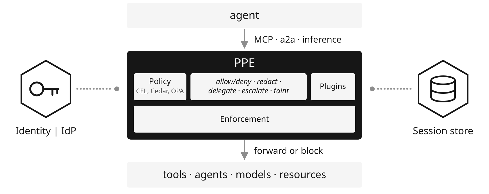

# Praxis Policy Engine Documentation

The Praxis Policy Engine (PPE) is a typed policy runtime for AI middleware. It
maps tools, resources, prompts, inference calls, and conventional APIs to routes
by entity type and name. PPE combines global defaults, matching
groups, and route controls into phases that validate inputs, authorize
operations, apply effects, and transform results. The pipeline controls which
operations run, what data returns, and where it may flow.

Before policy evaluation, PPE verifies the caller with the IdP and maps subject,
role, and permission claims into attributes. The Policy stage evaluates
predicates and invokes CEL, Cedar, or OPA where configured. Effects can redact
data, request approval, apply session taint, or perform token exchange /
delegation for an audience-scoped upstream credential. The session store carries
information-flow labels across calls. PPE records the delegation chain and audit
history.

## Documentation sections

The documentation is grouped by what you are trying to do. Read the sections
in this order, or jump to the one that matches your task.

1. [Getting started](#getting-started): run the engine and connect it to
   Praxis.
2. [Guides](guides/README.md): configure and operate a specific control.
3. [Concepts](concepts/README.md): how the engine works and why it is built
   this way.
4. [APL](#apl): the policy language, its grammar, and its effects.
5. [Reference](reference/README.md): configuration keys, contracts, crates, and
   builtins.

## Getting started

- [Quick Start](getting-started/quickstart.md):
  stand up an enforcement point and run your first policy
- [Use with Praxis](getting-started/use-with-the-gateway.md):
  run the engine as the Praxis `policy` filter

## Guides

- [HTTP Routing](guides/http-routing.md):
  the `http:` route selector, precedence, and the catch-all report
- [Rate Limiting](guides/rate-limiting.md):
  request limits before or after identity, counters, and denials
- [LLM Routes](guides/llm-routes.md):
  what an `llm:` route can read before and after the call, with a worked config
- [Identity and Delegation](guides/identity-delegation.md):
  inbound identity slots, outbound delegation subjects, and recipes
- [Add a claim mapper preset](guides/identity-claim-mapping.md):
  adding and testing a provider-specific JWT claim mapper preset
- [Auditing](guides/auditing.md):
  decision records, write-ahead effect records, and writing a sink
- [FIPS](guides/fips.md):
  OpenSSL FIPS selections, host setup, and startup checks
- [Deployment](guides/deployment.md):
  the same policy at a gateway, a sidecar, or in-framework
- [Patterns](guides/patterns.md):
  layered enforcement, shadow rollout, guardrails, least privilege
- [Testing](guides/testing.md):
  testing a policy as code
- [Upgrading APL](guides/upgrade-apl.md):
  every key and form an existing configuration must rewrite

## Concepts

- [How the Policy Engine works](concepts/overview.md):
  the enforcement pipeline, followed through one scenario end to end
- [Use Cases](concepts/use-cases.md):
  the controls running behind a real gateway
- [Vision](concepts/vision.md):
  the Reference Monitor model and where the engine sits in an agent stack
- [Threat Model](concepts/threat-model.md):
  the adversary, the trust boundary, and what each placement defends
- [Plugins and Pipeline](concepts/pipeline.md):
  hooks, the plugin manager, and execution modes
- [Common Message Format](concepts/cmf.md):
  the protocol-agnostic envelope policy reasons about
- [Extensions and Capability Gating](concepts/extensions.md):
  typed contextual state, and the capabilities that unlock it
- [CMF extensions and the attribute bag](concepts/cmf-extensions.md):
  the per-type absent-value contract and every key the bridge emits

## APL

- [APL](apl/index.md):
  routes, phases, predicates, rules, and field pipelines
- [Grammar](apl/apl-grammar.md):
  the normative grammar; where it and the parser disagree, one is a bug
- [Effects and Sequencing](apl/effects.md):
  the effect catalog, halt-on-deny, sequential and parallel composition
- [PDP Integration](apl/pdp.md):
  handing a decision to Cedar, CEL, or OPA
- [Identity](apl/identity.md):
  resolving a caller and what lands in the attribute bag
- [Static Attributes](apl/attributes.md):
  operator-maintained facts read under `data.*`
- [Fetched Metadata](apl/metadata.md):
  request-time facts acquired before later policy runs
- [Delegation](apl/delegation.md):
  token exchange, delegation subjects, and token caching
- [Elicitation](apl/elicitation.md):
  human in the loop, and the suspend and resume model
- [Session Taint](apl/tainting.md):
  information flow labels that outlive a single call
- [Backend Restriction](apl/restrict.md):
  constraining where a call is allowed to land

## Reference

- [Configuration](reference/configuration.md):
  the config document, its six top-level keys, and both dispatch modes
- [Header Assertions](reference/assertions.md):
  projecting derived identity onto upstream requests
- [Builtins](reference/builtins.md):
  bundled plugins, decision points, session stores, and their features
- [Crates](reference/crates.md):
  what each crate in the workspace is for
- [Benchmarks](reference/benchmarks.md):
  measuring the decision hot path, and reading the results
