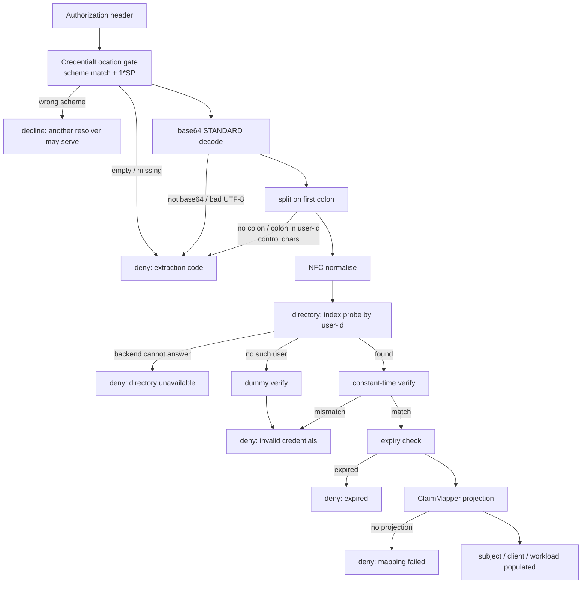
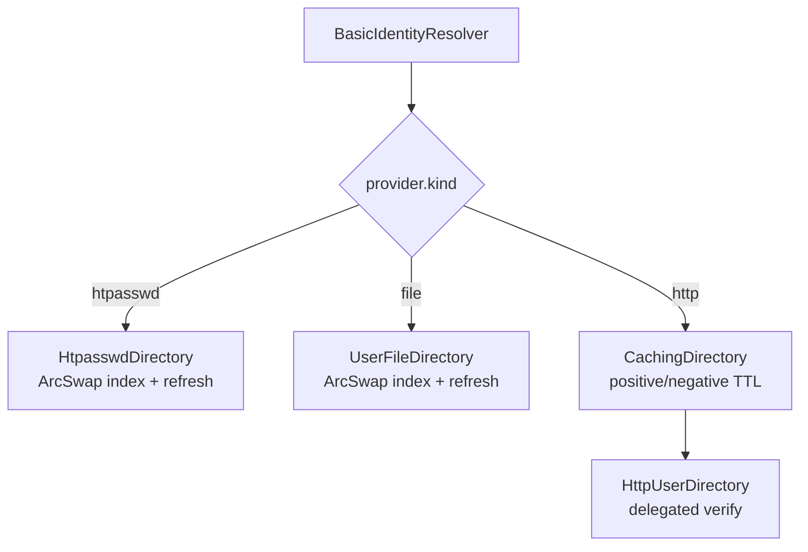

# feat: HTTP Basic Authentication (RFC 7617) identity support

## Summary

Add `identity/basic`, a new builtin identity resolver behind a `basic` Cargo
feature, that decodes `Authorization: Basic <base64(user-id:password)>`, looks
the user up by user-id, verifies the password against a stored hash in constant
time, and projects the record through the shared claim mapper. Three backends
ship: a first-class `.htpasswd` reader, a username-indexed YAML file, and
delegated verification over HTTP.

## Problem Frame

Kuadrant's AuthPolicy has no first-class Basic support. The documented approach
bends the API-key feature by storing `base64(username:password)` as an opaque
key, which costs three things: the password *is* the index key, so a hashed
password is impossible and a rotation is a new record rather than an update;
`.htpasswd`, the near-universal on-disk format, cannot be consumed; and lookup
is keyed by the secret rather than by the subject, so every rule needing the
username re-decodes the header.

PPE resolved the API-key half of this in #108. This plan does the Basic half as
its own identity method, reusing the machinery from #108 where the semantics
actually match. `prefix: Basic` on `identity/api-key` stays as the
Authorino-parity escape hatch.

---

## Requirements

**Credential handling**

- R1. `Authorization: Basic <token68>` is extracted with case-insensitive scheme
  matching and `1*SP` after the scheme, per RFC 7235. The credential location is
  restricted to **headers**: `validate()` rejects a cookie or query-param
  location at load, because a password in a URL reaches access logs, proxy logs
  and browser history, and a cookie-borne one invites CSRF on a credential
  replayed every request.
- R2. The extracted value is base64-decoded with the STANDARD alphabet, and
  split on the **first** colon into user-id and password.
- R3. A user-id containing a colon, a decoded credential with no colon, an empty
  user-id, an empty password, control characters in either half, non-base64
  input, and invalid UTF-8 are all rejected. "Control characters" means the Cc
  category plus line and paragraph separators and the bidi overrides and
  isolates in Cf, since the user-id reaches logs and `subject.id`.
- R4. The user-id is NFC-normalised before indexing. Stored user-ids are
  normalised identically at load, so a non-NFC stored name stays reachable. The
  password is **not** normalised, because stored hashes are over raw bytes.
- R5. The password is held in a zeroized buffer with no `Debug`, `Display` or
  `Serialize`, is never written to `raw_credentials`, and never appears in a log
  line or a denial reason. Decode, normalise and split operate on pre-sized
  zeroized buffers; no error value carrying credential bytes or offsets is ever
  formatted into a message.
- R26. A credential whose user-id or password exceeds a configured length
  ceiling
  is rejected before any verification. Where the stored verifier truncates — as
  bcrypt does at 72 bytes — a password longer than the truncation point is
  rejected rather than silently accepted on a prefix match.
- R27. The caller's password must not reach a service that did not
  authenticate it. **Scope corrected 2026-10-29:** the plugin cannot strip the
  inbound `Authorization` header, because the identity hook has no
  request-mutation channel — `IdentityPayload.headers` is a private,
  builder-set input the executor never reads back
  (`crates/ppe-core/src/identity/payload.rs:122`). What the plugin guarantees
  is that it never populates `raw_credentials`, so no downstream policy step
  can forward the password. Removing the header before an upstream sees it is
  a host or route-level obligation, documented in U7. Closing the rest needs a
  request-mutation seam in the engine, scoped as separate work.

**Directory and verification**

- R6. Lookup is O(1) in directory size, keyed by a hash index on the normalised
  user-id.
- R7. Password verification is constant-time, and a user-id miss performs a
  dummy
  verification whose work factor is at least that of the most expensive record
  in
  the directory, so a miss is never cheaper than any hit. The dummy hash is
  derived from the directory's actual parameters at load and on every reload,
  and
  the stored-hash parse happens before the found/not-found branch so both paths
  pay it.
- R8. The `.htpasswd` backend reads bcrypt (`$2a$`, `$2b$`, `$2y$`) and argon2,
  but **not both in one file** -- a mixed file is a load error. **Added
  2026-10-29:** the two schemes' cost parameters are not comparable (bcrypt
  cost is a CPU exponent; argon2's dominant term is memory bandwidth), so a
  mixed directory has no well-defined dearest record to use as its miss-path
  hash. Measured, a `m=4096,t=3` argon2 record scored *above* `bcrypt cost=12`
  on the within-scheme work factor while verifying 28x faster -- which made a
  miss cheaper than a hit and reopened the enumeration oracle R7 and KTD9
  exist to close. A calibrated cross-scheme estimate was rejected: the ratio
  moves with hardware, so a baked-in constant would mis-rank silently on
  machines it was not measured on. Refusing to mix is checkable; a fudge
  factor is not.
  apr1 (`$apr1$`) and `{SHA}` are recognised but **refused**, with a load error
  naming the fix (re-hash with bcrypt or argon2). **Scope corrected
  2026-10-29:** this originally said they load under an explicit opt-in. They
  do not, and the opt-in has been removed rather than left inert — neither MD5
  nor SHA-1 is in this dependency tree, and adding two crypto crates to serve
  the schemes this plugin exists to migrate operators off is the wrong trade.
  Revisit only if a real migration blocks on it.
  DES-crypt and plaintext are rejected at load.
- R9. A username-indexed YAML backend carries a verifier, projectable fields,
  and
  an optional `expires_at`.
- R10. An HTTP backend delegates verification to a service, over HTTPS only
  unless cleartext is explicitly opted into, sending the user-id and password as
  separate fields and following no redirects.
- R11. A duplicate user-id in any file backend is a config-load error, not
  last-wins. The check runs **after** normalisation, so two differently-encoded
  spellings of one name are caught rather than silently collapsing.
- R12. File backends honour a `refresh_secs` revocation window and a
  **required** `max_staleness_secs` fail-closed ceiling, swapping the whole
  index
  atomically and continuing to serve the previous index when a reload fails.
- R13. A malformed or unreadable directory file fails at config load, not at
  request time. A reload that fails keeps the previous index only until the
  staleness ceiling, after which lookups fail closed.
- R23. Hash parameters above a configured ceiling are rejected at load, so a
  well-formed but extreme cost factor cannot turn one login into a denial of
  service.
- R24. Password verification runs off the async worker, with a bounded
  concurrency limit that denies when saturated.
- R25. Expiry enforcement is mandatory; there is no mode that delegates it to
  the
  directory. An unparseable `expires_at` is a load error.

**Identity projection**

- R14. The record is projected through the shared `ClaimMapper`, with
  `subject.id` defaulting to the user-id.
- R15. Each backend strips its own storage fields, so no password hash and no
  username index field reaches the projected claims.
- R16. The attestor records that identity was established by Basic
  authentication.

**Brute-force resistance**

- R28. Repeated failures for one user-id are bounded, by a per-user-id failure
  limiter keyed on the normalised user-id. Where the engine cannot own this, the
  plan states plainly that the host or a quota plugin must supply it, and the
  operator documentation says so rather than leaving hash cost as the only
  brake.
- R29. Failure logging is rate-limited, the user-id is logged only at debug
  level
  and sanitised, and no metric carries the user-id as a label.

**Denial and challenge**

- R17. A denial **raised by this resolver** carries HTTP 401 and a
  `WWW-Authenticate: Basic realm="<realm>"` header, with `charset="UTF-8"`
  appended when configured. `realm` is required in config and validated at load
  to printable ASCII excluding `"` and `\`, so it cannot break the quoted string
  or inject a header. The scope limit is deliberate and is not the whole of what
  RFC 7235 wants — see R30 and the Open Question it points to.
- R30. Where a credential is declined by every resolver rather than denied by
  this one, the challenge is **not** emitted, because the engine synthesizes
  that
  denial itself with no channel for a declining plugin to contribute
  (`crates/ppe-core/src/executor.rs:970-973`). A single-resolver route therefore
  satisfies RFC 7235; a route pairing Basic with another scheme does not. v1
  ships the single-resolver case and documents the gap. Closing it needs an
  engine change, scoped as its own work.
- R18. Unknown-user and bad-password produce the **same** denial code, so a
  client cannot distinguish them. Directory-unavailable stays a distinct code.
- R19. Extraction-phase denial codes are reused verbatim from the existing
  identity plugins.

**Packaging**

- R20. `kind: identity/basic` registers behind a `basic` Cargo feature, through
  the facade re-export and the registration macro, and resolves via
  `install_builtins`.
- R21. A credential presented under another scheme declines without denying, so
  a Basic resolver and a Bearer resolver coexist on one `Authorization` header.
- R22. Two `identity/basic` resolvers on one route are a documented unsupported
  configuration, not a load-time rejection. Rejecting it would need either a
  builtin's `kind` string hardcoded into `ppe-core` — against the documented
  dependency flow — or a new engine-side cross-plugin validation mechanism;
  `crates/ppe-core/src/config.rs` has no kind-aware check today, every existing
  check being deliberately kind-agnostic. Enforcement is scoped out; the
  behaviour is stated in the operator docs.

---

## Key Technical Decisions

- KTD1. **Extraction reuses the existing credential gate rather than adding new
  code.** `CredentialLocation` with `prefix: Some("Basic ")` already performs
  case-insensitive scheme matching and consumes `1*SP`, returning the base64
  payload verbatim — see `crates/ppe-core/src/identity/credential.rs:187`
  (`strip_gate`), where a prefix with an empty leader after the space is exactly
  the scheme-only case. Decoding and splitting happen after extraction returns.
  This removes a whole class of RFC-conformance risk from the new plugin.

- KTD2. **A separate `CredentialDirectory` trait, not an extension of
  `KeyDirectory`.** The epic recommends adding a `verify(user_id, password)`
  sibling to `KeyDirectory`. The existing trait takes one opaque credential and
  returns a record, where the match *is* finding the digest
  (`crates/builtins/src/plugins/identity_api_key/directory.rs:107`). Basic needs
  lookup-by-user-id returning a record that carries a verifier the resolver must
  never see. A defaulted `verify` would leave `FileDirectory`, `HttpDirectory`
  and `CachingDirectory` each carrying a method they cannot serve. The new trait
  mirrors the old one's shape — `Debug + Send + Sync` supertraits, a
  `&dyn HostServices` parameter a file backend ignores, `kind()`, and
  `DirectoryError` kept distinct from `Ok(None)`.

  Be honest about the cost: this is **pattern reuse, not code reuse**.
  `CachingDirectory` holds a concrete `Arc<dyn KeyDirectory>` and its `lookup`
  takes `&PresentedKey` returning `KeyRecord`
  (`crates/builtins/src/plugins/identity_api_key/cache.rs:127,230`), so it
  cannot
  be composed against a different trait without genericising it. U5 therefore
  writes parallel HTTP and caching types that follow the sibling's structure and
  reasoning rather than calling into it. The alternative — genericising the
  existing cache over a shared trait — touches working authentication code for a
  second consumer that does not exist yet, so it is deferred until there are two
  implementations to generalise from (the same judgement as KTD8). The
  duplication
  is real and is accepted deliberately.

- KTD3. **Unknown-user and bad-password share one denial code.** The sibling
  plugin deliberately splits "no record matched" from "directory could not
  answer" so an operator can act on a denial spike. That reasoning is preserved
  for directory-unavailable. It is deliberately *not* extended to the
  user-unknown/bad-password split: that distinction is a username-enumeration
  oracle if it reaches a client. Operators keep the distinction in logs and
  metrics. This diverges from both the epic's code list and the sibling plugin,
  and the divergence is written into the source comment.

- KTD4. **The challenge rides the existing denial-detail channel, and delivery
  is a host obligation.** A denial sets `proto_error_code = 401` and places the
  `WWW-Authenticate` value in the violation's `details` under the established
  `http.headers` key (`crates/ppe-apl-cmf/src/constants.rs:197`). Identity
  resolvers run `mode: sequential`, so the live path is the serial phase, which
  moves the plugin's violation out intact and assigns only `plugin_name`
  (`crates/ppe-core/src/executor.rs:1122-1134`); `PipelineResult::denied` stores
  it unfiltered. So no change to `PluginViolation` and no change to the APL
  response path.

  Three honest caveats, because this is the plan's least-settled decision:

  - **Nothing in this repo reads `http.headers`.** `decorate_denial_response`
    (`crates/ppe-apl-runtime/src/route_handler.rs:863`) *writes* that key; it is
    the producer, not a consumer. Rendering it on the wire is documented as the
    host's job (`docs/content/apl/index.md:149-151`), and the reference host
    does
    not do it. U3 can therefore assert only that the violation carries the key —
    an assertion about this plugin, not about a challenge reaching a client. If
    the production host does not render it, R17 is unmet no matter what the
    violation holds. This is the load-bearing external unknown.
  - **The quota plugin is not a usable precedent.** It does set a status this
    way
    (`crates/builtins/src/plugins/quota/handlers.rs:362-366`), but it registers
    on CMF hooks, and under the default dispatch those route through
    `crates/ppe-apl-runtime/src/cmf_invoker.rs:421-424`, which destructures the
    violation down to reason and code — dropping `details` and
    `proto_error_code` entirely. Quota's own 429 is silently lost on that path.
    The identity hook does not go through that invoker, which is why this works
    for Basic, but the precedent should not be cited as proof.
  - **`proto_error_code` is protocol-dependent.** On an MCP route the repo reads
    it as a JSON-RPC code and merges `details` into `error.data`
    (`tests/utils/src/host.rs:692-700`), so a Basic denial there would put 401
    where a JSON-RPC code belongs. Basic on an MCP route is not a sensible
    deployment, but the plugin should not pretend otherwise.

- KTD5. **Weak hash schemes are refused outright.** apr1 and `{SHA}`
  are
  are refused at load with a message naming the fix. Accepting MD5-grade
  verifiers silently is worse than failing a drop-in migration loudly, and an
  opt-in that cannot admit anything is worse still: a draft carried one, both
  of its branches returned the same error, so it was a knob that changed
  nothing. Removed rather than wired up, because wiring it up means taking on
  MD5 and SHA-1 on a runtime authentication path. Writing hashes is out of
  scope entirely — PPE verifies, it does not mint. Startup warns with a count of
  weak-scheme records, since their verify cost is distinguishable from bcrypt's
  (see KTD9).

- KTD6. **Pragmatic PRECIS, not full profile enforcement.** UTF-8 decoding, NFC
  normalisation, and rejection of control characters and a colon in the user-id.
  Full `UsernameCasePreserved`/`OpaqueString` enforcement can lock out real
  users
  for no security gain here, and under-normalising would split one user across
  two index keys — NFC addresses that.

- KTD7. **One Basic resolver per route in v1, enforced by documentation.**
  API-key splits populations by the leader after the scheme; Basic has no
  sub-scheme, so stacking two resolvers means "try each directory by username"
  with order-dependent results. The engine offers no seam to reject this at load
  without a layering violation (see R22), so v1 states the constraint in the
  operator docs instead of enforcing it. Multi-realm is deferred. This is weaker
  than it should be and is called out as such rather than papered over.

- KTD8. **Refresh machinery is copied, not abstracted.** The ArcSwap index, the
  CAS-claimed refresh slot, and the publish ordering in
  `crates/builtins/src/plugins/identity_api_key/file_directory.rs` encode two
  races that a reimplementation would reintroduce. Records are stored **before**
  the timestamp, so a concurrent lookup sees new records under an old timestamp
  (reads stale, denies) rather than old records under a fresh one. The refresh
  marker advances even when the read fails, so an unreadable file is not retried
  on every request. Extracting a shared helper across two plugins is deferred
  until the second backend exists to generalise from.

- KTD9. **The dummy verify is worst-case, not dominant-case, within one
  scheme.** The scheme qualifier is load-bearing and was added after
  implementation: see R8. Across schemes the work factor is meaningless, so
  the backend refuses a mixed file rather than ordering across them, and the
  miss path reuses the dearest record's own hash rather than synthesizing one
  from a number. An earlier draft
  had the miss path copy the file's *dominant* scheme and cost. That leaks: in a
  file mixing bcrypt costs, or mixing bcrypt with argon2 or an opted-in legacy
  scheme, a miss costs the dominant parameters while hits on minority records
  are
  measurably faster or slower — which enumerates both which names exist and
  which
  users sit on a weak scheme, a ready-made target list. The miss path instead
  runs at the maximum work factor present in the directory, recomputed on every
  reload, so a miss is never cheaper than any hit. A counter test proves a dummy
  ran; it cannot prove it cost the same, so the test asserts the work factor
  rather than timing, which would be flaky in CI.

- KTD10. **Verification runs off the async worker, under a concurrency cap.** A
  bcrypt or argon2 verify is CPU-bound for milliseconds to seconds, and every
  syntactically valid header costs one — there is no cheap rejection path, and a
  miss costs a full dummy verify too. Run it on a blocking pool, following the
  OPA PDP's existing use of `spawn_blocking`
  (`crates/builtins/src/pdps/opa/resolver.rs:497`), and cap concurrent
  verifications so saturation denies rather than queueing unboundedly. Paired
  with the parameter ceiling in R23 and the length ceiling in R26, this closes
  the unauthenticated-CPU-exhaustion path that hash cost alone opens.

- KTD11. **The HTTP backend requires HTTPS and an authenticated service.** The
  sibling backend permits `http://`
  (`crates/builtins/src/plugins/identity_api_key/http_directory.rs:122`) and
  deliberately configures no TLS or credential, on the reasoning that trust
  roots
  belong to the host transport. That was defensible for high-entropy API keys.
  It
  is not defensible for a cleartext password POST, and the response is the
  entire
  trust decision — a forged `valid: true` from anything that can answer is a
  full
  authentication bypass whose fields then become roles. So this backend requires
  HTTPS unless cleartext is explicitly opted into, follows no redirects (a 307
  would replay the password to another host), and treats a `valid: true` with
  an unreadable body as a failure rather than an empty record.

  **On "mutually authenticated", corrected 2026-10-29.** An earlier draft of
  this KTD required the verification service to be mutually authenticated, as
  though that were this plugin's to enforce. It is not, and the plan should not
  have implied it: `HttpRequest` carries only method, URL, headers, body and
  timeout (`crates/ppe-core/src/http.rs:85-108`) — there is no TLS client
  identity on the seam at all, because trust roots, client certificates and
  protocol floors belong to the host that injects the transport. The sibling
  backend says exactly this and draws the blunt conclusion: "a `ca_bundle:` key
  in this config would look natural and do nothing"
  (`identity_api_key/http_directory.rs:15-18`). A `client_cert:` key here would
  be the same empty promise.

  What this backend can therefore enforce, and what U5 tests, is: the scheme is
  HTTPS unless cleartext is opted into; no redirect is followed; a positive
  verdict with an unreadable body fails; and an outbound credential, when the
  service needs one, is a secret PPE holds and renders through the secret
  provider rather than an inline literal. Transport-level mutual
  authentication is a **host deployment requirement**, stated in U7 next to the
  TLS requirement — not a config field this plugin pretends to own. This is a
  deliberate divergence from the
  sibling backend's posture, driven by what is being transmitted.

- KTD12. **The verify cache is keyed by a keyed MAC, not a bare digest.** The
  sibling cache keys on unsalted SHA-256 of the credential
  (`crates/builtins/src/plugins/identity_api_key/cache.rs:186`), justified by
  API
  keys being high-entropy. `SHA-256(user:password)` sitting in a long-lived
  map is
  an offline-crackable verifier in the heap or in a core dump. Use HMAC-SHA-256
  under a random per-process key, with length-prefixed inputs so that
  `("a","bc")` and `("ab","c")` cannot collide. The positive TTL is a revocation
  window — an old password keeps working until it expires — and is documented as
  one.

---

## High-Level Technical Design

Request path, from header to identity:

Both denial paths at `L` carry one code. Every deny node attaches 401 plus the
realm challenge.

Backend composition — the caching and HTTP layers are reused from the api-key
plugin's design by implementing the new trait, not by widening the old one:

---

## Implementation Units

Sliced to respect the per-PR added-production-line cap in `CONTRIBUTING.md`.
U1-U3 form the first PR, U4 the second, U5 the third, U6-U7 the fourth.

### U1. Credential decoding and the directory contract

**Goal:** The RFC 7617 decode/split/normalise step and the trait every backend
implements, with no backend yet.

**Requirements:** R1, R2, R3, R4, R5, R18, R19, R26

**Dependencies:** none

**Files:**
- `crates/builtins/src/plugins/identity_basic/mod.rs` (create)
- `crates/builtins/src/plugins/identity_basic/credential.rs` (create)
- `crates/builtins/src/plugins/identity_basic/directory.rs` (create)
- `crates/builtins/src/plugins/mod.rs` (declare the gated module)
- `crates/builtins/Cargo.toml` (the `basic` feature with its `_engine-core`,
  `_plugins`, `dep:base64` and `dep:unicode-normalization` edges; the
  `[[test]]` target)
- `Cargo.toml` (workspace entry for `unicode-normalization`)
- `Makefile` (add `basic` to the per-feature check loop)
- `crates/builtins/tests/identity_basic/main.rs` (create)
- `crates/builtins/tests/identity_basic/support.rs` (create)
- `crates/builtins/tests/identity_basic/decoding.rs` (create)

**Why the manifest edits land here rather than in U3:** without the feature and
the module declaration nothing compiles these files at all, so the unit could
not
be landed or verified on its own. Both dependency edges are also needed here,
not
later: `base64` is optional in the builtins manifest and reached only through
other features' `dep:` edges, and `unicode-normalization` is not a declared
dependency anywhere — it appears in the lock only as a transitive of the Cedar
stack, so under `--features basic` alone it would not resolve. The per-feature
check is the gate that catches exactly that, which is why it moves here too.

**Approach:** `credential.rs` re-exports the shared `CredentialLocation` and
`ExtractionError` (mirroring the api-key shim) and adds the decode step that
runs
after extraction: trim trailing OWS, STANDARD base64 with strict padding, split
on first colon, NFC normalise the user-id, reject control characters and a colon
in the user-id. The trailing trim matters because the shared gate strips only
the
leading separator, so a legal `Authorization: Basic dG9r ` would otherwise fail
strict padding. The password
lands in a zeroized, no-`Debug`/`Display`/`Serialize` buffer modelled on
`PresentedKey`; the user-id is text because it is an index key. The decoded
intermediate is a third copy of the secret beyond the host's header map and must
be zeroized too. Scope the password type `pub(in
crate::plugins::identity_basic)`
rather than `pub(crate)`, since `pub(crate)` now reaches all ten builtins.
`directory.rs` defines the record type (fields plus optional expiry, verifier
held separately from projectable fields), `DirectoryError`, and the trait per
KTD2.

**Patterns to follow:**
`crates/builtins/src/plugins/identity_api_key/directory.rs`
for `PresentedKey`'s type discipline and the trait shape;
`crates/builtins/src/plugins/identity_api_key/credential.rs` for the re-export
shim.

**Execution note:** RFC conformance is the whole point of this unit — write the
decode/split cases test-first.

**Test scenarios:**
- Covers R1. `basic QWxhZGRpbjpvcGVuIHNlc2FtZQ==` (lowercase scheme) extracts.
- Covers R1. `Basic` followed by three spaces then the token extracts.
- Covers R1. `Bearer <token>` under a Basic gate declines rather than denying.
- Covers R1. A header with trailing whitespace after the token still decodes.
- Covers R2. `QWxhZGRpbjpvcGVuIHNlc2FtZQ==` yields user-id `Aladdin`, password
  `open sesame`.
- Covers R2. A password containing colons keeps every colon after the first.
- Covers R3. A decoded value with no colon denies as malformed.
- Covers R3. Non-base64 input denies as malformed.
- Covers R3. Base64 that decodes to invalid UTF-8 denies as malformed.
- Covers R3. A control character in the user-id or the password denies.
- Covers R3. Non-canonical base64 padding denies.
- Covers R4. Decomposed and precomposed forms of the same user-id normalise to
  one index key.
- Covers R5. A denial reason names the credential location and never the value.
- Covers R5. The password type does not implement `Debug`, `Display` or
  `Serialize` (compile-fail or trait-absence assertion).
- Covers R5. A base64 decode failure, a UTF-8 failure and a split failure each
  produce a message carrying no byte, offset or buffer from the credential.
- Covers R3. An empty user-id and an empty password each deny.
- Covers R3. A bidi override or isolate in the user-id denies.
- Covers R26. A user-id or password beyond the length ceiling denies before any
  verification is attempted.
- Covers R4. The password is not normalised, so a decomposed password still
  matches a hash computed over its raw bytes.
- Empty header, header present with only the scheme, and a duplicated
  `Authorization` header each produce their established extraction code.

**Verification:** The decode step round-trips the RFC 7617 example, every
malformed shape denies with a shared extraction code, and no test can print a
password.

### U2. The `.htpasswd` backend

**Goal:** Parse `.htpasswd`, index by user-id, verify bcrypt and argon2 in
constant time with dummy-verify-on-miss, and carry the refresh window.

**Requirements:** R6, R7, R8, R11, R12, R13, R15, R23, R24, R26, R29

**Dependencies:** U1

**Files:**
- `crates/builtins/src/plugins/identity_basic/htpasswd.rs` (create)
- `crates/builtins/src/plugins/identity_basic/verifier.rs` (create)
- `crates/builtins/Cargo.toml` (add the hashing and constant-time deps)
- `Cargo.toml` (add workspace dependency entries)
- `crates/builtins/tests/identity_basic/htpasswd_backend.rs` (create)

**Approach:** `verifier.rs` owns hash-scheme detection by prefix, the verify
call, the parameter ceiling (R23) and the worst-case dummy (KTD9), so the
resolver never holds a verifier and only the backend knows the scheme. The
backend tracks the maximum work factor across the loaded index and regenerates
the dummy hash from it on every reload; the dummy must be a *valid* hash the
verifier runs in full, since some libraries return early on a malformed one.
Parse the stored hash before branching on found/not-found so both paths pay it.
Verification goes through a blocking pool under a concurrency cap (KTD10, R24).
Rejected schemes and over-ceiling parameters fail at load, not at verify. The
index and refresh machinery follow KTD8, including the records-then-timestamp
store order and the CAS-claimed refresh slot, with the staleness ceiling now
required (R12) so a persistently failing reload cannot serve revoked users
forever. User-ids are normalised at load, before the duplicate check (R11). The
parser is fully fallible — no slicing, no unwrap — and strips the hash field so
it cannot reach the projected claims. New dependencies carry a manifest comment
in the house style: why this crate, what was excluded, and the supply-chain
reasoning.

**Patterns to follow:**
`crates/builtins/src/plugins/identity_api_key/file_directory.rs` for the whole
index/refresh/staleness structure and for `CONSUMED_FIELDS`-style stripping;
`crates/builtins/Cargo.toml` dependency comments for the justification style.

**Execution note:** Write the constant-time and dummy-verify rationale as a
dense
source comment — the repo documents where constant-time comparison is *not*
needed, so the case where it *is* needed is net-new reasoning reviewers will
expect at that density.

**Test scenarios:**
- Covers R8. A bcrypt record (`$2y$`, `$2a$`, `$2b$`) verifies the right
  password
  and rejects a wrong one.
- Covers R8. An argon2 record verifies and rejects.
- Covers R8. apr1 and `{SHA}` records fail at load, with a message naming the
  fix rather than implying the record is corrupt.
- Covers R8. A DES-crypt or plaintext record fails at load, distinctly from the
  MD5/SHA-1 refusal, since the operator action differs.
- Covers R8. A bcrypt record with a malformed cost fails at load.
- Covers R7. A miss performs a dummy verification (assert via a test-only
  counter rather than timing).
- Covers R7, KTD9. In a file mixing bcrypt costs, the miss-path work factor is
  at
  least the maximum present, not the dominant one.
- Covers R7, KTD9. In a file mixing bcrypt and argon2, the miss path still runs
  at the worst case.
- Covers R7. After a reload that raises the maximum cost, the dummy tracks the
  new maximum.
- Covers R23. A bcrypt cost above the ceiling fails at load even though it is
  well-formed; likewise argon2 with over-ceiling memory or time parameters.
- Covers R24. Concurrent verifications beyond the cap deny rather than queueing
  without bound.
- Covers R26. A password longer than bcrypt's truncation point is rejected
  rather
  than accepted on a 72-byte prefix match.
- Covers R11. A duplicate user-id fails at load.
- Covers R11, R4. Two differently-normalised spellings of one user-id are caught
  as duplicates rather than silently collapsing onto one key.
- Covers R4. A stored user-id in a non-NFC form is still reachable by a client
  sending either form.
- Covers R13. A file with a malformed line, and an unreadable path, both fail at
  construction.
- Comment lines, blank lines, and trailing whitespace parse without error.
- Covers R12. A record removed from the file still authenticates until the
  refresh interval elapses, then stops.
- Covers R12. A failed reload keeps the previous index serving and logs a
  warning.
- Covers R12, R13. A reload that keeps failing past the staleness ceiling fails
  closed, so a syntax error introduced while revoking a user cannot keep that
  user authenticated indefinitely.
- Covers R12. Past the staleness ceiling, lookups return directory-unavailable
  rather than no-such-user.
- Covers R12. A config omitting `max_staleness_secs` fails to load.
- Covers R12. A burst of concurrent lookups triggers one file read.
- Covers R15. The hash never appears in the projected claims.
- Covers R6. Lookup cost does not grow with record count (large-file case).
- Covers R29. A burst of failures does not emit one log line per attempt.

**Verification:** A loaded `.htpasswd` authenticates a known user, rejects a
wrong password identically to an unknown user, and revokes within the refresh
window.

### U3. Config, resolver, projection, and registration

**Goal:** The plugin's config block, the hook handler wiring the pieces
together,
the challenge on denial, and registration behind the feature.

**Requirements:** R14, R16, R17, R18, R20, R21, R22, R25, R27, R28, R29

**Dependencies:** U1, U2

**Files:**
- `crates/builtins/src/plugins/identity_basic/config.rs` (create)
- `crates/builtins/src/plugins/identity_basic/resolver.rs` (create)
- `crates/builtins/src/plugins/identity_basic/record_map.rs` (create)
- `crates/builtins/src/plugins/identity_basic/factory.rs` (create)
- `crates/builtins/src/lib.rs` (feature-to-module doc table)
- `crates/ppe/Cargo.toml` (forward feature, `builtins` umbrella entry)
- `crates/ppe/src/lib.rs` (factory re-export, module alias, macro row, docs
  list, **and the `every_enabled_builtin_resolves_its_kind` table** — the one
  omission that fails silently, since the test passes whether or not the kind is
  listed)
- `crates/builtins/tests/identity_basic/wiring.rs` (create)
- `crates/builtins/tests/identity_basic/projection.rs` (create)
- `crates/builtins/tests/identity_basic/challenge.rs` (create)

**Approach:** Config mirrors the api-key block — `credential`, `provider` as a
`kind`-tagged non-exhaustive enum, `record_map`, `role`, `expiry` — plus a
required `realm` and an optional `charset`. There is no weak-hash opt-in: see
KTD5. `validate()` returns the compiled mapper so it is
not compiled twice, and rejects the incoherent combinations the sibling rejects.
It does **not** reject the stacked-resolver case: R22 and KTD7 settle that as
unsupported-but-loadable, because rejecting it needs either a builtin's `kind`
string hardcoded into `ppe-core` or a new engine-side cross-plugin validation
mechanism. The constraint lives in the operator docs (U7), not in
`validate()`. The resolver enforces
`mode: sequential` / `on_error: fail`, declines on a wrong scheme (R21), and on
every denial sets 401 and the realm challenge per KTD4. Expiry is enforce-only
(R25) — unlike the sibling, there is no mode delegating it to the directory,
because `.htpasswd` has no native expiry and nothing else would be positioned to
enforce it. R27 is **not implemented by the resolver**, because it cannot be:
`IdentityPayload.headers` is a private, builder-set input
(`crates/ppe-core/src/identity/payload.rs:122`, setter at `:244`) that the
executor never reads back, and no request-header-removal surface is reachable
from the `identity.resolve` hook — the same layering fact behind R30. Stripping
the header before it reaches an upstream is therefore a host or route-level
obligation, stated in U7. What the plugin *does* guarantee is that it never
populates `raw_credentials`, so no downstream policy step can forward the
password; a test pins that. Closing R27 properly needs a request-mutation seam
in the engine, scoped as its own work.

The resolver owns the failure limiter and the rate-limited, sanitised failure
logging (R28, R29). `record_map.rs` is the
13-line glue: a Basic attestor, and reserved fields left empty so a directory
field is never silently dropped — backends strip their own storage fields
instead. Registration is the nine-file checklist; the module-group marker and
the
`dep:` edges are the two silent-failure points, which is why `Makefile` is in
this unit.

**Patterns to follow:**
`crates/builtins/src/plugins/identity_api_key/{config,resolver,record_map,fact
ory}.rs`
throughout; `crates/ppe/src/lib.rs:208-234` for the alias-plus-macro-row pair.

**Test scenarios:**
- Covers R20. The kind resolves through `install_builtins` with the feature on.
- Covers R17. A denial carries 401 and `WWW-Authenticate: Basic realm="..."`.
- Covers R17. With `charset: UTF-8` configured, the challenge appends it.
- Covers R17. A config with no `realm` fails to load.
- Covers R18. Unknown-user and bad-password yield byte-identical denials.
- Covers R14. `subject.id` defaults to the user-id with no `record_map` entry
  for it.
- Covers R14. Each of the three role slots projects, and a role with no section
  fails at load.
- Covers R16. The projected identity records the Basic attestor.
- Covers R21. A Bearer credential leaves the identity slots untouched and lets a
  second resolver serve it.
- Covers KTD4. A route declaring its own `response:` headers does not override
  the plugin's challenge, pinning the precedence the code already implements.
- Covers R30. When every resolver declines, the synthesized denial carries no
  challenge — asserted so the known gap cannot regress silently into a false
  belief that it is covered.
- Covers R20. The `every_enabled_builtin_resolves_its_kind` table includes the
  new kind, so the umbrella feature cannot drift.
- Covers R17. A `realm` containing a quote, a backslash or a newline fails at
  load rather than reaching the header.
- Covers R25. A config naming a non-enforcing expiry mode fails to load.
- Covers R27. After a successful resolve, `raw_credentials` is unset, so no
  downstream policy step can forward the caller's password. The forwarded
  request still carries the inbound `Authorization` header: removing it is a
  host obligation (see R27), and a test asserting otherwise could not pass.
- Covers R28. Repeated failures for one user-id are bounded, and the limiter
  keys
  on the normalised user-id so encoding variants share a bucket.
- Covers R29. No metric carries a user-id label.
- Covers R21, R30. A route with only `identity/basic` denies a `Bearer`
  credential rather than continuing anonymously — but the denial is the
  engine's synthesized `auth.unrecognized_credential`, which carries **no**
  challenge and no `proto_error_code`
  (`crates/ppe-core/src/executor.rs:970-973`). A declining resolver has no
  channel to contribute one. The test asserts exactly that, so the R30 gap
  cannot regress into a false belief that it is covered.
- Covers R21. A *missing* header, by contrast, is a denial this resolver raises
  itself, so it does carry 401 and the challenge.
- A missing `config:` block, an unknown config key, and a wrong execution mode
  each fail at load with a message naming the fix.
- `raw_credentials` is never populated after a successful resolve.

**Verification:** A route configured with `identity/basic` authenticates through
a real engine; a denial this resolver raises carries `proto_error_code = 401`
and the `WWW-Authenticate` value under the `http.headers` details key — asserted
**on the violation**, not on the response wire, since nothing in this repo
renders that key and delivery is documented as the host's job
(`docs/content/apl/index.md:149-151`). A wire-level assertion would need a host
that renders it, which is out of tree. The per-feature check passes with only
`basic` enabled.

### U4. Username-indexed YAML backend

**Goal:** A YAML backend carrying a verifier plus projectable fields and an
optional expiry.

**Requirements:** R9, R11, R12, R13, R15, R25

**Dependencies:** U1, U2, U3

**Files:**
- `crates/builtins/src/plugins/identity_basic/user_file.rs` (create)
- `crates/builtins/src/plugins/identity_basic/config.rs` (add the provider
  variant)
- `crates/builtins/tests/identity_basic/user_file_backend.rs` (create)

**Approach:** A `deny_unknown_fields` record with typed `username`,
`password_hash` and `expires_at` fields plus flattened remaining fields, indexed
by username, reusing the same refresh machinery and verifier as U2. This is the
backend that gives Basic the identity fields `.htpasswd` structurally cannot
carry, and the only one with native expiry.

**Patterns to follow:** `identity_api_key/file_directory.rs` record and
index types; U2's verifier and refresh code.

**Test scenarios:**
- Covers R9. A record's roles and teams project into the identity.
- Covers R9, R25. A record past `expires_at` denies as expired.
- Covers R25. An unparseable `expires_at` fails at load rather than silently
  becoming "no expiry".
- Covers R11. A duplicate username fails at load.
- Covers R11, R4. Usernames are normalised before the duplicate check here too.
- Covers R13. A malformed YAML file and an unknown key each fail at load.
- Covers R15. Neither `password_hash` nor the username index field reaches the
  projected claims.
- Covers R12. Refresh, failed-reload and staleness-ceiling behaviour match U2.

**Verification:** A YAML directory authenticates a user and projects fields
`.htpasswd` cannot express.

### U5. HTTP delegated-verification backend

**Goal:** Delegate verification to a service, with positive and negative
caching.

**Requirements:** R10, R15

**Dependencies:** U1, U3

**Size warning:** the api-key originals are ~300 and ~280 lines, and per KTD2
these are re-implementations rather than wrappers, so this unit is the most
likely to exceed the per-PR production-line cap. Expect to split it into the
HTTP
backend and the cache as two PRs.

**Files:**
- `crates/builtins/src/plugins/identity_basic/http_directory.rs` (create)
- `crates/builtins/src/plugins/identity_basic/cache.rs` (create)
- `crates/builtins/src/plugins/identity_basic/config.rs` (add the provider
  variant)
- `crates/builtins/tests/identity_basic/http_backend.rs` (create)
- `crates/builtins/tests/identity_basic/caching.rs` (create)

**Approach:** Mirror the api-key HTTP backend's contract for the parts that
transfer — POST a JSON body, require a 200, treat a missing verdict field as
malformed rather than guessing, strip envelope fields, cap the response body,
and
retry only what provably never landed — and diverge where the payload is a
password rather than a high-entropy key (KTD11): require HTTPS unless cleartext
is explicitly opted into, follow no redirects, and fail rather than default
when a positive verdict arrives with an unreadable body. Service authentication
is **not** a config field here — see KTD11 for why the transport seam cannot
express it — so an outbound credential, where one is needed, comes from the
secret provider, and transport mutual authentication is a host obligation
documented in U7. Send the user-id and password as **separate** JSON
fields, never concatenated, built in a zeroized buffer — and document the
residual copies `serde_json` leaves as partial, the way `PresentedKey` is honest
about the host's header map. Failures and timeouts are always unavailable, never
"invalid", and must not vary by user-id or they become an existence oracle. The
cache keys on a keyed MAC per KTD12.

Note on what the cache does **not** buy: an earlier draft claimed negative
caching limits password spray. It does not. The cache keys on the whole
presented
credential, so each new guess is a fresh key and a guaranteed miss; negative
caching only absorbs repeats of one identical guess. Spray resistance comes from
R28's failure limiter, not from here.

**Patterns to follow:**
`crates/builtins/src/plugins/identity_api_key/http_directory.rs` and
`cache.rs` for structure, with the TLS, authentication and keying divergences
above; capability declaration is operator-side via
`capabilities: [perform_http]`.

**Test scenarios:**
- Covers R10. A valid verdict resolves and an invalid one denies.
- Covers R10. A non-200 status, a non-object body, a missing verdict field, and
  a
  non-boolean verdict each surface as directory-unavailable or malformed, not as
  no-such-user.
- Covers R10. A positive answer is cached for its TTL and a negative answer for
  its own, shorter TTL.
- Covers R10. A backend failure is never cached.
- Covers R10. The negative cache has its own capacity ceiling, so a flood of
  guesses cannot evict live entries.
- Covers R10, KTD11. An `http://` URL fails to load without the cleartext
  opt-in, and loads with it.
- Covers R10, KTD11. A redirect response is not followed.
- Covers R10, KTD11. A `valid: true` response with an unreadable body fails
  rather than yielding an empty record.
- Covers KTD11. An outbound service credential, when configured, is resolved
  through the secret provider and sent on the request; a config trying to set
  TLS material (`ca_bundle`, `client_cert`) fails at load with a message saying
  the host transport owns it, so the key cannot look natural and do nothing.
- Covers R10. The user-id and password arrive as separate JSON fields.
- Covers R10. A timeout and a connection failure both surface as unavailable,
  with a message that does not vary by user-id.
- Covers R15. Envelope fields are stripped from the projected claims, including
  the service's own `reason` field, which must not reach a denial message.
- Covers KTD12. The cache key is a keyed MAC, and length-prefixed, so
  user/password pairs that concatenate identically do not collide.
- A response exceeding the size cap is rejected.

**Verification:** A fake transport drives every response shape, a repeated
lookup
hits the cache rather than the service, and no test can elicit a password from a
log line or a denial message.

### U6. Hot-path benchmark

**Goal:** Measure the per-request verification cost, since Basic replays the
password on every request.

**Requirements:** R6, R7

**Dependencies:** U2, U3

**Files:**
- `crates/ppe-benches/benches/basic_verify.rs` (create)
- `crates/ppe-benches/Cargo.toml` (the `[[bench]]` stanza **and** add `basic` to
  the fixed `praxis-policy-builtins` feature list)

**Approach:** The repo's feature-completeness bar asks for a benchmark on
significant changes, and this one earns it: api-key's hot path is one SHA-256
plus a map probe, while a bcrypt verify at a realistic cost is several orders of
magnitude slower and lands on *every* request because Basic has no session.
Measure the index probe and the verify separately so the cost attributable to
hash cost is visible, and include the miss path so the dummy verify is costed
too.

**Patterns to follow:** `crates/ppe-benches/benches/dpop.rs` — the closest
precedent, a per-request cryptographic verification cost measured in the shared
bench crate. Declare it as a `harness = false` bench alongside the others.

Note the consequence of living here: `ppe-benches` has no `required-features`
mechanism for builtin features, so `basic` is enabled unconditionally in its
dependency list, which means the feature and its hashing crates compile on every
lint run. The alternative — a bench under `crates/builtins/benches/` with
`required-features`, as the quota bench uses — is not reachable by `make bench`,
which targets `ppe-benches` only. Taking the unconditional enable is the lesser
cost.

**Test expectation: none -- a criterion bench carries no assertions.**

**Verification:** `make bench` reports the verify cost per scheme, and the
documentation cites a figure rather than a guess.

### U7. Documentation and worked example

**Goal:** An operator-facing recipe, the catalog entries, and the TLS guidance.

**Requirements:** R17, R20, and the TLS warning the RFC demands

**Dependencies:** U3, U4, U5

**Files:**
- `docs/content/identity-delegation.md` (new recipe)
- `docs/content/builtins.md` (catalog and feature tables)
- `docs/content/crates.md` (feature list)
- `docs/content/apl/identity.md` (identity resolver list)
- `CHANGELOG.md` (`Unreleased` / `Added`, with the issue link)

**Approach:** A recipe in the established numbered style with an `.htpasswd`
block as the common minimal case and the YAML and HTTP variants alongside, plus
the RFC 7617 §4 warning that Basic ships the password in cleartext and base64 is
not encryption, so TLS is required. The operator guidance must also state: the
hash file is an offline-crackable verifier and should not be world-readable; the
positive verify-cache TTL is a revocation window during which a rotated password
still works; brute-force protection is required and where it comes from (per the
Open Question on R28); and that access logs and request dumps must redact the
`Authorization` header. Pin the example against the doc-example regression
harness so it cannot drift. Keep planning identifiers out of the changelog and
the docs.

**Patterns to follow:** `docs/content/identity-delegation.md` Recipe 7 for
shape; `crates/ppe/tests/docs_examples/` for the regression hook.

**Test scenarios:**
- The recipe's YAML loads through the doc-example harness.
- The minimal `.htpasswd` example resolves an identity with no `record_map`.

**Verification:** The docs build clean, the example is exercised by a test, and
the TLS requirement is stated where an operator will read it.

---

## Scope Boundaries

**Deferred to follow-up work**

- Multi-realm support: more than one `identity/basic` resolver on a route, with
  defined ordering across directories (KTD7).
- A shared refresh/staleness helper extracted across the api-key and Basic file
  backends, once there are two implementations to generalise from (KTD8).
- Writing or rotating password hashes. PPE verifies; minting belongs elsewhere.

**Outside this plan**

- A Kubernetes `Secret`-backed directory, which #108 already deferred to a
  separate adapter exposing the directory contract. Same decision here.
- Removing or deprecating `prefix: Basic` on `identity/api-key`. It stays as the
  Authorino-parity escape hatch.

---

## Risks & Dependencies

- **New dependency class.** A password-hashing crate and a constant-time
  primitive are both firsts for this tree; the only existing mentions of
  constant-time comparison are explanations of why api-key does not need one.
  Licenses are already on the allow-list and no `deny.toml` change is needed,
  but
  a runtime-path advisory would not be ignorable under the current policy, so
  pick maintained crates and run the audit early.
- **Hot-path latency is also an availability surface.** bcrypt at a realistic
  cost is far slower than the api-key path, on every request, with no session to
  amortise it, and there is no cheap rejection path — a miss costs a full dummy
  verify by design. Unmitigated, that is an unauthenticated CPU-exhaustion
  vector, not merely a latency figure. R23, R24 and R26 (parameter ceiling,
  bounded concurrency off the async worker, length ceilings) are the
  mitigations;
  U6 measures what remains. A deployment choosing a high cost factor is choosing
  a per-request latency floor and a lower saturation threshold.
- **Brute-force resistance is not yet owned.** R28 requires a bounded per-user
  failure limiter but leaves open whether the engine owns it or the host must
  supply one (see Open Questions). Until that is settled, hash cost is the only
  brake on a password spray against guessable usernames. This is the single
  largest residual risk in the design.
- **Divergence from the sibling backend's security posture.** KTD11 and KTD12
  deliberately depart from the api-key HTTP backend and cache on TLS,
  service authentication and cache keying. Those choices were sound for
  high-entropy keys and are not for cleartext passwords. A reviewer comparing
  the
  two plugins side by side will see the inconsistency; the rationale is in the
  KTDs and must land in the source comments too, or a later refactor will
  "harmonise" the difference away.
- **Coverage gate.** The workspace gate is a hard 96% floor with no headroom,
  and
  an `.htpasswd` parser is branch-dense. Every rejected scheme and malformed
  shape needs a case. Baseline the gate before starting: an unrelated identity
  test is intermittently red.
- **Dummy-verify is hard to test directly.** It is by design indistinguishable
  in
  output, so the test asserts a test-only counter rather than timing. Timing
  assertions would be flaky in CI.
- **PR size cap.** CI enforces a maximum added production-line count, which is
  why the units are sliced into four PRs. Expect to split further if a unit
  grows
  — U5 most likely, per its size warning.
- **The per-feature check is not exhaustive today.** `BUILTIN_FEATURES` in the
  `Makefile` already omits two existing features, so a green per-feature check
  proves this feature is self-sufficient, not that every feature is. Do not read
  more into it than that.
- **U4 and U5 both edit the same provider enum** in `config.rs`, in different
  PRs. Not a correctness risk, just a rebase to expect.

---

## Open Questions

- **Challenge precedence is already decided by the code; pin it with a test.**
  An identity denial never reaches `decorate_denial_response` — the route
  handler
  is bound to the CMF and HTTP hook families, never to `identity.resolve`
  (`crates/ppe-apl-runtime/src/visitor.rs:705-707`), and all three call sites
  construct a fresh violation for an APL-level failure. So the plugin's 401 and
  challenge win unconditionally, and a route's `response: { status: ... }` block
  silently does **not** apply to identity-phase denials. That asymmetry is an
  operator surprise worth documenting in U7 rather than an open question. U3
  adds
  a test pinning it.
- **RESOLVED (2026-10-29): the credential location is restricted to headers.**
  The shared credential block offers cookie and query-param locations for free,
  but a password in a query string reaches access logs, proxy logs, browser
  history and `Referer` headers, and a cookie location invites CSRF on a
  credential that is replayed on every request. Basic is header-only in
  practice, the DPoP work set the precedent for a per-plugin restriction, and
  restricting costs an operator nothing real. `validate()` rejects a
  non-header location at load. R1 is updated to say so.
- **Whether `.htpasswd` duplicate user-ids should fail or warn.** R11 fails at
  load, consistent with the sibling's "picking either silently would hand one
  caller the other's identity." Real `.htpasswd` files in the wild do contain
  duplicates, so failing closed may block a migration. Failing is the default;
  revisit if it blocks adoption.
- **RESOLVED (2026-10-29): a plugin-local failure limiter for v1.** An
  in-process limiter keyed on the normalised user-id, owned by this plugin,
  with the multi-replica gap documented as a known limitation in U7. Extending
  the quota plugin was rejected on a concrete ground rather than taste: quota
  is marked experimental and is explicitly excluded from the `builtins`
  umbrella (`docs/content/builtins.md:22`), so routing identity through it
  would pull an experimental feature into a stable one. Leaving it wholly to
  the host was rejected because it leaves the default configuration with hash
  cost as its only brake. The original three-way framing is kept below for the
  reasoning, since the multi-replica weakness is real and will come back.

  **Original framing.** Three options, and the choice is
  architectural rather than incidental. The engine could own a per-user-id
  limiter inside this plugin, which is self-contained but duplicates state that
  a multi-replica deployment would want shared. The existing quota plugin could
  be extended, which fits the repo's layering but couples identity to an
  experimental feature. Or it stays a host responsibility, documented as a
  deployment requirement, which is honest but leaves the default configuration
  weak. Resolve before U3, since R28's wording depends on it. My inclination
  is a
  plugin-local limiter for v1 with the multi-replica case documented as a known
  limitation, but this is a design decision worth a second opinion rather than a
  default.

---

## Sources & Research

- Epic: `praxis-proxy/policy#189` — the requirement set, the parity-gap analysis
  against Authorino, and the config shape this plan follows.
- RFC 7617 (the Basic scheme), RFC 7235 / RFC 9110 §11 (the
  `Authorization`/`WWW-Authenticate` framework), RFC 7613 (PRECIS profiles).
- `crates/ppe-core/src/identity/credential.rs:187` — `strip_gate`, which makes
  Basic extraction reuse rather than new code (KTD1). Scheme-only behaviour is
  pinned by the existing tests at `:356-367`.
- `crates/builtins/src/plugins/identity_api_key/` — the resolver, config,
  record-map glue, and both backends this plugin mirrors module-for-module.
- `crates/builtins/src/plugins/identity_api_key/file_directory.rs` — the
  refresh,
  staleness and publish-ordering machinery copied by KTD8, including the
  in-source rationale for why constant-time comparison is absent there.
- `crates/ppe-apl-cmf/src/constants.rs:193-197` and
  `crates/ppe-apl-runtime/src/route_handler.rs:863` — the denial-detail header
  keys behind KTD4. The route handler *writes* them; nothing in-tree reads them.
- `crates/ppe-core/src/executor.rs:1122-1134` — the serial phase, which is the
  live path for a sequential identity resolver, moving the plugin's violation
  out
  intact. This is what lets the challenge ride `details`.
- `crates/ppe-core/src/executor.rs:970-973` — the synthesized
  `auth.unrecognized_credential` denial, constructed with no `details` and no
  `proto_error_code`, which is why R30 exists.
- `crates/ppe-apl-runtime/src/cmf_invoker.rs:421-424` — where a CMF-hook
  violation is destructured down to reason and code, which is why the quota
  plugin's 429 is not a usable precedent for KTD4.
- `crates/ppe-apl-runtime/src/visitor.rs:705-707` — the comment confirming no
  policy step installs under the identity hook, which settles the
  challenge-precedence question.
- `docs/content/apl/index.md:149-151` — the documented contract that denial
  status, body and headers are carried for the *host* to render, which makes
  delivery an out-of-tree obligation.
- `docs/dev/conventions.md` — the feature-completeness bar (tests, end-to-end
  coverage, a documented example, a benchmark), the test-writing rules, and the
  RFC-citation convention for conformance tests.
- `docs/plans/2026-09-25-001-refactor-consolidate-builtins-crate-plan.md` — the
  registration checklist and the silent-failure modes around feature gating.
