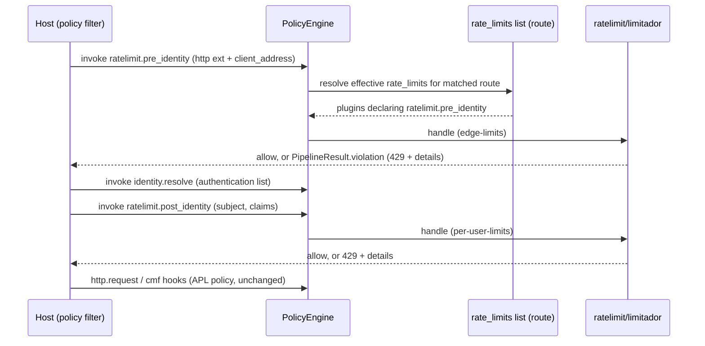
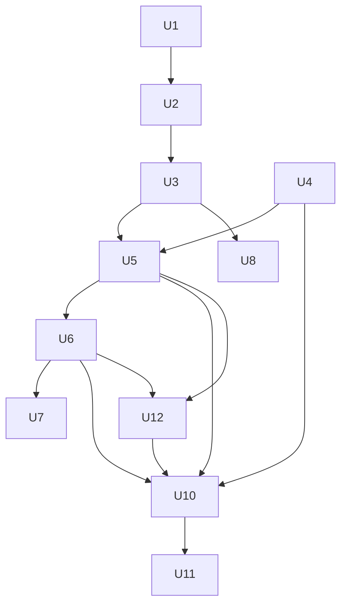

# feat: Pre- and post-identity rate-limit hooks

## Summary

Add two engine hooks, `ratelimit.pre_identity` and `ratelimit.post_identity`. A structural `rate_limits:` list dispatches them the same way `authentication:` dispatches `identity.resolve`. The `ratelimit/limitador` plugin moves onto them, off APL `run()` steps on `http.request`, so its 429 and details reach the host unchanged. It also covers a trusted host-supplied `http.client_address`, hardening, docs, and a draft issue for the Praxis gateway wiring.

---

## Problem Frame

`ratelimit/limitador` shipped as a plugin run from an APL `run()` step on `http.request`. Three problems follow from that placement:

- APL folds a plugin denial into `Decision::Deny`, which keeps only the code and reason, so the 429 never reaches the host. A side slot that carried the full violation past the decision was removed, so 8 ratelimit tests now fail on `proto_error_code` `None` versus `Some(429)`.
- `global` APL steps are inherited by `tool:` and `llm:` routes, where an HTTP-only plugin cannot run. A load-time hook check that guarded this was also removed.
- Rate limiting has no defined place relative to identity. Coarse limits belong before identity, where they protect token verification. Per-user and per-plan quotas need the resolved subject, so they belong after it.

The engine already has one structural dispatch list in policy mode, `authentication:` for `identity.resolve`. Making rate limiting a second structural hook family removes all three problems without changing APL.

---

## Requirements

- R1. Two hooks, `ratelimit.pre_identity` and `ratelimit.post_identity`, are declared through `define_hooks!` and registered in the builtin hook table.
- R2. A `rate_limits:` list is accepted at `global`, `global.defaults.<entity>`, `groups.<name>` and `routes[]`. It has the same list and `{steps, replace_inherited}` forms as `authentication:`, including per-step `config:` overrides.
- R3. Under `dispatch: policy`, the engine dispatches each rate-limit hook to the plugins in the effective route's `rate_limits:` whose declared `hooks:` include that hook, in resolution order. A plugin's stage comes from its declared hook.
- R4. A rate-limit denial returns the plugin's `PluginViolation` unchanged through `PipelineResult.violation`, including `proto_error_code` 429 and `details`. The 8 failing ratelimit acceptance tests pass again without being weakened.
- R5. `ratelimit/limitador` registers only on the rate-limit hook its config declares, exactly one of the two. A pre-identity instance that binds an identity-derived attribute family (`subject.*`, `claim.*`, and any other family populated by identity, such as delegation or agent attributes) is rejected at load. `run()` steps naming a plugin whose only hooks are rate-limit hooks are rejected at load, with a pointer to `rate_limits:`.
- R6. `HttpExtension` gains an optional, host-supplied
  `client_address`, exposed as bag attribute `http.client_address`.
  Plugins cannot write it, and capability filtering gates it. The input
  may be a bare IP literal, a bracketed IPv6 literal, an IP socket address
  with a port, or an IPv6 /64 prefix form for serialized round trips.
  The port is stripped before the address becomes a counter key.
  IPv4-mapped IPv6 is canonicalized to IPv4, and other IPv6 addresses
  collapse to their /64 prefix. An empty or unparseable value is dropped
  at the extension boundary, so it is treated as absent and fails
  closed.
- R7. Load-time safety:
  - reject `on_error` other than `fail`, and any `mode` other than `sequential`, for `ratelimit/limitador`;
  - refuse to load `ratelimit/limitador` when the build uses `panic = "abort"`, until Limitador returns condition errors instead of panicking;
  - at `pre_identity`, reject counter variables bound to caller-controlled attributes (`http.request_headers.*`, `http.query*`, `http.path`); at `post_identity`, warn instead;
  - validate every `rate_limits:` step's merged override config through the factory at load, and reject the load if it fails;
  - warn when a route inherits a post-identity limiter that binds `subject.*`/`claim.*` but resolves no authentication steps;
  - warn when `counter_capacity` is small for a counter keyed on an unbounded attribute such as `http.client_address`;
  - reject a `rate_limits:` entry whose plugin declares neither rate-limit hook;
  - reject an unknown plugin name;
  - in hook dispatch mode, reject `rate_limits:` as it rejects other policy scopes;
  - every check runs on every config load path.
- R8. Plugin hardening and diagnostics:
  - a 429 split into client-safe fields (`retry_after_seconds`, `limit`, `remaining`, `window_seconds`) in `details`, and operator-only fields (limit name, namespace, binding and capability hints) sent to logs, not to the client;
  - exported denial-code constants;
  - a status and a fix hint on attribute-missing and `check_failed` denials;
  - deny with `check_failed` before updating counters when a matching
    limit has a computed counter expression that resolves to no key;
  - method normalization;
  - a rate-limited log for repeated Limitador errors;
  - limitador dependencies moved to `[workspace.dependencies]`, with `cargo deny` advisories checked and justified ignores added;
  - a hot-path bench;
  - a clearer request-time `PluginError::Dispatch` message;
  - override limiter instances built once per config snapshot, so counters are stable for a whole config generation (see Key Technical Decisions);
  - a documented eviction policy: Limitador's bounded counter store evicts on capacity, eviction resets that counter, and evictions are logged at a rate-limited level.
- R9. Docs:
  - the README rewritten around `rate_limits:`, with the per-user (post-identity) and edge (pre-identity) examples, omitting default keys;
  - `docs/content` updated: configuration scope table, pipeline hook table, http-routing host obligations, builtins, crates, cmf-extensions and extensions attribute rows, upgrade notes;
  - the CHANGELOG updated;
  - safety-invariants catalog rows;
  - the proposal reworked, with its number settled;
  - a note on choosing quota or ratelimit;
  - a table of the attributes each stage can bind;
  - a note on the Limitador CEL dialect.
- R10. An issue body, ready to post, for `praxis-proxy/praxis` that wires both hooks and `http.client_address` into the Praxis policy filter. It is posted only after the user approves the text.

---

## Scope Boundaries

- APL is unchanged. `run()` keeps its current semantics, and `Decision::Deny` gains no fields.
- No token or tool-call rate limiting, and no shared or Redis counter storage. The proposal already defers these.
- No direct exposure of the PPE attribute bag to Limitador CEL. Limits still read flat bound variables.
- A stage is set per plugin instance, not per limit. Limiting at both stages takes two instances.

### Deferred to Follow-Up Work

- **Praxis gateway implementation of the hooks and client address:** separate change in `praxis-proxy/praxis`, tracked by the issue from U11.
- **Limitador returning condition errors instead of panicking**, which covers `panic = "abort"` hosts: an upstream issue in Kuadrant/limitador, noted in the README.
- **Preserving `run()` plugin denial details for other plugins on APL routes:** a separate design, if it is ever needed.

---

## Context & Research

### Relevant Code and Patterns

- Hook declaration: `crates/ppe-core/src/hooks/declare.rs` (`define_hooks!`), `hooks/metadata.rs` (`HOOK_TABLES`, `BUILTIN_HOOK_METADATA`), `identity/hook.rs` (`IDENTITY_HOOK_METADATA`, unphased, entity `None`), `http_hook.rs` (`HttpHook`, `HttpPayload`).
- Hook validation and registry: `config.rs` `validate_declared_hooks`; `registry.rs` `check_handler_family`; `crates/ppe-apl-runtime/tests/hook_phase_agreement.rs`.
- `authentication:` model:
  - `identity/route_config.rs` defines `RouteIdentityConfig` and `RouteIdentityStep`;
  - `config.rs` holds `deserialize_route_identity`, `parse_identity_step`, the `*_STRUCTURAL_KEYS` tables, `ConfigScope` and `validate_authentication`;
  - `section_layers` and `authentication_layers` walk the inheritance layers, and `resolve_identity_plugins_for_route` folds them;
  - `dropped_inherited_authentication` reports steps lost to `replace_inherited`;
  - `reject_typed_policy_scopes` and `reject_policy_mode_with_nothing_to_dispatch` handle hook-mode rejection.
- Structural dispatch:
  - `engine.rs` `filter_entries_by_route` contains the identity special case;
  - `create_override_instance` builds per-step override instances, and `route_cache` caches them;
  - `warn_once_if_route_authentication_is_unreachable` and `http_routes_declaring_authentication` warn when an `http:` route's list cannot apply;
  - `route_has_identity_resolution` also reads the identity list.
- Load-time warnings: `engine.rs` `warn_on_dropped_inherited_authentication` and `warn_on_assertions_findings`, called after normalization on every load path.
- APL visitor reachability: `crates/ppe-apl-runtime/src/visitor.rs` `record_authentication_names` and `report_unreachable_plugins` (which raises the `plugin_narrowed_by_policy` alarm).
- HTTP extension and bag:
  - `crates/ppe-core/src/extensions/http.rs` defines `HttpView` and `view()`;
  - `extensions/filter.rs` builds the capability-filtered copy;
  - `extensions/container.rs` `merge_http` merges plugin writes;
  - `crates/ppe-apl-cmf/src/http.rs` `extract_http` fills the bag;
  - `crates/ppe-apl-cmf/tests/key_catalog/` pins the attribute catalog.
- Reference host: `tests/utils/src/host.rs` `RefHost::call` and `resolve_identity`.
- Bench pattern: `crates/builtins/benches/quota_hot_path.rs`.
- The plugin today: `crates/builtins/src/plugins/ratelimit/` and `crates/builtins/tests/ratelimit/main.rs`.

### Institutional Learnings

- `docs/plans/2026-08-24-002-fix-cmf-hook-registry-plan.md`:
  - `BUILTIN_METADATA` is the only authority for hook names, and every dispatched hook needs a row;
  - there must be no second hand-written list of hook names, including in tests;
  - config-declared hooks are validated against the registry.
- `docs/plans/2026-08-24-001-feat-upstream-assertions-plan.md`:
  - config keys form a closed table pinned by `crates/ppe-core/tests/config_key_sets.rs`;
  - a structural control must fire on all four `PolicyEngine` entry points;
  - a structural denial is not a synthetic plugin, so it is exempt from `on_error` and capability filtering;
  - `replace_inherited` above the route is reported.
- Validation must run where every load path reaches it, which is `normalize_and_validate`. Test it with a programmatically built `PolicyConfig`, not only YAML.
- `docs/safety-invariants.md`:
  - blocking phases fail closed;
  - `on_error: ignore` is a documented deliberate fail-open row;
  - I12 requires a non-allow cell for each dispatch mode.
- `docs/content/threat-model.md`: never key on caller-controlled values. The repo has no prior guidance on client IP or `X-Forwarded-For`, so this plan writes the trust contract.
- `docs/dev/conventions.md` and `CLAUDE.md`:
  - a new capability needs unit and integration tests with allow and deny cases, docs and a bench;
  - coverage stays at 96% or above;
  - commits are signed off, with no AI trailers;
  - comments are short, with no em dashes;
  - prefer adding to an existing test binary, since each new one costs about 87s to link.

---

## Key Technical Decisions

- **Two hooks, entity `None`, `Unphased`, family `HttpHook`:** this mirrors `identity.resolve`. The hooks run wherever the host calls them, and they resolve against whatever route the request matched. Reusing `HttpHook` and `HttpPayload` lets the plugin keep its handler type, and `check_handler_family` accepts it.
- **One `rate_limits:` list, stage from the plugin's `hooks:` (option B):**
  - the stage is stated once, so policy cannot contradict it;
  - a step only selects which limiters run on a route;
  - the engine's existing `entries_for_hook(hook)` lookup already drops plugins without that hook, so one list feeds both hooks.
- **Generalize, don't copy:** the identity special case becomes a small table that maps each structural hook to the function resolving its list. The `authentication:` parse, validate and report helpers become generic over the scope name. This avoids a second copy of the error strings and inheritance logic, and keeps `authentication:` output byte-identical.
- **Hosts call each rate-limit hook once per inbound request**, for the route the request resolves to:
  - `pre_identity` runs before the first `identity.resolve`;
  - `post_identity` runs after the last;
  - this matters because identity may be called again with no side effects, but counters may not.
  - The host contract and the reference host encode this.
- **Stage checks run in the factory:** the factory reads its own `hooks:`. It rejects zero or two rate-limit hooks, `http.request`, identity-bound attributes on `pre_identity`, `on_error` other than `fail`, and non-`sequential` modes. Factory construction runs on every load path, so R7's coverage rule holds.
- **`http.client_address` is host-only:** plugins cannot change it, as with `secret_headers`. `read_headers` gates it. A missing value on a pre-identity limiter that binds it denies with the existing missing-attribute code, so the limiter fails closed.
- **`replace_inherited` is allowed for `rate_limits:`:** dropping an inherited limiter raises an alarm, as authentication does, both when a group drops it and when a route does. Rate limiting is not treated as a non-removable floor. Policy authors are trusted to the same degree as for `authentication:`.
- **Override limiter instances are built once per config snapshot, outside the request-time route cache:** the engine's `route_cache` is keyed per entity name, skips memoization when full, is not single-flight, and is cleared on plugin register and unregister. A per-request override instance would let a caller reset or split counters. So at load time the engine builds one override instance per (`rate_limits:` step, merged config). It holds them in the runtime snapshot, and the structural dispatch path selects them by step. This also runs the factory on every override config at load (R7), so a bad override fails the load instead of silently falling back to the base instance. Counters restart only when a new config snapshot is built; keeping them across reloads needs shared storage, which is deferred.
- **The override handler lookup uses the dispatched hook name:** `create_override_instance` selects the new instance's handler by `hook_type_name()`, which is the family name (`"http"` for `HttpHook`), not the hook name. That works for identity only because its family and hook names are the same string. Rate-limit overrides select the handler by the dispatched hook name.
- **`pre_identity` always resolves against the HTTP-global route:** the first identity call happens before the tool or model is known, so a pre-identity plugin listed under a `tool:`, `llm:`, `resource:` or `prompt:` route can never run. The load rejects that placement. `post_identity` resolves against the route the request finally classifies to.
- **The host contract** (the source for U10, U11 and U12):
  - call each rate-limit hook once per inbound request: `pre_identity` before the first `identity.resolve`, and `post_identity` after the last;
  - set meta (entity type and name) and the request line (method, path) on the extensions at both calls, as for `identity.resolve`;
  - set `client_address` only from the TCP peer or a configured trusted-proxy hop (rightmost untrusted hop), normalized per R6;
  - map only the client-safe `details` fields into the HTTP response.
- **Host conformance alarm:** when `identity.resolve` runs for a request on a route whose effective `rate_limits:` has `pre_identity` entries, and the pre-identity hook was not invoked for that request, raise an alarm in the style of `plugin_narrowed_by_policy`. The request carries a marker in its context table for this.
- **Eviction:** Limitador's in-memory store is bounded by `counter_capacity` and evicts when full, which resets the evicted counter. The plugin documents it, logs evictions at a rate-limited level, and warns at load when an unbounded key is paired with a small capacity. It doesn't add reject-at-capacity storage.
- **Post-identity counting precedes APL policy:** requests that policy later denies still count against the user. This is intended, because counting after policy would let denied traffic go unlimited.

---

## Open Questions

### Resolved During Planning

- *Two lists or one?* One list, with the stage taken from the plugin's hook (user choice).
- *Do we need the denial slot or a `Decision::Deny` change?* No. Structural dispatch returns the plugin's violation directly.
- *Can pre-identity limits key on something safe?* Only with the new host-supplied `http.client_address`. The docs and the warning steer users away from request headers.

### Deferred to Implementation

- *Generic helper names, and whether `RouteIdentityConfig` is renamed or wrapped:* this depends on how many call sites the rename touches. Keep its public name if renaming it breaks the facade.
- *The exact `details` key names for the 429:* align them with any existing `http.*` detail-key constants in `ppe-apl-cmf` when touching the code.
- *The proposal number:* check the `praxis-proxy/enhancements` numbering rule and rename the file only if the rule says so.

---

## High-Level Technical Design

> *This illustrates the intended approach and is directional guidance for review, not implementation specification. The implementing agent should treat it as context, not code to reproduce.*

| Plugin `hooks:` | In `rate_limits:`? | Result |
|---|---|---|
| `[ratelimit.pre_identity]` | yes | runs before identity |
| `[ratelimit.post_identity]` | yes | runs after identity |
| both rate-limit hooks | n/a | factory rejects (one stage per instance) |
| none, or `http.request` | yes | load rejects |
| a rate-limit hook | no | visitor reports it unreachable (existing check) |

---

## Implementation Units

- U1. **Declare the rate-limit hooks**

**Goal:** Add `ratelimit.pre_identity` and `ratelimit.post_identity` as builtin hooks.

**Requirements:** R1

**Dependencies:** None

**Files:**
- Create: `crates/ppe-core/src/ratelimit_hook.rs`
- Modify: `crates/ppe-core/src/lib.rs`, `crates/ppe-core/src/hooks/metadata.rs`
- Test: `crates/ppe-core/src/hooks/metadata.rs` (inline tests), `crates/ppe-apl-runtime/tests/hook_phase_agreement.rs`

**Approach:**
- Declare both rows with `define_hooks!`: family `HttpHook`, entity `None`, phase `Unphased`. Add the table to `HOOK_TABLES`.
- Export the constants from the crate root next to `HOOK_IDENTITY_RESOLVE`.

**Patterns to follow:** `crates/ppe-core/src/identity/hook.rs`

**Test scenarios:**
- Happy path: both names resolve through the hook lookup, with entity `None` and phase `Unphased`.
- Happy path: a plugin config declaring `hooks: [ratelimit.pre_identity]` passes `validate_declared_hooks`.
- Error path: a misspelling such as `ratelimit.preidentity` is rejected with a near-match suggestion.
- Integration: hook-phase agreement still passes with the new rows.

**Verification:** both hooks appear in the builtin table, and the existing hook tests are unchanged and green.

---

- U2. **`rate_limits:` configuration**

**Goal:** Parse, validate, inherit and report `rate_limits:` in the same way as `authentication:`.

**Requirements:** R2, R7

**Dependencies:** U1

**Files:**
- Modify: `crates/ppe-core/src/config.rs`, `crates/ppe-core/src/identity/route_config.rs` (or a new generic module beside it), `crates/ppe-core/src/engine.rs` (load-time report)
- Test: `crates/ppe-core/src/config.rs` (inline tests), `crates/ppe-core/tests/config_key_sets.rs`

**Approach:**
- Make the parsing generic over a scope label, so `authentication:` keeps its exact error text. Add a `rate_limits` field to `GlobalConfig`, `PolicyGroup` and `RouteEntry`.
- Add `rate_limits` to the three structural key tables, add new `ConfigScope` variants for the block and its steps, and update the `ALL` count.
- In policy mode, validate unknown names, and reject an entry whose plugin declares neither rate-limit hook. Reject `rate_limits` under `dispatch: hooks` through `reject_typed_policy_scopes`, and count it in `reject_policy_mode_with_nothing_to_dispatch` and in `declares_a_policy`.
- Add a rate-limit fold over `section_layers`, plus a dropped-inherited report raising an alarm named like `rate_limits_replaced_above_the_route`.

**Patterns to follow:** `authentication_layers`, `resolve_identity_plugins_for_route`, `dropped_inherited_authentication`, `validate_authentication`

**Test scenarios:**
- Happy path: the bare-list form and the `{steps, replace_inherited}` form both parse at every scope.
- Happy path: global, entity default, group and route steps stack in that order. `replace_inherited` at the route keeps only the route's steps.
- Happy path: a step with `config:` carries the override into the resolved plugin.
- Error path: an unknown plugin name is rejected, and the message names the scope.
- Error path: an unknown key inside `rate_limits:`, and `on_error:` on a step, are both rejected.
- Error path: a listed plugin that declares only `http.request` is rejected.
- Error path: `rate_limits:` under `dispatch: hooks` is rejected.
- Edge case: `replace_inherited` at a group or at a route drops global steps, and the load reports the affected routes.
- Integration: a config built in code (not from YAML) with a bad `rate_limits` name fails on the same load path.
- Regression: the existing `authentication:` parse and error-message tests are unchanged.

**Verification:** the key-set pins are updated and green, and the `authentication:` suite passes untouched.

---

- U3. **Engine structural dispatch for the rate-limit hooks**

**Goal:** Dispatch both hooks to the route's `rate_limits:` plugins, on every entry point.

**Requirements:** R3, R4

**Dependencies:** U2

**Files:**
- Modify: `crates/ppe-core/src/engine.rs`, `crates/ppe-apl-runtime/src/visitor.rs`
- Test: `crates/ppe-core/src/engine.rs` (inline tests), `crates/ppe-apl-runtime/tests/dispatch_mode_e2e.rs`

**Approach:**
- Replace the identity `if` in `filter_entries_by_route` with a lookup that maps each structural hook to its resolver. Identity maps to the identity list, and both rate-limit hooks map to the rate-limit list.
- Generalize the unreachable `http:`-route warning, and its once-per-cycle flag, to cover rate-limit routes.
- In the visitor, record plugins named under `rate_limits:` as reached, under the hooks they declare. Then `report_unreachable_plugins` and the narrowed-plugin alarm treat them correctly.
- The three named entry points (`invoke_by_name`, `invoke`, `invoke_named`) run the generalized resolver. `invoke_entries` takes a caller-resolved lineup and is deliberately unchanged.
- Build the rate-limit override instances once per config snapshot (Key Technical Decisions) and have the structural path select them by step, bypassing `create_override_instance` and the `route_cache` for them. Thread the dispatched hook name into the override handler lookup.
- Give the rate-limit unreachable-route warning its own once-per-cycle latch, reset in `clear_routing_cache` next to the authentication one.
- In the visitor, reject `run()` naming a plugin whose only hooks are rate-limit hooks. At load, reject a pre-identity plugin listed under a non-HTTP route's `rate_limits:`.
- Add the host conformance marker and alarm.

**Patterns to follow:** the identity branch and its `route_cache` key, `record_authentication_names`

**Test scenarios:**
- Happy path: a route listing a `pre_identity` plugin and a `post_identity` plugin. Each hook invokes only its own plugin, and order follows resolution.
- Happy path: a denying plugin's `PluginViolation` comes back with its `proto_error_code` and `details` unchanged.
- Edge case: a route with no `rate_limits:` lets both hooks through, and no plugin runs.
- Edge case: a per-step `config:` override on `ratelimit.pre_identity` gets its own instance with its own counters, and the base instance stays untouched.
- Edge case: distinct tool names on one glob route, a full route cache, concurrent first requests, and a plugin register/unregister all keep one shared override counter.
- Error path: an override config the factory rejects fails the load, with no silent fallback to the base instance.
- Error path: a `run()` step naming a rate-limit-only plugin fails the load, and the message points to `rate_limits:`.
- Error path: a pre-identity plugin under a `tool:` route's `rate_limits:` fails the load.
- Integration: an `llm:` route and a `tool:` route under a global `rate_limits:` both dispatch the hook (engine-level, with an `llm` and a `tool` entity).
- Integration: each of the three named entry points runs the rate-limit list.
- Integration: `identity.resolve` on a route with pre-identity limits, but without a prior pre-identity call, raises the conformance alarm.
- Integration: a plugin named only in `rate_limits:` is not reported unreachable, and no narrowed-plugin alarm fires for it.
- Integration: `authentication:` dispatch is unchanged; the existing identity dispatch tests pass.
- Error path: an `http:` route declaring `rate_limits:` with no readable path warns once and falls back to the global list.

**Verification:** dispatch tests are green under both feature passes, and the identity tests are unchanged.

---

- U4. **Host-supplied `http.client_address`**

**Goal:** Give pre-identity limits a key that callers cannot set.

**Requirements:** R6

**Dependencies:** None

**Files:**
- Modify: `crates/ppe-core/src/extensions/http.rs`, `crates/ppe-core/src/extensions/filter.rs`, `crates/ppe-apl-cmf/src/http.rs`, `crates/ppe-apl-cmf/src/constants.rs`, `crates/ppe-apl-cmf/src/capability_namespaces.rs`
- Test: `crates/ppe-core/src/extensions/http.rs` and `filter.rs` (inline tests), `crates/ppe-apl-cmf/tests/key_catalog/catalog.rs`, `crates/ppe-apl-cmf/tests/key_catalog/main.rs`

**Approach:**
- Add an optional address string to `HttpExtension`, and include it in `HttpView` (it is not secret).
- Copy it in the `read_headers` branch of the filtered copy, and add its prefix to the `read_headers` capability namespace. `merge_http` already clones the canonical copy and takes only headers from the plugin, so it needs only a regression test.
- Normalize at the extension boundary per R6. Leave it out of the `Debug` view, which goes to logs, but keep it in the serialized view that audit sinks read.
- `extract_http` emits `http.client_address` only when set.

**Patterns to follow:** how `secret_headers` stays host-only in the merge, and how `host` and `scheme` are emitted in `extract_http`

**Test scenarios:**
- Happy path: a host-set address appears in the bag as `http.client_address`.
- Edge case: when the address is unset, the bag has no key, not an empty string.
- Edge case: `203.0.113.7:4431`, `::ffff:203.0.113.7` and `203.0.113.7` normalize to the same value; two IPv6 addresses in one /64 normalize to the same prefix; an unparseable value is dropped.
- Error path: a plugin with `read_query` but not `read_headers` does not see the address.
- Error path: a plugin's modified extensions cannot change the address after merge.
- Integration: the key catalog lists the new attribute and its capability.

**Verification:** the catalog pins are updated, and the existing `http.*` attribute tests are unchanged.

---

- U5. **Move `ratelimit/limitador` onto the hooks**

**Goal:** The plugin runs at its declared stage and returns its 429 directly.

**Requirements:** R4, R5, R7

**Dependencies:** U3, U4

**Files:**
- Modify: `crates/builtins/src/plugins/ratelimit/factory.rs`, `handler.rs`, `config.rs`, `mod.rs`
- Test: `crates/builtins/tests/ratelimit/main.rs`, `crates/builtins/src/plugins/ratelimit/config.rs` (inline tests)

**Approach:**
- The factory derives the stage from `config.hooks` and registers its handler only on that hook.
- It rejects: zero or two rate-limit hooks, any other hook, `on_error` other than `fail`, a non-`sequential` mode, and a pre-identity instance whose bindings name `subject.` or `claim.` attributes.
- Port the test policies from `run()` steps on `http.request` to `rate_limits:` plus the hook, and invoke the hook the test exercises.
- Keep the 8 acceptance assertions exactly as they are.

**Execution note:** start by porting one acceptance test to the hook and confirming it fails on 429 for the right reason. Then port the rest.

**Patterns to follow:** quota's `allow_unauthenticated` style of explicit, fail-closed config checks

**Test scenarios:**
- Covers the 8 acceptance tests: Alice/Bob counting, global and route limits, claim binding, CEL macros, `limit` metadata conditions, route override counter, unreferenced binding and header binding. Each returns `Some(429)` and `ratelimit.exceeded`.
- Happy path: a post-identity per-user limit counts each `subject.id` separately; a free-plan POST counts against both matching limits.
- Happy path: a pre-identity limit keyed on `http.client_address` counts separately per address.
- Error path: a pre-identity instance binding `subject.id` fails to load, and the message names the binding and the stage.
- Error path: `hooks: [ratelimit.pre_identity, ratelimit.post_identity]` fails to load.
- Error path: `on_error: ignore` and `mode: concurrent` each fail to load.
- Error path: a pre-identity instance with a counter variable bound to `http.request_headers.x-user` fails to load; the same binding on post-identity loads with one warning.
- Error path: under a `panic = "abort"` build the factory refuses to load (a cfg-gated test).
- Error path: a missing `http.client_address` on a pre-identity limiter that binds it denies before any counter changes.
- Integration: the existing panic test (`int(subject_id) > 1`) still denies with `check_failed`, now through the hook.
- Error path: a matching limit with an unresolved computed counter key
  denies before another matching limit updates its counter; a rule whose
  conditions do not match is unaffected.
- Integration: the concurrency test still never exceeds the limit.

**Verification:** all ratelimit tests pass, including the 8 previously failing ones, with no assertion weakened.

---

- U6. **Plugin hardening and diagnostics**

**Goal:** Harden the plugin and improve its diagnostics.

**Requirements:** R7, R8

**Dependencies:** U5

**Files:**
- Modify: `crates/builtins/src/plugins/ratelimit/handler.rs`, `config.rs`, `mod.rs`
- Test: `crates/builtins/tests/ratelimit/main.rs`

**Approach:**
- Build the 429 client-safe `details` from Limitador's check result, picking the most restrictive matched counter. Log the operator-only fields (limit name, namespace) instead of returning them.
- Export the denial codes as constants from the module.
- Give the attribute-missing and `check_failed` denials a status and a short fix hint, without leaking raw error text.
- Uppercase the method before binding.
- Warn at load when a counter variable is bound to an `http.request_headers.*` attribute.
- Rate-limit the error log for persistent Limitador failures.

**Test scenarios:**
- Happy path: a 429 carries remaining 0, the limit's max, its window and a positive retry-after, and no limit name, namespace or capability names.
- Edge case: a lowercase `get` matches a `method == 'GET'` limit.
- Error path: a missing binding denies with a status. The hint that names the variable, the attribute and the capability to grant goes to the operator log, not the response.
- Error path: `check_failed` carries a status and no raw error text.
- Integration: a post-identity header-bound counter variable logs one load-time warning, and the config still loads.
- Integration: filling the counter store past `counter_capacity` with distinct keys logs a rate-limited eviction message, and the documented reset behavior holds.
- Integration: a global per-user limiter with an anonymous route that inherits it logs the load-time warning.

**Verification:** each new detail is asserted, and the denial-code constants are used in the tests.

---

- U7. **Hot-path bench**

**Goal:** Measure per-request cost at both stages.

**Requirements:** R8

**Dependencies:** U6

**Files:**
- Create: `crates/builtins/benches/ratelimit_hot_path.rs`
- Modify: `crates/builtins/Cargo.toml`

**Approach:** benchmark allow and deny at each hook with one and with several limits. Gate it on `experimental-ratelimit`, following the quota bench.

**Patterns to follow:** `crates/builtins/benches/quota_hot_path.rs`

**Test expectation:** none. This is a bench; it must compile under `--all-features`.

**Verification:** the bench compiles in the workspace build and documents its run command.

---

- U8. **Supply chain and runtime diagnostics**

**Goal:** Clean up dependencies and the request-time dispatch error.

**Requirements:** R8

**Dependencies:** U3

**Files:**
- Modify: `Cargo.toml` (root `[workspace.dependencies]`), `crates/builtins/Cargo.toml`, `deny.toml`, `crates/ppe-apl-runtime/src/cmf_invoker.rs`
- Test: `crates/ppe-apl-runtime/tests/cmf_invoker_dispatch.rs`

**Approach:**
- Move limitador and the second `cel` version to workspace dependencies, and keep them optional in the crate.
- Run the advisory check with all features. Add justified ignores only for advisories that actually fire.
- Make the `PluginError::Dispatch` message name the remedy: move the step, or use a plugin with a hook for this context.

**Test scenarios:**
- Error path: a `run()` step whose plugin's only hook has a non-matching entity or phase (a test plugin, not the limiter) denies, and the message names the plugin, the context and the remedy.

**Verification:** the advisory check is clean under all features, and the dispatch test asserts the new message.

---

- U12. **Reference-host integration, resilience and security scenarios**

**Goal:** Show, end to end through the reference host, that the stages run in order around identity, count once per request, and fail closed.

**Requirements:** R3, R4, R5, R6, R7

**Dependencies:** U5, U6

**Files:**
- Modify: `tests/utils/src/host.rs` (`RefHost::call` invokes both hooks and accepts an optional client address), `tests/utils/src/fixtures.rs` (rate-limit policies), `tests/utils/Cargo.toml` and the three suite `Cargo.toml` files (an opt-in `experimental-ratelimit` feature forwarded to the facade), `tests/integration/tests/suite/scenarios/mod.rs`
- Create: `tests/integration/tests/suite/scenarios/rate_limit.rs`
- Test: `tests/resilience/tests/suite/concurrency.rs`, `tests/security/tests/suite/rate_limit_evasion.rs` (a module in the existing security binary, not a new binary)

**Approach:**
- The suites build `praxis-policy/builtins`, which excludes experimental plugins, so nothing experimental is covered there today. Add a per-suite `experimental-ratelimit` feature, and gate the new scenarios with `cfg(feature = ...)` so the default pass is unchanged. The `--all-features` pass runs them.
- Add the stages to the reference host following the host contract in Key Technical Decisions: pre-identity before the first identity call, post-identity after the last. The host must not call a stage again when it calls identity again for the classified tool.
- Keep the host suites to what only the host can prove. Plugin-level behavior (plan tiers, panics, method case) stays in U5 and U6, and `llm:` inheritance is covered at engine level in U3.
- Reuse the scripted IdP fixtures to mint real JWTs for distinct subjects and plans.

**Patterns to follow:** existing scenario modules (`alice_deny.rs`, `bob_allow.rs`), `RefHost::call` and `Outcome`, the security suite's `match_evasion.rs`

**Test scenarios:**
- Integration: with a JWT for Alice, the per-user post-identity limit allows N calls through the full flow and denies call N+1 with 429 and `ratelimit.exceeded`. The upstream sees exactly N requests.
- Integration: Alice exhausting her limit does not affect Bob; his calls still go through.
- Integration: a pre-identity edge limit denies by client address before identity runs. An invalid token over the edge limit gets 429, not 401, which proves the stage order.
- Integration: one MCP tool call that resolves identity twice (HTTP-global, then the tool) decrements each counter once.
- Integration: a pre-identity limiter that binds `http.client_address` denies when the host omits it, and the upstream is never reached.
- Integration: an MCP `tool:` route under a global `rate_limits:` is limited end to end.
- Resilience: concurrent requests from one subject never exceed the limit, end to end.
- Security: varying `X-Forwarded-For` or another caller header does not reset a counter keyed on `http.client_address` or `subject.id`.
- Security: a forged `X-Demo-User`-style header cannot pick another subject's counter.
- Security: a pre-identity 429 reveals no raw Limitador error, secret header, limit name, namespace or capability name.
- Security: port-bearing, mapped-IPv4 and same-/64 IPv6 forms of one client share a counter.

**Verification:** the scenarios pass under the all-features pass and are skipped in the default pass. The existing scenarios are unchanged.

---

- U13. **Bring existing branch changes in line with the conventions**

**Goal:** Fix the convention violations already in the branch, so the history rewrite starts from clean content.

**Requirements:** Conventions section

**Dependencies:** None for the docs fixes; the test-file fixes land with U5

**Files:**
- Modify: `CHANGELOG.md`, `docs/proposals/00134_limitador-rate-limit-plugin.md`, `crates/builtins/src/plugins/ratelimit/README.md`, `crates/builtins/src/plugins/mod.rs`, `crates/builtins/src/plugins/ratelimit/handler.rs`, `crates/builtins/tests/ratelimit/main.rs`

**Approach:**
- Already applied in the worktree:
  - removed the issue link from the CHANGELOG entry and the proposal's `issue:` front matter;
  - replaced the "this PR" and "HTTP PR" wording with release-neutral text;
  - replaced the proposal's process-narrative "Review basis" section with a plain References list;
  - removed "from this worktree" from the README;
  - replaced the em dash on the added `ratelimit` row in `plugins/mod.rs` and the proposal's en dash;
  - trimmed a comment in the handler that narrated what the code does down to the "why".
- With U5, while porting the tests:
  - give every assertion a message (33 currently have none);
  - remove the demo `show_verdict` printing helper and its `print_stdout` allow.

**Test scenarios:**
- Test expectation: none. These are wording and test-message fixes, with no behavior change.

**Verification:**
- A scan of every line the branch adds finds no plan, issue or PR references, no review or worktree mentions, and no em or en dashes.
- Every assertion in the ratelimit tests has a message.
- Lines from main that use em dashes are left untouched.

---

- U10. **Documentation**

**Goal:** Every user-facing surface describes the hooks, `rate_limits:` and `http.client_address`.

**Requirements:** R9

**Dependencies:** U4, U5, U6, U12

**Files:**
- Modify:
  - `crates/builtins/src/plugins/ratelimit/README.md`
  - `docs/content/configuration.md`, `pipeline.md`, `http-routing.md`
  - `docs/content/builtins.md`, `crates.md`
  - `docs/content/cmf-extensions.md`, `extensions.md`
  - `docs/content/upgrade-apl.md`
  - `docs/safety-invariants.md`
  - `docs/proposals/00134_limitador-rate-limit-plugin.md`
  - `CHANGELOG.md`

**Approach:**
- **README:** rebuild it around `rate_limits:`. Document that a route that skips authentication but inherits a per-user limiter needs `rate_limits: {replace_inherited: true}`, and that the edge example needs a host that sets `client_address`. Lead with the per-user post-identity example and the edge pre-identity example, both omitting default keys (`mode`, `on_error`, `engine_settings.dispatch`, `counter_capacity`). Keep `capabilities` and explain why it is needed.
  - Add a stage-to-attributes table: pre-identity binds route, method, path and `http.client_address`; post-identity adds `subject.*` and `claim.*`.
  - Add a note on the Limitador CEL dialect: flat names, cel 0.12, not the `cel:` PDP dialect.
  - Add the denial-code table.
  - Add the counter-reset behavior.
  - Add a quota-versus-ratelimit note.
  - Note the upstream panic issue for `panic = "abort"` hosts.
  - Remove the `run()` examples and the two-filter workaround.
- **Configuration:** add the scope-table rows and a prose section for `rate_limits:`.
- **Pipeline:** add the two hooks to the hook table and the call order.
- **http-routing:** describe the host contract from Key Technical Decisions: call order, once per request, meta and request line at both calls, the `client_address` source and format, the client-safe `details` set, and the conformance alarm.
- **cmf-extensions and extensions:** add the `http.client_address` attribute and capability rows.
- **upgrade-apl:** a note on moving from `run()` to `rate_limits:`.
- **Safety invariants:** catalog cells for both hooks under each dispatch mode, and an entry recording that `on_error` other than `fail` is refused for this kind.
- **Proposal:** rework the Decision section around the two hooks and the structural list. Update the mapping table, and settle the number. Drop the `issue:` front-matter link and replace the three "this PR" / "HTTP PR" passages with release-neutral wording.
- **CHANGELOG:** an Added entry for the hooks, `rate_limits:` and `http.client_address`. Change the existing plugin entry so it describes the hook-based plugin, and remove its issue link. New entries carry no issue or PR links.

**Test expectation:** none. These are docs only; check that every YAML example in the README is also exercised by a test policy in U5.

**Verification:**
- Every changed doc names the hooks consistently.
- The README examples parse, either as tests or by being copied verbatim into a test policy.
- The advisory markdown lint is no worse than before.

---

- U11. **Draft issue for the Praxis gateway**

**Goal:** A ready-to-post issue for `praxis-proxy/praxis`.

**Requirements:** R10

**Dependencies:** U10

**Files:**
- None in the repo. Write the issue body as a scratch artifact outside the committed tree and show it to the user; it is never committed.

**Approach:**
- Describe the contract the policy filter must meet:
  - invoke `ratelimit.pre_identity` before identity and `ratelimit.post_identity` after the last identity resolution, once per inbound request, with meta and the request line set at both calls;
  - set `HttpExtension.client_address` from the TCP peer, or from the rightmost untrusted hop of a configured trusted-proxy header, normalized as the policy docs specify;
  - map the violation's 429 and only the client-safe `details` fields to the HTTP response, including `Retry-After` and the RateLimit headers;
  - keep the existing two-filter setups working during migration.
- Include acceptance criteria. The issue may link the policy change, because it is a tracking artifact and not durable code or docs.
- Show the text to the user. Post it with `gh issue create` only after explicit approval, since posting is outward-facing.

**Test expectation:** none. This is an issue body.

**Verification:** the user has approved the text, or chosen to post it later.

---

## System-Wide Impact

- **Interaction graph:**
  - `filter_entries_by_route` now serves three structural hooks.
  - The APL visitor's reachability accounting gains a second structural source.
  - The reference host's request flow gains two calls.
- **Error propagation:** a rate-limit denial is a plain plugin violation returned by the hook call. The host stops the request before identity (pre-identity) or before policy (post-identity).
- **State lifecycle risks:** counters live in each plugin instance. Base and override instances are both built once per config snapshot, so counters restart only on a new snapshot, which is documented. The `DispatchCache` OnceCell fix covers the APL dispatch path and is unrelated to the structural path.
- **API surface parity:**
  - New public items: hook constants, the `client_address` field, the `rate_limits` config fields and the denial-code constants.
  - The `HttpExtension` struct literals in the repo use `..Default::default()`, except the filtered copy, which is updated.
- **Integration coverage:** the order of the two stages relative to identity, and one count per request, can only be proven through the reference host. U12 covers this in the integration, resilience and security suites, behind an opt-in feature.
- **Unchanged invariants:**
  - APL semantics, `Decision::Deny`, `run()` dispatch and the `authentication:` behavior and messages.
  - Hook dispatch mode stays as it is, except that `rate_limits:` is rejected there.

---

## Risks & Dependencies

| Risk | Mitigation |
|------|------------|
| Generalizing the `authentication:` helpers changes their error text | Keep the label as a parameter; the existing message-assertion tests guard it |
| The host calls a rate-limit hook more than once per request and double counts | The host contract and the reference host require one call per request; the Praxis issue repeats it |
| The host never calls a stage, so the limiter silently does not run | Conformance alarm when identity runs on a route with pre-identity limits and no pre-identity call was made; documented in the host contract and the upgrade note |
| `panic = "abort"` hosts crash on a Limitador condition panic | The factory refuses to load under that profile until Limitador is fixed upstream |
| Callers mint fresh counters by varying keys or filling the route cache | Override instances live in the config snapshot, not the route cache; counter keys on caller-controlled attributes are rejected pre-identity; eviction is documented and logged |
| Hosts populate `client_address` from `X-Forwarded-For` without trusting it | Doc the trust contract in http-routing and the Praxis issue; warn on header-bound counters |
| The new `ConfigScope` variants break out-of-tree visitors | Additive variants; an upgrade note |
| A new test binary adds link time | Extend the existing binaries (ratelimit, engine inline, `dispatch_mode_e2e`); add none unless unavoidable |
| The coverage gate drops | The test scenarios cover every new branch; run coverage at the end |

---

## Conventions (apply to every unit)

From `docs/dev/conventions.md`, `.claude/CLAUDE.md` and `CONTRIBUTING.md`:

- **Comments say why, not what.**
  - Runtime narration goes in `tracing::debug!`, `trace!` or `info!` calls, not comments.
  - Comment only a non-obvious constraint, invariant or workaround.
  - Never restate what an identifier already says.
- **Short and plain.** Keep rustdoc, comments, CHANGELOG prose and commit messages to one or two sentences each. Do not use em dashes; use a comma, a colon or a second sentence.
- **No process or tracking references in durable text.**
  - Code, comments, rustdoc, test names, assertion messages, README and `docs/content` carry no plan, issue or PR IDs. That covers issue and PR numbers, plan filenames, U- and R-IDs, review or reviewer mentions, test counts and "this PR". Describe what is true of the code.
  - No exceptions for anything this work adds or edits. New CHANGELOG entries carry no issue links, the proposal's `issue:` link and its PR wording are removed, and new tests do not use `known gap #<issue>`. Commit messages carry no IDs either.
  - Before each commit, grep the added lines for these patterns.
- **Tests:** put the explanation in the assertion message, not in an inline comment inside the test body.
- **File layout:**
  - every new source file starts with the SPDX and copyright header;
  - section separators are full width (77 dashes), never `// --- x ---`;
  - files follow the order constants, public items, private items, private utilities;
  - numeric constants carry a trailing human-readable comment;
  - modules use the `mod.rs` style in `crates/builtins`.
- **Lints:**
  - add no new violations;
  - suppress at the narrowest scope, with a `reason`;
  - `dead_code` is denied, so delete unused items rather than silencing them.
- **Commits:**
  - short Conventional Commit subjects;
  - always `git commit -s`;
  - no AI tool trailers or co-authors;
  - the original human author is credited with a `Co-authored-by:` trailer.

---

## Documentation / Operational Notes

- The `DispatchCache` OnceCell fix stays in this change as its own commit.
- History is rewritten into a few signed, conventional commits that credit the original author with `Co-authored-by`:
  - proposal docs;
  - the `DispatchCache` fix;
  - the hooks and `rate_limits:`;
  - `http.client_address`;
  - the plugin;
  - docs.
- The feature stays experimental and outside the `builtins` feature set.

---

## Sources & References

- Related code: `crates/ppe-core/src/engine.rs` (`filter_entries_by_route`), `crates/ppe-core/src/config.rs` (`section_layers`), `crates/builtins/src/plugins/ratelimit/`
- Prior plans: `docs/plans/2026-08-24-002-fix-cmf-hook-registry-plan.md`, `docs/plans/2026-08-24-001-feat-upstream-assertions-plan.md`
