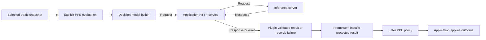

# Decision models for PPE

## What?

Add an optional, experimental builtin plugin that sends configured questions
and selected traffic content to a decision model through the System One HTTP
API. It publishes typed evaluation results in a dedicated namespace. PPE
policy uses those results to deny, restrict routing, request approval, or
set headers. The embedding application applies the policy outcome.

The namespace name and policy operation syntax remain implementation design
decisions. All contracts below are proposed, not existing loader syntax.

### Glossary

- **PPE:** Praxis Policy Engine, embedded in an application to evaluate policy.
- **Embedding application (host):** the application that calls PPE, supplies
  traffic and HTTP services, and applies policy outcomes. Praxis is one host.
- **PDP (policy decision point):** a component that evaluates policy rules
  against attributes, such as the Cedar, CEL, and OPA integrations.
- **Decision model (decision making model):** a model designed to evaluate
  content against configured questions and return constrained answers and
  probabilities. Examples include Jev, Kev, Laya, and vLLM-SR Decision models.
  [System One concepts][system-one], [Decision API][decision-api].
- **System One HTTP API:** the decision model API contract exposed through
  `POST /v1/systemone`. It accepts state and named questions, then returns
  typed answers. Any backend implementing the required contract is eligible;
  the named services are reference targets. [API contract][api].
- **Compatible decision model backend:** a serving deployment that supports
  that API contract and a selected decision model supporting the requested
  question types. Compatibility requires both the service and the model.
- **Serving runtime:** software that loads and executes a model, such as
  Ollama or llama.cpp. A runtime can serve multiple decision model families.
  [Ollama guide][ollama-guide], [llama.cpp announcement][llamacpp].
- **State:** the selected text or structured data the model evaluates.
- **Evaluation instance:** a named configuration binding a backend, model,
  input selection, questions, and execution limits.
- **Policy evaluation:** one execution of PPE. A host may invoke PPE
  separately for request and response processing.
- **Question and rubric:** the configured instruction and answer criteria;
  a rubric defines the ordered levels used by a Score question.
- **Noul, Choice, and Score:** the answer primitives: a yes probability, one
  category, and a position on a rubric, respectively. Their ranges and
  uncertainty fields are described under **Result contract**.
- **Model judgment:** the model's predicted answer, with its uncertainty.
- **Evaluation result:** either a complete set of judgments or an execution
  error. An error contains no judgments.
- **Policy decision:** PPE's application of policy to available inputs,
  including model judgments, to determine enforcement and other actions.

An HTTP endpoint or a general model's ability to return JSON does not by
itself establish decision model compatibility. Protocol conformance and model
suitability are evaluated separately.

### Goals

- Support Noul probabilities, categorical Choice answers, and rubric Scores.
- Evaluate bounded text and structured data from HTTP, LLM, and tool traffic
  wherever the host exposes that content to PPE.
- Demonstrate all four primary stories below, including response enforcement.
- Make uncertainty, timeout, and other failures explicit policy inputs.
- Accept any hosted or self-hosted decision model backend meeting the System
  One API contract, without provider or model name allow-lists.
- Keep input disclosure, execution budgets, and telemetry under operator
  control. Ship disabled by default behind a dedicated Cargo feature.

### Non-goals

- Hosting, downloading, training, or fine-tuning models inside PPE.
- General chat completion, generated policy, or autonomous tool execution.
- Replacing authentication, deterministic authorization, or signature rules.
- Incremental streaming analysis, images, audio, or unbounded payloads.
- Extracting PII spans or implementing redaction; existing transforms can act
  on a classification, but detection alone supplies no redaction coordinates.
- Automatic retries, result caching, or automatic carryover of results
  between separate PPE evaluations.
- Numeric threshold enforcement in Cedar in the first experiment.
- Universal accuracy, speed, WAF coverage, or GDPR compliance guarantees.

## Why?

Policies can already act on attributes. Meaning inside a prompt, tool
argument, or response often needs interpretation before it becomes an
attribute. Decision models turn that interpretation into constrained values
that ordinary policy can use.

Specialized inference and batched questions may reduce the latency and cost
of asking a general language model for the same judgment. The experiment
must measure that benefit, including network and PPE overhead. A structured
answer is easier to consume; it can still be wrong.

### User stories

The first four stories are required demonstrations. The others extend the
same capability without requiring a separate integration for each detector.

| User need | Model signal | Later PPE action |
|---|---|---|
| Malicious HTTP traffic | Risk and attack class | Deny or set a header |
| Prompt injection | Probability | Deny or restrict tools |
| Coding versus architecture work | Task and effort | Guide semantic routing |
| PII in requests or responses | Presence and type | Restrict egress/release |
| Secret exfiltration | Risk | Deny or require approval |
| Destructive tool operations | Risk | Require human approval |
| Instructions in retrieved content | Injection risk | Reject tool result |
| Specialist or MCP selection | Intent and domain | Restrict services |
| Ambiguous or unsupported requests | Uncertainty | Fallback or clarify |
| Response content rules | Category | Withhold release or escalate |

For semantic routing, PPE can restrict model pools or provide task and effort
attributes that help the host choose an appropriate model.

These are classifications of the supplied content. They do not establish
user identity, grant permissions, or prove that an action is safe.

## Who?

- **Policy owners** define questions, thresholds, failure branches, and actions.
- **Platform operators** choose inference deployments, approved destinations,
  credentials, input scope, and resource budgets.
- **Security and privacy owners** assess service data handling and detector
  quality against representative workloads.
- **PPE maintainers and host integrators** own protected results, evaluator
  projections, transport boundaries, metrics integration, and conformance.

## Architecture



Model judgments feed APL predicates and PDPs. PPE combines their decisions
with policy effects and assertions. The application performs forwarding,
backend selection, or response release according to the resulting outcome.

### Evaluation lifecycle

1. Run cheap checks and relevant content transforms. Capture the current
   payload after those transforms, not an earlier attribute snapshot. Keep
   configured questions separate from untrusted traffic.
2. Invoke evaluation explicitly in the policy sequence, before its consumers.
   Several questions about the same state may share one bounded call.
3. Validate and atomically publish either the complete answer set or an error
   record. Refresh the policy context before subsequent rules or PDP calls.
4. Apply normal PPE predicates and effects. Classification can narrow existing
   routing candidates; the host router still handles health and selection.

Support evaluation before dispatch and before response release. Results live
within the PPE policy evaluation that produced them. Request and response
callbacks can be separate evaluations; results are not automatically shared
between them. Each instance publishes once per evaluation. Use distinct
instances for request, response, or repeated inspections.

The framework stamps the resolved instance identity and installs immutable
results. Other plugins cannot fabricate or overwrite them, and need an
explicit reading capability to access them. Child evaluations start without
the parent's results.

A judgment describes the selected snapshot. If a later transform changes
content relevant to enforcement, re-evaluate it through a distinct instance
before relying on the judgment.

For response enforcement, the application holds the bounded response until
classification and policy evaluation finish. Reject an enforcing
configuration the application cannot honor. Observational behavior must be
configured explicitly. Response checks control disclosure; they cannot undo
a tool action.

### Result contract

Use a **dedicated namespace for model judgments**. This makes probabilistic
evidence recognizable to policy authors. It requires its own evaluator and
assertion projections, while sharing suitable callout and protection patterns
with other information sources.

Publish `success` with the complete answer set, or `error` with a normalized
error code and no answers. A skipped operation creates no record. These are
execution outcomes, not allow/deny verdicts.

Provenance includes the evaluation instance, phase, backend identity,
requested and reported model identities, question revision, and configured
deployment revision when available. A reported model name is not proof of
immutable weights. Preserve absent usage or model information as absent.

- **Noul:** estimated P(true) in `[0, 1]`, with no separate confidence field.
  Policy chooses its boolean threshold. [Noul semantics][noul].
- **Choice:** one configured category, its probability distribution, and
  provider confidence. Multiple simultaneous labels need separate questions,
  such as one Noul per PII class. [Choice semantics][choice].
- **Score:** a probability-weighted position on an ordered rubric. Three
  levels yield values from `0` to `2`, including fractions. An example is
  `effort.score > 1.5`; `score > 100` needs an explicitly defined policy scale.
  [Score semantics][score].

Confidence summarizes a distribution; it is not measured correctness. Its
formula can differ between services. Thresholds belong to a particular
model, question set, and workload. [TypeSafe confidence][confidence],
[Laya compatibility notes][laya].

Require exactly the requested answer set. Validate types, category membership,
numeric ranges, probability distributions, and Score consistency with the
configured rubric. Allow documented rounding tolerance. Reject invalid or
partial results as one error, without exposing raw backend error text.

APL and CEL can consume fractional values; OPA receives JSON numbers. Test
threshold boundaries without assuming identical arithmetic. Cedar initially
supports categorical results and execution status. Cedar numeric enforcement
requires a separately reviewed projection with explicit scale and rounding;
silently stringifying or rounding scores is not compatibility.

## Hypothetical configuration examples

This is one PPE policy document with two route examples. It uses the existing
[configuration structure](../content/configuration.md): plugin declarations,
secret providers and values, a global PDP, and route-bound policy. Praxis
listeners, upstreams, and backend pools are configured in the embedding host.

The proposed additions are `kind: model/systemone`, hook `model.evaluate`,
`evaluate_model(...)`, the plugin-specific `config`, the `read_http_body`
capability, and the `model_results` namespace. Their names are illustrative;
this document cannot run until the feature and host prerequisites exist.
The namespace is always an object, even when empty, allowing presence checks.
Model names, thresholds, and limits require workload validation.

Each plugin selects the current host-supplied request within its reading
capabilities. `current_http_request` includes the request line, headers, and
bounded body; `current_llm_request` selects the current inference request.
These selectors require the current-content delivery described above. The
sensitive-input acknowledgment covers the selected content as a whole.

```yaml
engine_settings:
  dispatch: policy

secrets:
  providers:
    mounted:
      kind: file
      base_dir: /var/run/secrets/ppe
  values:
    decision_model_api_key:
      provider: mounted
      ref: decision-model-api-key

plugins:
  - name: inspect_login
    kind: model/systemone
    hooks: [model.evaluate]
    mode: sequential
    on_error: fail
    capabilities: [perform_http, read_headers, read_query, read_http_body]
    config:
      endpoint: https://decisions.example.com/v1/systemone
      auth:
        kind: bearer
        secret: decision_model_api_key
      model: operator-selected-model-version
      input: current_http_request
      acknowledge_sensitive_input: true
      purpose: Inspect login requests, including sensitive content, for SQL injection.
      timeout_milliseconds: 100
      max_input_bytes: 8192
      max_request_bytes: 16384
      max_response_bytes: 4096
      max_concurrent: 16
      questions:
        malicious:
          type: noul
          instructions: Does any part of this request attempt SQL injection?

  - name: classify_task
    kind: model/systemone
    hooks: [model.evaluate]
    mode: sequential
    on_error: fail
    capabilities: [perform_http, read_llm_request]
    config:
      endpoint: https://decisions.example.com/v1/systemone
      auth:
        kind: bearer
        secret: decision_model_api_key
      model: operator-selected-model-version
      input: current_llm_request
      acknowledge_sensitive_input: true
      purpose: Classify inference requests, including sensitive content, for routing.
      timeout_milliseconds: 100
      max_input_bytes: 8192
      max_request_bytes: 16384
      max_response_bytes: 4096
      max_concurrent: 16
      questions:
        task:
          type: choice
          instructions: What kind of work does this request ask for?
          criteria:
            coding: Implement or debug code.
            architecture: Design or assess a system architecture.
            other: Other work or unclear intent.

global:
  pdp:
    - kind: cel

routes:
  - http:
      path: /login
      method: POST
    authorization:
      pre_invocation:
        - "evaluate_model(inspect_login)"
        - cel:
            expr: >-
              has(model_results.inspect_login) &&
              model_results.inspect_login.outcome == 'success' &&
              model_results.inspect_login.answers.malicious.noul < 0.1

  - http:
      path_prefix: /
    authorization:
      pre_invocation:
        - "deny"

  - llm: assistant
    authorization:
      pre_invocation:
        - "evaluate_model(classify_task)"
        - when: >-
            model_results.classify_task.outcome == 'success' &
            model_results.classify_task.answers.task.choice == 'architecture' &
            model_results.classify_task.answers.task.confidence >= 0.8
          do:
            - restrict:
                custom: {pool: architecture}
                on_empty: deny
        - when: >-
            !(model_results.classify_task.outcome == 'success' &
              model_results.classify_task.answers.task.choice == 'architecture' &
              model_results.classify_task.answers.task.confidence >= 0.8)
          do:
            - restrict:
                custom: {pool: general}
                on_empty: deny
```

The host registers the file secret provider, CEL, and the proposed model
builtin. `auth.secret` names a `secrets.values` entry containing the raw API
key; the plugin constructs `Authorization: Bearer <key>` for the inference
call. No API key is written in this document or projected onto traffic.

The proposed `evaluate_model(name)` operation resolves the declared instance,
captures its selected input, and invokes `model.evaluate`. It serializes the
input as text state and publishes the validated result before the next policy
step. Model timeouts and service failures produce error records so policy can
continue; `on_error: fail` applies to unexpected plugin/framework failures.

### 1. WAF-style inspection followed by a CEL decision

`POST /login` selects `inspect_login`. For a body containing
`"password": "' OR 1=1 --"`, suppose the model returns `malicious.noul: 0.97`.
The later CEL rule reads
`model_results.inspect_login.answers.malicious.noul` and denies; the host
withholds forwarding. A successful result of `0.02` passes this check. An
error or missing result denies while policy execution can continue. An
enclosing deadline expiry follows the host's deadline behavior. The HTTP
catch-all denies other methods and paths in this example.

### 2. Task classification followed by semantic routing

The host reports the logical model name `assistant`, selecting the `llm:`
route, and labels eligible backends `pool: architecture` or `pool: general`.
Those pools belong to the host's routing configuration.

If `classify_task` returns `task.choice: architecture` with
`task.confidence: 0.92`, the first branch restricts candidates to the
architecture pool. The host router selects a healthy eligible backend.
Coding, other categories, low confidence, or an error/missing result select
the explicit general-pool fallback. APL uses `&` and `!`; the two conditions
are complements, so exactly one restriction applies. Existing restrictions
still apply; an empty candidate set denies.

Each route evaluates its instance once. The routing example demonstrates
classification only; protecting that traffic also requires a security check
before routing.

## Provider compatibility

Compatibility is defined by the System One API contract and supported
question types. The named backends below are reference targets, not a closed
list. Operators configure the endpoint, authentication, and model; a new
compatible backend should not require a new PPE plugin or model registration.

For more decision model candidates, see the [Decision Index][decision-index].

Target the shared `POST /v1/systemone` envelope: configured `model`, selected
`state`, named `questions`, and corresponding typed `answers`. A dependency
on an earlier answer requires a subsequent policy operation.
[System One API][api].

Question isolation depends on the model: some llama.cpp models process the
questions jointly. Evaluate the configured question set together rather than
assuming questions cannot affect one another.
[Runtime contract][llamacpp-server].

Documentation checked on 2026-10-22; these are compatibility targets, not
claims of completed PPE interoperability tests.

| Target | Required compatibility evidence |
|---|---|
| [TypeSafe / Jev][api] | Hosted API; Bearer auth; model identity and aliases |
| [jaredpalmer/Kev][kev] | Self-hosted API; optional Bearer auth |
| [Laya][laya] | Checkpoint selection; confidence and limit differences |
| [Ollama][ollama-api] | Dedicated endpoint; local/cloud auth differences |
| [vLLM-SR Decision API][decision-api] | Decision models; text state; auth |
| [llama.cpp][llamacpp] | GGUF decision models; single/router model selection |

Ollama documents local support from v0.35.0 and cloud support from v0.40.5.
Local requests need no API key. Its local text plus schema limit is 64 KiB;
the complete input must also fit the model context. [API][ollama-api],
[decision guide][ollama-guide].

The portable wire format uses text state, with selected structured data
serialized as JSON text, as required by the [Decision API][decision-api].
That API can return per-question errors inside a response; treat any such
error as an unavailable evaluation with no partial publication, even when
the HTTP status is successful.

In llama.cpp, a single loaded model can ignore the requested model name;
router mode selects models by request. Verify reported model identity and
deployment configuration. [Serving modes][llamacpp].

The portable initial question profile uses Noul, 2–26 Choice options, and
2–10 described Score levels, subject to stricter deployment limits. Enforce
verified input budgets for state, questions, and criteria; reject excess
input. Some runtimes truncate accepted input, so HTTP success alone cannot
prove complete inspection. A deployment without a usable nontruncating budget
is unsuitable for enforcement. [Runtime limits][llamacpp-server].

Add service-specific behavior only for verified incompatibilities. Record
tested server/model versions; endpoint compatibility does not establish
detector quality or interchangeable confidence thresholds. Backend support
for images or other extensions does not expand the initial scope.

## Failures, uncertainty, and deadlines

Uncertainty is a valid model answer interpreted by policy. Execution failure
means no answer is available. A missing result means the evaluation did not
complete or was skipped. None of these implies that traffic is safe.

| Condition | Result available to PPE | Policy responsibility |
|---|---|---|
| Valid answer | Success and typed answers | Apply thresholds and categories |
| Uncertainty | Success and typed answers | Apply uncertainty policy |
| Timeout/overload/backend error | Error, no answers | Choose failure path |
| Missing/oversized/unsupported input | Error, no answers | Handle gap |
| Invalid answer | Error, no answers | Handle unavailable evaluation |
| Missing/skipped result | No record | Handle missing inspection |
| Enclosing deadline/cancellation | No result guaranteed | Host deadline rules |

Reject invalid configuration before activation. At runtime, a policy relying
on a model judgment must require a successful result for that inspection.
WAF, injection, and PII protection examples deny on missing or failed
evaluation (fail closed). Routing examples choose an explicit deterministic
fallback. A policy can deliberately proceed without a judgment (fail open),
subject to its other checks. Continuing policy evaluation with an error
record still leaves later rules responsible for the outcome.

The model operation has a total deadline covering preparation, admission,
transport, response collection, and validation. Cap it by the remaining PPE
evaluation budget and any host request/response deadline, leaving time for
policy and fallback execution. The application supplies those budgets and
separately controls body collection and upstream request time.

On expiry, cancel local HTTP work and discard late results. Cancellation does
not guarantee that the remote server stops inference. A model timeout can
become a policy input while enclosing budgets remain. An expired PPE or host
deadline cannot guarantee a result record or fallback execution.

Bound concurrent model calls and reject excess work as overload. The
application must also bound aggregate buffered content; a per-response size
limit alone does not bound memory across concurrent traffic. Use one attempt,
with no automatic retry or result cache. Set latency budgets from deployment
measurements.

## External requests and sensitive inputs

Use PPE's host-owned HTTP service and `perform_http` capability. The builtin
must not construct an independent network client or retain a transport.
Resolve inference-service credentials through PPE's existing `secrets`
providers and named values. Bind only the configured secret to the model
instance, validate the reference before activation, and reject startup if it
cannot resolve. Retain a rotation-aware secret reference and read its current
value for each call, following host-driven `refresh_secrets()` semantics.
Never fall back to an unauthenticated call when configured authentication
cannot be applied. Keep these credentials out of model state, published
results, logs, and metrics. Send them only to the configured destination;
do not forward them across redirects.

The application embedding PPE (such as Praxis) handles TLS, connection reuse,
DNS resolution, destination validation, and cancellation through its HTTP
service.

The operator configures the model endpoint. Request content and model answers
cannot change it. The application's outbound network rules must allow access
to that endpoint, including local or private addresses when required.

PPE must limit the selected input size, serialized HTTP request size, and
model response size.

Input selection is explicit and checked against reading capabilities at load
time. An evaluation may inspect the complete supported request or response,
including all fields exposed by the host, within configured size limits.

Before enabling model evaluation, the administrator or policy owner must
explicitly acknowledge and accept that selected request or response content
may contain credentials, PII, or other sensitive data and will be sent to the
configured model service. Record this acknowledgment and the inspection
purpose in the evaluation configuration.

The acknowledgment covers the selected content as a whole, including changes
to bodies, query parameters, and headers as applications evolve. It does not
grant access beyond the plugin's reading capabilities. Approved local and
hosted services are allowed; local inference is recommended for sensitive
inspection. Service authentication credentials are not implicitly copied
into model state.

Destination approval must respect service data-use rules. For example, the
public vLLM-SR Decision API states that content may be logged and prohibits
sensitive data; API compatibility alone does not approve it for credential
or PII inspection. [Service logging policy][decision-api].

## Observability

Submit metrics and traces through a host-provided observation interface,
without waiting for network export. PPE starts no exporter or metrics
listener. This interface is required integration work. Audit delivery uses
the existing bounded callbacks; observation failures must not change model
results or policy verdicts.

- Count evaluations by configured instance, phase, outcome, and error code.
- Record duration histograms, in-flight evaluations, overload rejections,
  input/output bytes, and reported token usage. Do not invent zero usage
  when a service omits it or treat provider token counts as equivalent cost.
- Record evaluation outcomes and model/question revisions. Correlate them
  with the final PPE decision audit for the verdict and requested actions.
  Application telemetry reports the actual routing or response-release action.
- Exclude raw traffic, answers, credentials, question text, user identifiers,
  and arbitrary model names from routine logs and metric labels. Put needed
  deployment identity in restricted audit records.

Diagnostic capture is a separate, disabled-by-default opt-in with restricted
access, size and retention limits, and an approved storage destination. It
must not expose service credentials or fall back to ordinary debug logging.

## Existing foundations and required work

PPE already supplies host HTTP services, bounded HTTP types, secret
providers, capabilities, PDPs, assertions, routing restrictions, and scripted
test transports. Its [metadata carrier][metadata] is a useful precedent for
immutable, source-owned results, not the chosen namespace for this feature.

The [HTTP metadata PIP proposal][pip] overlaps with required infrastructure.
Coordinate shared work for deadline propagation, explicit evaluation
dispatch, immediate context refresh, observation, and protected header
projection. Its fetch operation is proposed for pre-invocation only; the
model operation needs both request and response placement. Shared work does
not depend on that proposal's cache or retry features.

Required additions include the model plugin, per-instance secret binding,
protected result carrier, reading capabilities, evaluator projections,
context refresh, and assertion sources. Hosts must deliver selected bounded
content to PPE: the current generic [HTTP hook payload][http-payload] carries
no body. HTTP dispatch alone does not enable WAF body inspection. Deadline
propagation must supply the enclosing policy and host budgets to
[host HTTP services][host-services].

Header publication uses explicit scalar sources, bounded rendering,
protected-header rules, and spoofed-header removal. Routing attributes and
restrictions must reach the host before backend selection.

### Prior experiment

The [experimental commit][prototype] implements request-state selection,
batched Noul/Choice/Score questions, a bounded HTTP call, strict answer
validation, and a typed request extension. These principles are reusable.
Its [design plan][prototype-plan] also discusses future policy and routing
consumers; the commit does not implement those consumers in PPE.

Adapt the approach to PPE's host services and dedicated result namespace.
Replace direct HTTP failure responses with outcome records. Avoid inheriting
unacknowledged credential export, unrestricted destination validation, or
full answer debug logging. The prototype adds no metrics or tests; those
remain part of this feature's acceptance work.

## Validation and experimental rollout

### Required validation

1. **Protocol tests:** a reusable conformance suite and versioned fixtures for
   each named reference backend; all primitives, optional fields, rounded
   distributions, per-question errors, model selection, rejected statuses,
   and input/context limits, including silent truncation. Additional backends
   qualify through the same contract and tests.
2. **Engine tests:** all four primary stories through actual PPE sequencing,
   with allow/deny, header projection, routing restrictions, error handling,
   and uncertainty branches. Verify immediate visibility, capability checks,
   source ownership, missing/skipped results, child and evaluation isolation,
   and response withholding. Test categorical/status projections across PDPs
   and numeric threshold boundaries in APL, CEL, and OPA.
3. **Resilience and security:** scripted transport failures, deadline
   exhaustion, cancellation, saturation, oversized inputs, sensitive data
   acknowledgment, egress enforcement, malformed answers, and hostile content.
   Cover missing authentication secrets, credential refresh, header validation,
   and prevention of credential disclosure through redirects or diagnostics.
   Verify bounded memory across concurrent buffered responses and that late
   results cannot be published. Check that inspected content matches the
   transformed content ultimately dispatched or released. Observer and audit
   failures or timeouts must leave model results and policy verdicts unchanged.
4. **Live conformance:** environment-gated checks against at least one hosted
   and one local service. Publish the tested matrix and distinguish live
   results from fixture-only coverage. Regular CI must need no provider key.
5. **Model evaluation:** labeled benign and adversarial workloads for each
   primary story, including ambiguous and out-of-domain inputs. Measure
   false positives/negatives, routing quality, uncertainty and fallback rates,
   and performance across input lengths and supported languages.

Use existing `FakeTransport` and suite conventions. Implementation checks
include both default and all-feature test passes, examples with regression
coverage, the repository coverage floor, linting, and benchmarks described in
the [development conventions][conventions]. Scripted replies prove policy
integration, not model accuracy.

Measure p50/p95/p99 end-to-end latency, throughput, saturation, memory, and
PPE overhead under representative load. Separate cold model startup from
steady-state inference. Compare with the existing policy path and, where
relevant, a general-model baseline on the same questions. Re-evaluate after
model, deployment, input mapping, question, or threshold changes.

### Rollout and graduation

Implement shared prerequisites and the optional source, then consumers and
the four examples, then interoperability and workload evaluations. Keep
contracts experimental until reviewed against the graduation criteria.

Start with observational policies, which still incur disclosure and resource
costs. Canary enforcement only after policy owners accept measured quality
and latency budgets. Retain a reviewed baseline policy for rollback; disabling
inference must not silently convert a required protection into an allow.

Before promotion beyond experimental, publish the compatibility matrix,
failure tests, detector evaluation results, deployment budgets, and operator
guidance. Resolve namespace and operation names during implementation design.
Cedar numeric projection, caching, retries, streaming, and multimodal support
remain separate follow-up proposals.

[noul]: https://docs.typesafe.ai/primitives/noul
[choice]: https://docs.typesafe.ai/primitives/choice
[score]: https://docs.typesafe.ai/primitives/score
[confidence]: https://docs.typesafe.ai/confidence
[system-one]: https://docs.typesafe.ai/concepts/system-one
[decision-index]: https://multimodalart-jev-decision-index.static.hf.space/index.html
[api]: https://docs.typesafe.ai/api/system-one
[kev]: https://github.com/jaredpalmer/kev#api
[laya]: https://github.com/NandhaKishorM/laya#self-hosting-http-server-jev-compatible
[ollama-api]: https://docs.ollama.com/api/systemone
[ollama-guide]: https://docs.ollama.com/capabilities/decision
[decision-api]: https://decision.vllm-sr.ai/docs
[llamacpp]: https://huggingface.co/blog/ggml-org/decision-models-in-llamacpp
[llamacpp-server]: https://github.com/ggml-org/llama.cpp/blob/master/tools/server/README.md
[metadata]: ../content/extensions.md
[http-payload]: ../../crates/ppe-core/src/http_hook.rs
[host-services]: ../../crates/ppe-core/src/host.rs
[pip]: 00215_http-external-metadata-pip.md
[conventions]: ../dev/conventions.md
[prototype]: https://github.com/rikatz/praxis/commit/a3a61b66ffccb4fe48ba8212ff2002010d21fa67
[prototype-plan]: https://github.com/rikatz/praxis/blob/a3a61b66ffccb4fe48ba8212ff2002010d21fa67/docs/architecture/system-one-decision-filter-plan.md
